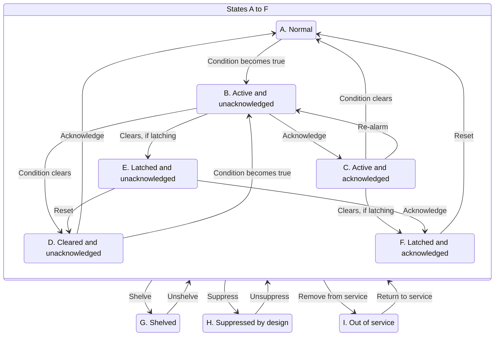
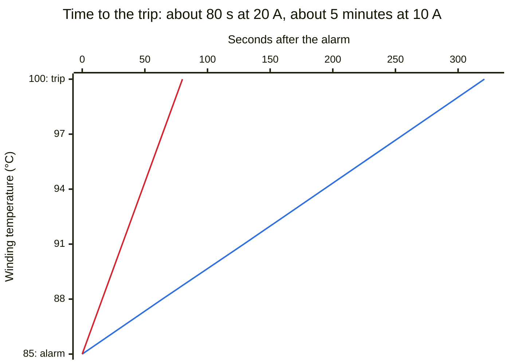

---
jupytext:
  text_representation:
    format_name: myst
kernelspec:
  display_name: Python 3 (ipykernel)
  language: python
  name: python3
---

# Alarms

{.lead}
An alarm tells an operator that equipment or a process needs a response, in time to make it. It works only while operators trust it, and they stop trusting alarms that go off too often or need nothing from them.

{download}`Download this page as a notebook <alarms.md>` to run its code in JupyterLab. [Running the notebooks](notebooks/running.md) explains how to set it up.

## What an alarm is

The alarm management standards ANSI/ISA-18.2 and IEC 62682 define an alarm as an "audible and/or visible means of indicating to the operator an equipment malfunction, process deviation, or abnormal condition requiring a timely response".[^exida-primer] An alarm goes to a person, it marks something abnormal, and the person has to act on it soon. If the operator doesn't need to respond promptly, the condition shouldn't be an alarm.[^exida-primer]

ISA-18.2 names the notifications that fall short of an alarm:[^exida-notifications]

- An **alert** needs assessment or action, but doesn't meet the criteria for an alarm.
- A **notice** doesn't need a timely response.
- An **event** is recorded for later review, and isn't shown to the operator.

In Nominal, an {gloss}`event` marks a point or span of time for review, so it fits the last kind.

### Alarms, trips and events

An alarm, a {gloss}`trip` and an event can all start from the same measurement. They differ in who responds:

| | Who responds | Example |
| --- | --- | --- |
| Alarm | An operator, soon | A load motor's winding passes 85 °C, and the operator drops the load |
| Trip | The control software, at once | A motor on a dyno passes 100 °C, and the control software stops every motor |
| Event | Someone reviewing the data later | A test point starts |

An alarm protects nothing by itself. It works only if someone notices it, understands it, and acts in time. After the explosion at the Texaco refinery in Milford Haven, HSE recommended that "ultimate plant safety should not rely on operator response to a control system alarm."[^hse-milford] In layer of protection analysis, the norm is to credit an operator's response to an alarm with at most a tenfold reduction in risk, and usually only if the operator has at least 20 minutes to respond.[^pii-lopa]

So where the consequence of a late response is damage, use a trip. Where it's harm to people, use a rated safety function, as described in [Safety functions and the control system](safety.md#safety-functions-and-the-control-system).

## Alarm limits and trip limits

An alarm limit sits between normal operation and the trip limit. Alarm limits "should be set such that the operators have sufficient time to carry out their defined response before the plant condition escalates."[^hse-alarm-mgmt] An alarm limit too close to normal operation goes off all the time. One too close to the trip limit leaves the operator no time before the system trips.

To place an alarm limit, work back from the trip limit. The time the operator gets is the margin between the two limits, divided by how fast the measurement can move toward the trip limit. The [worked example](#worked-example-an-alarm-on-the-load-motors-temperature) does this for the dyno.

The same ordering applies between software and hardware. On a {gloss}`dyno <dynamometer>`, where two load motors brake the motor under test, the power supply has its own overvoltage protection, set above the software's bus voltage trip so that the software trips first.

A limit alarm in [OPC UA](communications.md#industrial-ethernet-ethercat-and-opc-ua) can have four limits, which must be in the order HighHigh > High > Low > LowLow.[^opcua-part9]

## How alarm software handles an alarm

Ignition, a {gloss}`SCADA` platform, and OPC UA Part 9, the OPC UA model for alarms and conditions, show how an alarm behaves once it's configured.

### Active and acknowledged

An alarm is active while its condition is true, and clears when the condition becomes false. Separately, an operator acknowledges it to show they've seen it. Ignition combines the two into four states:[^ign-alarming]

| State | What it means |
| --- | --- |
| Active and unacknowledged | The condition is true, and no operator has acknowledged it yet. |
| Active and acknowledged | The condition is true, and an operator has acknowledged it. |
| Cleared and unacknowledged | The condition has gone, but no operator has acknowledged it. |
| Cleared and acknowledged | The condition has gone, and an operator has acknowledged it. |

In Ignition, a cleared alarm never becomes active again. If the condition returns, a new alarm event starts.[^ign-alarming] Ignition's **Ack Mode** setting makes acknowledgement manual, automatic when the alarm clears, or unused.[^ign-tag-alarm]

Acknowledging an alarm says that someone saw it, not that the problem is fixed. OPC UA can keep the two apart. In its example, an operator acknowledges a motor's high temperature alarm, lowers the load on the motor, and then confirms the alarm to report that a corrective action has been taken.[^opcua-part9] A latched alarm goes further: it stays active until someone resets it, even after the value returns to normal.[^opcua-part9]

### The ISA-18.2 state diagram

ISA-18.2's first edition draws every state an alarm can be in, and what moves it from one to the next:[^iconics-isa][^nasby]



Ignition's four states are A to D. Where the diagram moves an alarm from D back to B, Ignition starts a new alarm event instead.[^ign-alarming] A re-alarming alarm goes from C back to B if it's still active after a set time, which brings it back to the operator's attention.[^opcua-part9]

OPC UA keeps each part of an alarm's state separately, as `ActiveState`, `AckedState`, `LatchedState`, `ShelvingState`, `SuppressedState` and `OutOfServiceState`, rather than as one list of combined states. Shelving, suppression and out of service don't depend on whether the alarm is active or acknowledged. OPC UA says its model supports all the alarm states in IEC 62682.[^opcua-part9]

### Priority

Priority tells the operator which alarm to answer first. Set it from how severe the consequence is, and how much time the operator has to respond.[^siemens-wp] HSE recommends about three priorities, based on the consequences if the operator fails to respond, in proportions such as 5% high, 15% medium and 80% low.[^hse-chis6]

Ignition has five priorities: Diagnostic, Low, Medium, High and Critical.[^ign-tag-alarm] OPC UA uses a severity from 1 to 1,000, and recommends severities above 400 for alarms.[^opcua-part9]

### Kepware

Kepware Server connects to devices and serves their data over OPC. Its Alarms & Events plug-in adds alarms to server tags, such as a temperature tag that raises an event when it reaches its maximum value. It supports level, deviation and rate-of-change alarms, each with a severity from 0 to 1,000, and serves them to OPC Alarms and Events clients.[^kepware-ae] An HMI or SCADA client then shows them to operators.

## Alarm fatigue

Healthcare research defines {gloss}`alarm fatigue` as "sensory overload when clinicians are exposed to an excessive number of alarms, which can result in desensitization to alarms and missed alarms."[^sendelbach] In hospitals, The Joint Commission estimates that 85% to 99% of alarm signals don't require clinical intervention. Of 98 alarm-related events reported to it from 2009 to 2012, 80 resulted in a death, and alarm fatigue was the most common contributing factor.[^tjc-sea50]

Operators learn how much an alarm is worth. In a study of responses to alarms that were true 25%, 50% or 75% of the time, about 90% of subjects didn't respond to every alarm. They matched how often they responded to how often the alarms were true.[^bliss] Google's site reliability engineers found the same with pages to on-call engineers: "When pages occur too frequently, employees second-guess, skim, or even ignore incoming alerts, sometimes even ignoring a 'real' page that's masked by the noise."[^sre]

### Floods

An {gloss}`alarm flood` is more alarms than an operator can handle. EEMUA 191, the UK alarm management guide, starts one at more than 10 new alarms in 10 minutes.[^vancamp]

At Milford Haven in 1994, two operators had to recognize, acknowledge and act on 275 alarms in the last 10.7 minutes before the explosion. At times, they did nothing but acknowledge alarms. Of the alarms configured, 87% were high priority, with no rule for deciding what priority an alarm should have. The flare drum's high-level alarm went off about 25 minutes before the explosion, and there's no evidence that anyone saw it.[^hse-milford]

### Standing alarms

An alarm that stays on tells the operator nothing. At the BP Texas City refinery in 2005, a tower's high-level alarm was active for the entire startup that ended in an explosion. Operators expected it, because they purposely filled the tower above the range of its level transmitter during startup, and the alarm had gone off 74 times in 14 of the previous 19 startups. A second, hardwired high-level alarm failed and never sounded. Its silence reinforced the board operator's belief that the tower's level reading was accurate, while the tower had in fact filled four feet above the transmitter's top tap.[^csb-texas-city]

### Where nuisance alarms come from

When alarms moved into software, they became free to add. A control panel wall had fewer than 100 possible alarms, where the control system that replaced it could have 2,000 to 4,000.[^hollifield] Common causes of nuisance alarms follow from that:

- **Defaults.** Some teams turn on every alarm the control system offers, at default limits of 10%, 20%, 80% and 90% of range.[^siemens-wp]
- **Status shown as alarms.** An alarm that says a pump is off, rather than that it's off when it should be on, reports status, not a problem.[^hollifield] HSE says status indicators shouldn't be alarms.[^hse-chis6]
- **Alarms for equipment that isn't running.** In many control rooms, more than 50% of standing alarms are for motors that aren't running.[^siemens-wp]
- **Fear of removing alarms.** Teams keep an alarm because it was "obviously put there for a reason."[^siemens-wp]

## Deciding what gets an alarm

Every alarm should be "useful and relevant to the operator, and have a defined response."[^hse-alarm-mgmt] Reviewing each alarm against that rule is called rationalization. Ask three questions of each one:[^siemens-wp]

1. Does it show an abnormal condition?
2. Does the operator have to act to prevent a defined consequence?
3. Is it the only alarm for that condition?

For each alarm that passes, record its cause, its consequence, the operator's response, and the time the operator has to respond.[^siemens-wp] Those set its limit and its priority.

A condition that fails still has somewhere to go:

- If no one has to act, but the record is useful later, record it as an event.[^tennant]
- If it shows that something is running normally, show it on the {gloss}`HMI` as status.[^hse-chis6]
- If it repeats another alarm, remove it.
- If it needs a faster response than a person can give, make it a trip.

The same rules hold for alerts in software operations. Google's SRE book says that "every page should be actionable", and that "it's better to spend much more effort on catching symptoms than causes".[^sre] On industrial equipment, alarm on the condition the operator acts on, such as a hot motor, rather than on each thing that could cause it.

On a test stand, an alarm can protect the data as well as the hardware. Above 85 °C, the dyno's motor controllers reduce their current without reporting it, so the stand looks like it's at the commanded load when it isn't. An alarm whose consequence is data that's quietly wrong has a defined consequence and a defined response, so it passes.

Rationalization takes time. HSE estimates that a quick first pass covers about 50 alarms per shift, while a thorough review and redesign may take more than one shift per alarm.[^hse-chis6]

## Fixing nuisance alarms

Alarm software has settings for each kind of nuisance alarm:

| Nuisance | Fix | Ignition | OPC UA |
| --- | --- | --- | --- |
| Chattering: a noisy value near its limit turns the alarm on and off repeatedly | A {gloss}`deadband`, so the value must come back past the limit by a margin before the alarm clears | **Deadband**[^ign-tag-alarm] | Deadband properties on limit alarms[^opcua-part9] |
| Chattering, when a deadband isn't enough | An off-delay, which holds the alarm on for a time after the condition clears | **Clear Delay**[^ign-tag-alarm] | `OffDelay`[^opcua-part9] |
| Fleeting: a brief spike past the limit | An on-delay, which waits until the value has stayed past the limit for a time | **Active Delay**[^ign-tag-alarm] | `OnDelay`[^opcua-part9] |
| Standing: the alarm doesn't apply in the system's current state | Suppress the alarm in that state | **Enabled**, bound to a tag[^ign-configuring] | `SuppressedState`[^opcua-part9] |
| A known problem someone is already working on | Shelve the alarm for a limited time | Shelving[^ign-alarming] | Timed or one-shot shelving[^opcua-part9] |

In Ignition, an alarm with setpoints of 45 and 65 and a deadband of 3 goes active between 45 and 65, and clears only when the value falls below 42 or rises above 68.[^ign-configuring] Ignition can bind **Enabled** to a tag, for example to "disable alarms when production is stopped."[^ign-configuring]

The function below applies a limit, a deadband and the two delays to a measurement read once a second. The alarm turns on when the value passes the limit, and turns off when the value falls below the limit minus the deadband. An on-delay or an off-delay holds back that change until its condition has held for that many seconds.

```{code-cell} ipython3
import matplotlib.pyplot as plt
import numpy as np
import pandas as pd
from learning.style import set_matplotlib_style

set_matplotlib_style()
```

```{code-cell} ipython3
def alarm(value, limit, deadband=0.0, on_delay=0, off_delay=0):
    """Return whether a high alarm is active at each sample, one a second."""
    active = np.zeros(len(value), dtype=bool)
    on = False
    held = 0  # samples in a row that meet the condition to change state
    for i, v in enumerate(value):
        # Turn on above the limit, and off below the limit minus the deadband
        change = v < limit - deadband if on else v > limit
        held = held + 1 if change else 0
        # Change once those samples span the delay, in seconds
        if held - 1 >= (off_delay if on else on_delay):
            on, held = not on, 0
        active[i] = on
    return active
```

This simulated temperature rises toward an 85 °C limit, stays near it for several minutes, and falls again. Every reading has noise, and one reading jumps 3 °C. The cell counts the alarms that each setting gives:

```{code-cell} ipython3
rng = np.random.default_rng(1)
t = np.arange(20 * 60)  # 20 minutes, a sample a second
noise = rng.normal(0, 0.25, t.size)  # a standard deviation of 0.25 °C
temp = 82 + 3.5 * np.sin(np.pi * t / t.size) + noise
temp[150] += 3  # one noisy reading, at 2.5 minutes

settings = {
    "Limit only": {},
    "0.5 °C deadband": {"deadband": 0.5},
    "0.5 °C deadband, 60 s off-delay": {"deadband": 0.5, "off_delay": 60},
    "2 °C deadband": {"deadband": 2},
    "2 °C deadband, 5 s on-delay": {"deadband": 2, "on_delay": 5},
}
active = {name: alarm(temp, 85, **s) for name, s in settings.items()}
# An alarm starts each time the state changes to on
starts = {
    name: np.count_nonzero(np.diff(a, prepend=False) & a)
    for name, a in active.items()
}
pd.Series(starts, name="Alarms")
```

With the limit alone, the noise sets the alarm off dozens of times. A 0.5 °C deadband is smaller than the noise, so the alarm still chatters, and a 60 s off-delay stops the chattering. A 2 °C deadband is larger than the noise, so it stops the chattering by itself, but the alarm still goes off twice, once for the noisy reading. A 5 s on-delay ignores that reading, which leaves one alarm. A 2 °C deadband and a 5 s on-delay are the settings the [worked example](#worked-example-an-alarm-on-the-load-motors-temperature) chooses.

In the plot, the alarm on the limit alone turns on and off whenever the temperature is near 85 °C. With the 2 °C deadband and the 5 s on-delay, it turns on once, at about 7 minutes, and stays on until the temperature falls below 83 °C, at about 17 minutes.

```{code-cell} ipython3
fig, (ax1, ax2) = plt.subplots(
    2, 1, sharex=True, height_ratios=[2, 1], figsize=(8, 4)
)
ax1.plot(t / 60, temp, lw=0.8, label="Temperature")
ax1.axhline(85, color="C9", ls="--", label="Limit, 85 °C")
ax1.axhline(83, color="C2", ls=":", label="2 °C deadband: clears below 83 °C")
ax1.set_ylabel("Temperature (°C)")
ax1.legend(loc="lower center", bbox_to_anchor=(0.5, 1), ncols=3)
# One row for each setting, filled while the alarm is on
for row, name in enumerate(["Limit only", "2 °C deadband, 5 s on-delay"]):
    ax2.fill_between(t / 60, row, row + 0.8 * active[name], step="post")
ax2.set_yticks([0.4, 1.4], ["Limit only", "Deadband and\non-delay"])
ax2.set_ylabel("Alarm on")
ax2.set_xlabel("Time (min)")
plt.show()
```

ISA-18.2's first edition gives starting points for deadbands and delays:[^siemens-wp]

| Measurement | Deadband, % of range | On-delay or off-delay |
| --- | ---: | ---: |
| Flow | 5% | 15 s |
| Level | 5% | 60 s |
| Pressure | 2% | 15 s |
| Temperature | 1% | 60 s |

Treat them as starting points, and check each delay against how fast the measurement can move. The [worked example](#worked-example-an-alarm-on-the-load-motors-temperature) has a temperature where a 60 s delay would use up most of the operator's time.

{gloss}`Shelving` hides an alarm. It doesn't fix one. In Ignition, a shelved alarm always has a duration, and the scripting function that shelves alarms defaults to 15 minutes.[^ign-alarming][^ign-shelve] OPC UA has a maximum shelving time to "prevent permanent Shelving of an Alarm."[^opcua-part9] Inductive Automation, which makes Ignition, says shelving "is not intended as a long-term or indefinite solution for nuisance alarms."[^ia-smarter] Fix the cause.

## An alarm depends on its measurement

An alarm can't go off if its measurement stops changing. At the Buncefield fuel depot in 2005, a tank's level gauge had stuck 14 times in the three months before the explosion. When it stuck again, the tank's alarms, which worked from that gauge, couldn't operate. The tank's independent high-level switch didn't work either.[^buncefield]

Alarm on the measurement's health, as well as its value. Ignition has a **Bad Quality** alarm mode, which goes active when a tag's value becomes bad quality, such as when communication is lost.[^ign-tag-alarm] The dyno checks that each measurement is fresh before it trips on it, and trips on telemetry more than 0.5 s old. See [Network performance](network-performance.md#example-when-the-dynos-computer-fell-behind).

In this simulation, a tank fills at 1% of its level gauge's range a minute, and the gauge sticks at 15 minutes. While the simulated gauge works, noise changes its reading at every sample. Once it sticks, it repeats the same value, so a check can alarm when the reading hasn't changed for 2 minutes:

```{code-cell} ipython3
rng = np.random.default_rng(2)
t = np.arange(0, 60 * 60, 10)  # an hour, a sample every 10 s
level = 60 + t / 60  # % of range, filling at 1% a minute
reading = level + rng.normal(0, 0.05, t.size)  # the gauge's reading, with noise
reading[t > 15 * 60] = reading[t == 15 * 60][0]  # the gauge sticks at 15 minutes

reading = pd.Series(reading, index=t)
same = reading.diff().eq(0)
unchanged = same.groupby((~same).cumsum()).cumsum() * 10  # seconds without a change
stuck_alarm = unchanged >= 2 * 60

high = 90  # % of range, the high-level alarm's limit
print(f"High-level alarm goes off: {(reading > high).any()}")
print(f"Tank passes {high}%: {t[level > high][0] / 60:.0f} min")
print(f"Stuck alarm goes off: {t[stuck_alarm][0] / 60:.0f} min")
```

The plot shows the reading flat from 15 minutes, while the tank keeps filling and passes the high-level limit at 30 minutes. The high-level alarm, which works from the reading, never goes off, while the stuck alarm goes off at 17 minutes.

```{code-cell} ipython3
fig, ax = plt.subplots()
ax.plot(t / 60, level, ls="--", label="Level in the tank")
ax.plot(t / 60, reading, label="Gauge reading")
ax.axhline(high, color="C9", ls=":", label="High-level limit")
ax.axvline(t[stuck_alarm][0] / 60, color="C2", ls="-.", label="Stuck alarm")
ax.set_xlabel("Time (min)")
ax.set_ylabel("Level (% of range)")
ax.legend()
plt.show()
```

A stuck measurement can also cause an alarm. A temperature sensor stuck high looks like a hot motor. After a thermal alarm or trip on the dyno, check that the reading falls as the motor cools.

## Measuring an alarm system

ISA-18.2 sets targets for each operator's alarm load, based on at least 30 days of data:[^siemens-wp]

| Measure | Target |
| --- | --- |
| Alarms per hour | About 6 is very likely acceptable, and 12 is the most that's manageable |
| Alarms per 10 minutes | About 1 is very likely acceptable, and 2 is the most that's manageable |
| 10-minute periods with more than 10 alarms | Under 1% |
| Share of all alarms from the 10 most frequent | 1% to 5% at most |
| Chattering and fleeting alarms | None |
| Stale alarms, active for more than 24 hours | Fewer than 5 a day |
| Priorities | 80% low, 15% medium and 5% high |

Averages hide peaks, so count floods as well as the average.[^vancamp]

This simulated alarm log covers 30 days of a system with 1,000 configured alarms. Most of them go off a few times a month, but alarms 1 to 3 chatter, in bursts of up to 16 alarms within 3 minutes. Six upsets each set off dozens of alarms within a few minutes:

```{code-cell} ipython3
rng = np.random.default_rng(3)
start = pd.Timestamp("2026-01-01T12:00:00Z")
days = 30
span = days * 24 * 60 * 60  # s

# Alarms 4 to 1,000 go off at random times, 2,500 times in all
ids = [rng.integers(4, 1001, 2500)]
offsets = [rng.uniform(0, span, 2500)]
# Alarms 1 to 3 chatter: 180 bursts of 3 to 16 alarms within 3 minutes
size = rng.integers(3, 17, 180)
ids.append(np.repeat(rng.integers(1, 4, 180), size))
offsets.append(
    np.repeat(rng.uniform(0, span, 180), size) + rng.uniform(0, 180, size.sum())
)
# Six upsets set off 20 to 60 alarms each, most within a few minutes
size = rng.integers(20, 61, 6)
ids.append(rng.integers(4, 1001, size.sum()))
offsets.append(
    np.repeat(rng.uniform(0, span, 6), size) + rng.exponential(120, size.sum())
)

time = (start + pd.to_timedelta(np.concatenate(offsets), unit="s")).floor("s")
log = pd.DataFrame({"time": time, "alarm": np.concatenate(ids)}).sort_values("time")
log = log[log.time < start + pd.Timedelta(days=days)]
log.head()
```

The measures count the alarms in each 10-minute period, including the periods with none:

```{code-cell} ipython3
def per_10_minutes(log):
    periods = pd.date_range(start, periods=days * 24 * 6, freq="10min")
    return (
        log.groupby(log.time.dt.floor("10min")).size().reindex(periods, fill_value=0)
    )


def measures(log):
    counts = per_10_minutes(log)
    floods = (counts > 10).mean()
    top_10 = log.alarm.value_counts().head(10).sum() / len(log)
    return pd.Series(
        {
            "Alarms per hour": len(log) / (days * 24),
            "Alarms per 10 minutes": counts.mean(),
            "10-minute periods with more than 10 alarms (%)": 100 * floods,
            "Share of all alarms from the 10 most frequent (%)": 100 * top_10,
        }
    )


pd.DataFrame(
    {
        "All alarms": measures(log),
        "Without alarms 1 to 3": measures(log[log.alarm > 3]),
    }
).round(1)
```

On average, the log has about 6 alarms an hour, and about 1 per 10 minutes, which ISA-18.2 calls very likely acceptable. The averages hide the floods: about 2% of 10-minute periods have more than 10 alarms, against a target of under 1%. The 10 most frequent alarms make up about 40% of all alarms, and the three chattering alarms are most of those. Without them, every measure meets its target.

In the plot of alarms per 10 minutes, most periods have one alarm or none, and the floods stand out as spikes above 10.

```{code-cell} ipython3
counts = per_10_minutes(log)
fig, ax = plt.subplots()
ax.plot((counts.index - start) / pd.Timedelta(days=1), counts, lw=0.8)
ax.axhline(10, color="C9", ls="--", label="Flood: more than 10")
ax.axhline(counts.mean(), color="C2", ls=":", label=f"Average: {counts.mean():.1f}")
ax.set_xlabel("Time (days)")
ax.set_ylabel("Alarms per 10 minutes")
ax.legend()
plt.show()
```

ISA-18.2 is written for the process industries.[^siemens-wp] On a test stand, the same counts work per run: how many alarms the operator saw, how many needed a response, and which alarms went off most often. HSE suggests watching for operators who acknowledge many alarms in quick succession, or turn audible alarms off.[^hse-chis6]

## Alarms in Nominal

A Nominal streaming checklist evaluates a published [checklist](https://dev.nominal.io/platform/reference/glossary/#checklist) against an asset's live data. When a check fails, it can create an event and notify an integration such as Slack.[^nominal-streaming-checklists] The events give you a record of every alarm to count and review in a {gloss}`workbook`.

```python
from datetime import timedelta

from nominal.core import NominalClient, StreamingNotificationConfig

client = NominalClient.from_profile("default")
checklist = client.get_checklist("<checklist RID>")

checklist.execute_streaming(
    assets=["<asset RID>"],
    notifications=[StreamingNotificationConfig("<integration RID>")],
    # A failing check can't recover for at least 60 s, so a noisy channel can't chatter
    recovery_delay=timedelta(seconds=60),
    # Record each failure as an event, and update the event when the check recovers
    auto_create_events=True,
)
```

`recovery_delay` must be at least 15 s. `StreamingNotificationConfig` also takes `mute_until`, which silences a destination's notifications until a given time, like shelving with a time limit.[^nominal-client]

## Worked example: an alarm on the load motors' temperature

The dyno trips when any motor's temperature passes 100 °C. It has no alarm before that. The load motors' windings limit how long it can run at load: copper losses heat the windings, while the controllers stay cool. Above 85 °C, each load motor's controller starts reducing its current, so data taken there isn't at the commanded load. The dyno's manual says to drop the load and cool down at 85 °C.

That's an alarm. Rationalize it:

| Question | Answer |
| --- | --- |
| What's abnormal? | A load motor's winding is above 85 °C while the stand runs. |
| What does the operator do? | Drops the load, and lets the motor cool. |
| What happens if they don't? | The test point's data isn't at the commanded load. At 100 °C, the stand trips and the run ends. |
| How long do they have? | About 5 minutes at 10 A, and about 80 s at 20 A. |

The time comes from a measured soak test. At 10 A of brake current, the windings rose about 2.8 °C a minute. Copper loss grows with the square of the current, so at the load motors' 20 A maximum, they heat four times as fast. The time to the trip is the 15 °C between 85 °C and 100 °C, divided by the heating rate:

```{code-cell} ipython3
alarm_limit, trip_limit = 85, 100  # °C
rate_10a = 2.8  # °C a minute at 10 A, from the soak test
for current in (10, 20):  # A
    # Copper loss, and so the heating rate, grows with the current squared
    rate = rate_10a * (current / 10) ** 2
    time_to_trip = (trip_limit - alarm_limit) / rate * 60  # s
    print(f"{current} A: {rate:.1f} °C a minute, {time_to_trip:.0f} s to the trip")
```

That's about 5 minutes at 10 A. At 20 A, the windings heat about 11 °C a minute, which leaves about 80 s. Both figures are on the safe side, because the temperature rises more slowly as a motor nears its {gloss}`steady state`.



The rest of the design follows from those numbers:

- **Priority.** The consequence is bad data and a tripped run, not damage, because the trip at 100 °C protects the motors. Rank it below any alarm whose consequence is damage.
- **On-delay.** ISA-18.2's starting point for temperature is 60 s. At 11 °C a minute, 60 s would use 11 °C of the 15 °C margin. An on-delay of 5 s uses under 1 °C, and still ignores a single noisy reading.
- **Deadband.** Make it larger than the reading's noise, which you can see in a past run's data. With a 2 °C deadband, the alarm clears once the temperature falls below 83 °C.
- **State.** Enable the alarm only while the stand is RUNNING. In ARMED, nothing loads the motors, so there's no load to drop.
- **Acknowledge and confirm.** The operator acknowledges the alarm, drops the load, and confirms it once the temperature is falling.

To check the heating rate of your own motors, plot each motor's winding temperature and current from a past run in a workbook, and read the slope at each current.

## Further reading

- HSE, [Better alarm handling](https://www.hse.gov.uk/pubns/chis6.pdf), a four-page checklist for reviewing an alarm system.
- HSE, [The explosion and fires at the Texaco Refinery, Milford Haven](https://jesip.org.uk/uploads/media/incident_reports_and_inquiries/Texaco%20Refinery%20Explosion.pdf), the full investigation report.
- Siemens, [Setting a new standard in alarm management](https://assets.new.siemens.com/siemens/assets/api/uuid:234f1026-298f-49dc-8961-0c5223c38588/white-paper-alarm-management-2021-final.pdf), a summary of the ISA-18.2 lifecycle and its metrics.
- Inductive Automation, [Alarming](https://docs.inductiveautomation.com/docs/8.1/platform/alarming), the Ignition 8.1 documentation.
- OPC Foundation, [OPC 10000-9: Alarms and Conditions](https://reference.opcfoundation.org/Core/Part9/v105/docs/), the alarm model that OPC UA servers and clients share.
- R. Ewaschuk, [Monitoring Distributed Systems](https://sre.google/sre-book/monitoring-distributed-systems/), chapter 6 of Google's *Site Reliability Engineering*, on alerts in software operations.

## References

[^exida-primer]: exida, ["Alarm Management Primer"](https://www.exida.com/Alarm-Management/Alarm-Management-Primer). Retrieved 2026-11-19.
[^exida-notifications]: T. Stauffer, exida, ["When is an Alarm not an Alarm?"](https://www.exida.com/Blog/when-is-an-alarm-not-an-alarm), 2019-07-18. Retrieved 2026-11-19.
[^hse-milford]: HSE, ["The explosion and fires at the Texaco Refinery, Milford Haven, 24 July 1994"](https://jesip.org.uk/uploads/media/incident_reports_and_inquiries/Texaco%20Refinery%20Explosion.pdf), HSE Books, 1997, paragraphs 102–105 and recommendation 6. Retrieved 2026-11-19.
[^pii-lopa]: W. Bridges and T. Clark, Process Improvement Institute, ["LOPA and Human Reliability – Human Errors and Human IPLs (Updated)"](https://www.process-improvement-institute.com/wp-content/uploads/2026/05/LOPA-Validating-Human-IPLs-and-IEs-Updated-2011.pdf), AIChE 7th Global Congress on Process Safety, March 2011. Retrieved 2026-11-19.
[^hse-alarm-mgmt]: HSE, ["Alarm management"](https://www.hse.gov.uk/humanfactors/topics/alarm-management.htm), human factors topic page, 2024-10-29. Retrieved 2026-11-19.
[^opcua-part9]: OPC Foundation, ["OPC 10000-9: UA Part 9: Alarms and Conditions"](https://reference.opcfoundation.org/Core/Part9/v105/docs/), version 1.05.06, sections 4.3, 4.6, 4.8, 5.8.2, 5.8.17 and 5.8.18, and Annex E. Retrieved 2026-11-19.
[^ign-alarming]: Inductive Automation, ["Alarming"](https://docs.inductiveautomation.com/docs/8.1/platform/alarming), Ignition 8.1 documentation, updated 2026-04-17. Retrieved 2026-11-19.
[^ign-tag-alarm]: Inductive Automation, ["Tag Alarm Properties"](https://docs.inductiveautomation.com/docs/8.1/platform/tags/tag-properties/tag-alarm-properties), Ignition 8.1 documentation, updated 2026-10-06. Retrieved 2026-11-19.
[^ign-configuring]: Inductive Automation, ["Configuring Alarms"](https://docs.inductiveautomation.com/docs/8.1/platform/alarming/configuring-alarms), Ignition 8.1 documentation, updated 2026-06-04. Retrieved 2026-11-19.
[^ign-shelve]: Inductive Automation, ["system.alarm.shelve"](https://docs.inductiveautomation.com/docs/8.1/appendix/scripting-functions/system-alarm/system-alarm-shelve), Ignition 8.1 documentation, updated 2024-05-23. Retrieved 2026-11-19.
[^ia-smarter]: Inductive Automation, ["Smarter SCADA Alarming"](https://inductiveautomation.com/resources/article/smarter-scada-alarming), updated 2018-11-19. Retrieved 2026-11-19.
[^iconics-isa]: ICONICS, ["ISA 18.2 Alarm State Transition Diagram"](https://documentation.iconics.com/v10.98/Content/Alarming/Alarm%20Server/Alarm%20References/alarm-state-transition-diagram.htm), GENESIS64 10.98 documentation. Reproduces the ISA-18.2-2009 state diagram, which this guide redraws. Retrieved 2026-11-19.
[^nasby]: G. Nasby, ["Introduction to the ISA 18.2 Alarm Management Standard"](https://www.grahamnasby.com/files_publications/NasbyG_2013_IntroToAlarmMgmt_YorkRegion_oct2013_slides.pdf), York Region alarm management training, 2013, slide 38. Retrieved 2026-11-19.
[^siemens-wp]: Siemens Industry, ["Setting a New Standard in Alarm Management"](https://assets.new.siemens.com/siemens/assets/api/uuid:234f1026-298f-49dc-8961-0c5223c38588/white-paper-alarm-management-2021-final.pdf), white paper, 2021. Its starting points for deadbands and delays cite ANSI/ISA-18.2-2009. Retrieved 2026-11-19.
[^hse-chis6]: HSE, ["Better alarm handling"](https://www.hse.gov.uk/pubns/chis6.pdf), Chemicals Information Sheet No 6, 2000. Retrieved 2026-11-19.
[^kepware-ae]: PTC, ["OPC AE"](https://support.ptc.com/help/kepware/kepware_server/en/kepware/server/interface-opc-ae.html), Kepware Server help. Retrieved 2026-11-19.
[^sendelbach]: S. Sendelbach and M. Funk, ["Alarm fatigue: a patient safety concern"](https://pubmed.ncbi.nlm.nih.gov/24153215/), *AACN Advanced Critical Care* 24(4), 378–386, 2013. Retrieved 2026-11-19.
[^tjc-sea50]: The Joint Commission, ["Medical device alarm safety in hospitals"](https://digitalassets.jointcommission.org/api/public/content/f65e5c9df2b94000a99445e0a7877007), Sentinel Event Alert issue 50, 2013-04-08. Retrieved 2026-11-19.
[^bliss]: J. P. Bliss, R. D. Gilson and J. E. Deaton, ["Human probability matching behaviour in response to alarms of varying reliability"](https://doi.org/10.1080/00140139508925269), *Ergonomics* 38(11), 2300–2312, 1995. Retrieved 2026-11-19.
[^sre]: R. Ewaschuk, ["Monitoring Distributed Systems"](https://sre.google/sre-book/monitoring-distributed-systems/), chapter 6 of *Site Reliability Engineering*, Google. Retrieved 2026-11-19.
[^vancamp]: K. VanCamp, Emerson, ["Alarm Management By the Numbers"](https://www.chemengonline.com/alarm-management-numbers/), *Chemical Engineering*, 2016-03-01. Retrieved 2026-11-19.
[^csb-texas-city]: U.S. Chemical Safety and Hazard Investigation Board, ["Investigation Report: Refinery Explosion and Fire, BP Texas City"](https://www.csb.gov/assets/1/20/csbfinalreportbp.pdf), 2007-03-20. Retrieved 2026-11-19.
[^hollifield]: B. Hollifield, ["Taming the wild alarm system – part one"](https://www.octave.com/learn/resources/blogs/taming-wild-alarm-system-part-one), Octave. Retrieved 2026-11-19.
[^tennant]: M. Tennant, Yokogawa, ["Implementing Alarm Management per the ANSI/ISA-18.2 Standard"](https://www.yokogawa.com/uk/library/resources/media-publications/implementing-alarm-management-per-the-ansi-isa-182-standard-control-engineering), *Control Engineering*, 2013. Retrieved 2026-11-19.
[^buncefield]: COMAH Competent Authority, ["Buncefield: Why did it happen?"](https://www.icheme.org/media/10706/buncefield-report.pdf), HSE, 2011. Retrieved 2026-11-19.
[^nominal-streaming-checklists]: Nominal, ["Trigger alerts on live data"](https://dev.nominal.io/python/guides/streaming/streaming-checklists/). Retrieved 2026-11-19.
[^nominal-client]: Nominal, `Checklist.execute_streaming` and `StreamingNotificationConfig` in the [nominal](https://pypi.org/project/nominal/) Python client, version 1.186.0. Retrieved 2026-11-19.
