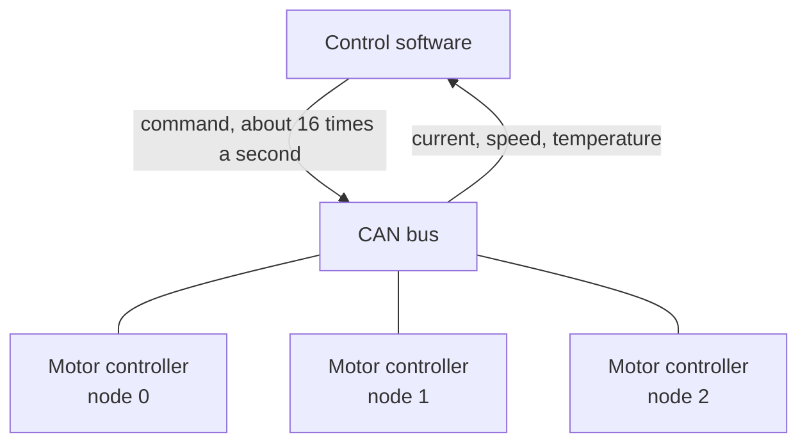
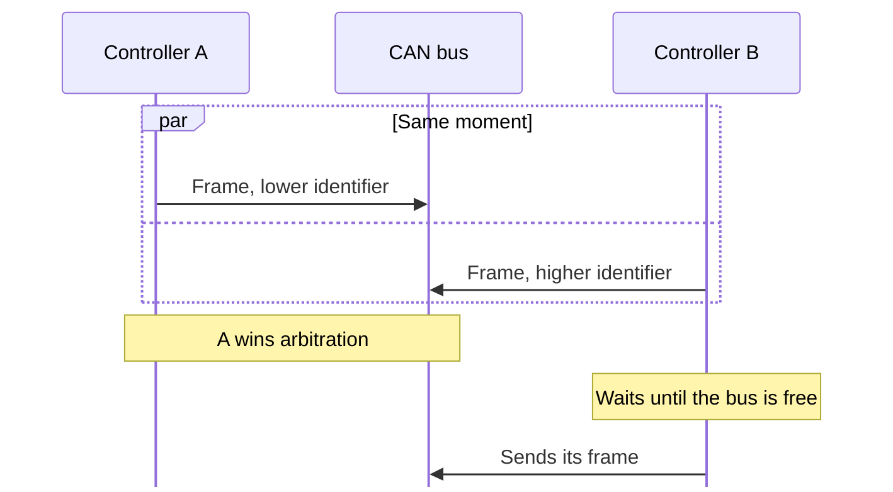

# Communications

{.lead}
Instruments talk to the computer in messages, over a link, using a protocol both ends agree on. The link decides how fast values arrive and where they're timestamped.

## Layers

Every link has three layers, and problems can live in any of them:

- **The physical layer** is the wires and the voltages on them: how many wires, how long they can be, and how a bit is signaled.
- **The protocol layer** is how bits become messages: how a message starts and ends, how a device is addressed, and how errors are detected.
- **The application layer** is what the messages mean: which message sets a speed, and which one reads a temperature.

On an e-axle {gloss}`dyno <dynamometer>`, for example, where a motor drives the e-axle under test and a load motor on each side brakes it, the power supply uses USB as its physical layer and SCPI as its application layer. The three motor controllers use CAN for both the physical and protocol layers, and each controller's own set of messages for the application layer.

## Serial links: RS-232 and RS-485

Serial links send one bit at a time. RS-232 connects one device to one other device over a short cable, and appears on older instruments and as the serial port of a USB adapter.

RS-485 sends each signal as the difference between two wires, which rejects noise picked up by both. One RS-485 bus can connect up to 32 unit loads, and can run at up to 10 Mbit/s over 12 m (40 ft), or up to 1,200 m (4,000 ft) at 100 kbit/s. Each end of the line needs a termination resistor, and stubs off the line should be as short as possible, to avoid signal reflections.[^ti-rs485]

## CAN

A {gloss}`CAN bus` connects the controllers in a vehicle or machine over one twisted pair. Every node can send, and every node hears every message.[^ti-can]

- **Arbitration.** When two nodes start sending at once, the bus settles it bit by bit, by each message's identifier. The identifier with the lower binary value has the higher priority, and wins.[^ti-can]
- **Identifiers.** A classic CAN frame has an 11-bit message identifier, or a 29-bit extended one.[^ti-can]
- **Data.** A classic frame carries 0 to 8 bytes of data.[^ti-can] CAN FD carries up to 64 bytes, and can switch to a faster bit rate for the data part of each frame.[^cia-can-fd]
- **Speed and length.** Classic CAN runs at up to 1 Mbit/s on a bus 40 m long, with up to 30 nodes. The bus is terminated at both ends with 120 Ω resistors.[^ti-can]

Classic CAN and CAN FD are both standardized in ISO 11898-1:2024.[^cia-can-fd]

### Example: the dyno's CAN bus

The dyno's three motor controllers share one CAN bus, with node IDs 0, 1 and 2. The control software sends each controller a command about 16 times a second, and each controller reports its current, speed and temperature back.



If two controllers start a frame at the same moment, the frame with the lower message identifier wins arbitration and goes first. The other controller waits, and sends once the bus is free. Neither frame is lost.



## Instrument control: SCPI and VISA

SCPI, Standard Commands for Programmable Instruments, is a text command language for test instruments. It builds on IEEE 488.2, which set out how to send commands to instruments and responses back to a controller.[^scpi]

SCPI commands are readable words in a tree, such as `MEASure:VOLTage?`. Each keyword has a long form and a short form, and the uppercase letters are the short form, so `MEAS:VOLT?` means the same.[^scpi] A command that ends in `?` is a query, and the instrument answers it.

This exchange sets a power supply to 48 V, turns its output on, and reads back the voltage and the error queue. Exact commands vary by instrument, so check its programming manual:

```text
→ *IDN?
← <manufacturer>,<model>,<serial number>,<firmware version>
→ VOLT 48
→ OUTP ON
→ MEAS:VOLT?
← 47.98
→ SYST:ERR?
← 0,"No error"
```

`*IDN?` is a common command from IEEE 488.2, and its answer has four comma-separated fields.[^scpi] `SYST:ERR?` reads the instrument's error queue, one error at a time. The dyno's software has a routine that clears errors left behind by a session that didn't close cleanly: it sends `SYST:ERR?` until the answer starts with 0.

SCPI runs over many physical links, including GPIB, USB, Ethernet and serial. VISA is a standard software library that gives a program the same interface to an instrument whichever link it uses. The IVI Foundation maintains the VISA and SCPI standards, along with specifications for instruments on USB and on Ethernet.[^ivi-specs]

## Modbus

Modbus is a request-and-reply protocol: a client sends a request with a function code, and a server answers. It runs over TCP/IP on Ethernet, on port 502, or over serial links such as RS-232 and RS-485.[^modbus-spec]

A Modbus server presents its data as four tables:[^modbus-spec]

| Table | Size of each item | Access |
| --- | ---: | --- |
| Discrete inputs | 1 bit | Read only |
| Coils | 1 bit | Read and write |
| Input registers | 16 bits | Read only |
| Holding registers | 16 bits | Read and write |

To read a value, the client asks for a range of registers by function code, such as 03, Read Holding Registers. A 16-bit register can't hold a 32-bit value, so a device spreads it over two registers. The device's manual says which register holds which half.

## Industrial Ethernet: EtherCAT and OPC UA

EtherCAT is an industrial Ethernet standard, part of IEC 61158, for fast, tightly timed control. Each device reads the data addressed to it as the frame passes through. This allows cycle times of 100 µs or less, and clock jitter well under 1 µs. One segment can hold up to 65,535 devices.[^ethercat]

OPC UA is a platform-independent standard for exchanging data between industrial systems. It models data with its meaning, such as units and relationships, and supports both client-server requests and publish-subscribe for many-to-many data.[^opc-ua]

## What the link means for your data

Before you trust a channel's data, check how its link handles each of these:

- **Timestamps.** Find out where each value is timestamped: when the device measured it, or when the computer received it. The dyno's software timestamps each value when it arrives, so delays in the link appear as delays in the data.
- **Rate.** A value can't update faster than the computer asks for it. The dyno's software polls the motor controllers about 16 times a second, but the power supply only every half second, because its SCPI interface can't keep up with the motor rate.
- **Timing.** USB and ordinary Ethernet don't guarantee when a message arrives. Links like EtherCAT are designed for guaranteed timing.
- **Error handling.** CAN and Modbus check each message for errors. A link can still fail completely, which is why the dyno's motor controllers stop their motors when commands stop arriving. See [Safety](safety.md).

## Links compared

Each link suits different devices on a test stand:

| Link | Topology | Speed and reach | On test stands |
| --- | --- | --- | --- |
| RS-485 | Multi-drop bus | 10 Mbit/s at 12 m, 100 kbit/s at 1,200 m | Industrial devices, including Modbus devices |
| CAN | Multi-drop bus | 1 Mbit/s at 40 m | Motor controllers, vehicle electronics |
| USB | Point to point | Depends on the USB version | Bench instruments, DAQ devices, adapters |
| Ethernet | Switched network | Depends on the network | Instruments, DAQ chassis, Modbus TCP, OPC UA |
| EtherCAT | Line, tree or star | Cycle times of 100 µs or less | Fast motion control and distributed I/O |

## Further reading

- Texas Instruments, [Introduction to the Controller Area Network (CAN)](https://www.ti.com/lit/an/sloa101b/sloa101b.pdf).
- Texas Instruments, [The RS-485 Design Guide](https://www.ti.com/lit/an/slla272d/slla272d.pdf).
- IVI Foundation, [specification downloads](https://www.ivifoundation.org/specifications/default.html), for VISA, USBTMC and HiSLIP.
- SCPI Consortium, [SCPI-99](https://www.ivifoundation.org/downloads/SCPI/scpi-99.pdf), the full command standard.
- Modbus Organization, [Modbus Application Protocol Specification V1.1b3](https://www.modbus.org/file/secure/modbusprotocolspecification.pdf).

## References

[^ti-rs485]: T. Kugelstadt, Texas Instruments, ["The RS-485 Design Guide"](https://www.ti.com/lit/an/slla272d/slla272d.pdf), SLLA272D, revised May 2021. Retrieved 2026-11-12.
[^ti-can]: S. Corrigan, Texas Instruments, ["Introduction to the Controller Area Network (CAN)"](https://www.ti.com/lit/an/sloa101b/sloa101b.pdf), SLOA101B, revised May 2016. Retrieved 2026-11-12.
[^cia-can-fd]: CAN in Automation, ["CAN FD: The basic idea"](https://www.can-cia.org/can-knowledge/can-fd-the-basic-idea). Retrieved 2026-11-12.
[^scpi]: SCPI Consortium, ["Standard Commands for Programmable Instruments (SCPI), Volume 1: Syntax and Style"](https://www.ivifoundation.org/downloads/SCPI/scpi-99.pdf), version 1999.0. Retrieved 2026-11-12.
[^ivi-specs]: IVI Foundation, ["Specification Downloads"](https://www.ivifoundation.org/specifications/default.html). Retrieved 2026-11-12.
[^modbus-spec]: Modbus Organization, ["MODBUS Application Protocol Specification V1.1b3"](https://www.modbus.org/file/secure/modbusprotocolspecification.pdf), 2012. Retrieved 2026-11-12.
[^ethercat]: EtherCAT Technology Group, ["EtherCAT: the Ethernet Fieldbus"](https://www.ethercat.org/en/technology.html). Retrieved 2026-11-12.
[^opc-ua]: OPC Foundation, ["Unified Architecture"](https://opcfoundation.org/about/opc-technologies/opc-ua/). Retrieved 2026-11-12.
