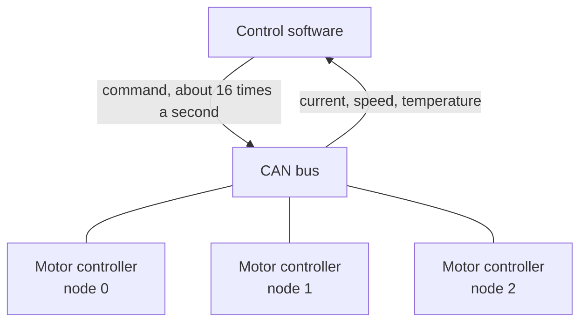
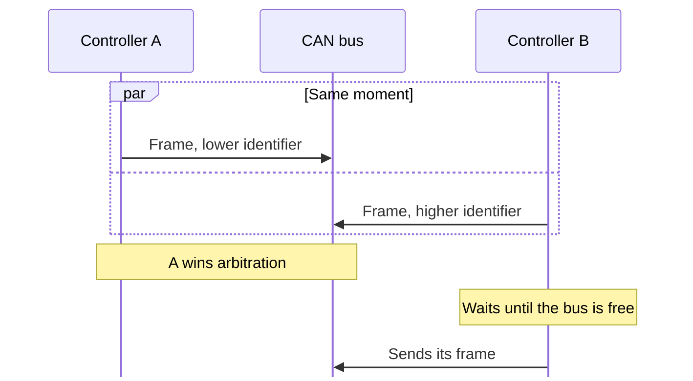

---
jupytext:
  text_representation:
    format_name: myst
kernelspec:
  display_name: Python 3 (ipykernel)
  language: python
  name: python3
---

# Communications

{.lead}
Modern systems are communication-heavy, with many devices which must pass data to each other. This communication spans software and hardware layers and has impacts on what the overall system is capable of.

{download}`Download this page as a notebook <communications.md>` to run its code in JupyterLab, with {download}`communications-sim.yaml <communications-sim.yaml>` beside it. [Running the notebooks](notebooks/running.md) explains how to set it up.

## Layers

The communications links between systems can be defined in terms of the Open Systems Interconnection (OSI) model[^itu-x200], which divides communication into seven layers, from the physical layer (layer 1) up to the application layer (layer 7). This guide merges layers of that model into three:

- **The physical layer** is the specification for the actual wires or electromagnetic waves carrying data. This matches OSI layer 1.
- **The protocol layer** is how bits become messages, including framing, device addressing, and error detection & correction. This covers OSI layers 2-4: data link, network, and transport.
- **The application layer** is what the messages mean, anything from a command to a data package. This can include additional framing and formatting. This covers OSI layers 5-7: session, presentation, and application.

Consider this webpage. Your Ethernet or Wi-Fi connection spans the physical layer and portions of the protocol layer. Your operating system handles the rest of the protocol layer. Cryptography and the HTTP request which fetched this page are carried on the application layer. Finally, the browser takes the content carried by HTTP (the HTML) and renders it.

## Serial links: RS-232 and RS-485

Serial links send one bit at a time. RS-232 connects one device to one other device over a short cable, and appears on older instruments and as the serial port of a USB adapter.

RS-485 sends each signal as the difference between two wires, which rejects noise picked up by both. One RS-485 bus can connect up to 32 unit loads, and can run at up to 10 Mbit/s over 12 m (40 ft), or up to 1,200 m (4,000 ft) at 100 kbit/s. Each end of the line needs a termination resistor, and stubs off the line should be as short as possible, to avoid signal reflections.[^ti-rs485]

## CAN

A {gloss}`CAN bus` connects the controllers in a vehicle or machine over one twisted pair. Every node can send, and every node hears every message.[^ti-can]

- **Arbitration.** When two nodes start sending at once, the bus settles it bit by bit, by each message's identifier. The identifier with the lower binary value has the higher priority, and wins.[^ti-can]
- **Identifiers.** A classic CAN frame has an 11-bit message identifier, or a 29-bit extended one.[^ti-can]
- **Data.** A classic frame carries 0 to 8 bytes of data.[^ti-can] CAN FD carries up to 64 bytes, and can switch to a faster bit rate for the data part of each frame.[^cia-can-fd]
- **Speed and length.** Classic CAN runs at up to 1 Mbit/s on a bus 40 m long, with up to 30 nodes. The bus is terminated at both ends with 120 Ω resistors.[^ti-can]

Classic CAN and CAN FD are both standardized in ISO 11898-1:2024.[^cia-can-fd]

### Decoding a frame

ISO 11898 defines CAN's physical and data-link layers, OSI layers 1 and 2. What a frame's data bytes mean belongs to the application layer, where a higher-layer protocol such as CANopen, or the manufacturer of the device, defines it.[^ti-can] To decode a frame, you need its layout: which bytes hold each signal, in which byte order, and how to scale the raw number into units.

These status frames come from three motor controllers, with a made-up layout:

```{code-cell} ipython3
import struct

import pandas as pd
import pyvisa
```

```{code-cell} ipython3
# The made-up layout. Each value's low byte comes first (little-endian).
#   bytes 0-1  current, signed, 0.1 A per bit
#   bytes 2-3  speed, signed, 1 rpm per bit
#   byte 4     temperature, unsigned, 1 °C per bit, offset -40 °C
STATUS = struct.Struct("<hhB")


def decode_status(data: bytes) -> dict[str, float]:
    current, speed, temperature = STATUS.unpack(data[: STATUS.size])
    return {
        "current (A)": current / 10,
        "speed (rpm)": speed,
        "temperature (°C)": temperature - 40,
    }


# Each frame's identifier and data bytes, as received
frames = {0x110: "0B02DC0555", 0x120: "80FFDC055C", 0x130: "7DFFDE055B"}
pd.DataFrame.from_dict(
    {
        f"0x{id_:03X}": decode_status(bytes.fromhex(data))
        for id_, data in frames.items()
    },
    orient="index",
)
```

The layout stores current as a signed integer, so the bytes `80 FF` of the frame 0x120 decode as −12.8 A. Read as unsigned, the same bytes would be 6,540.8 A.

### Example: the dyno's CAN bus

The dyno's three motor controllers share one CAN bus, with node IDs 0, 1 and 2. The control software sends each controller a command about 16 times a second, and each controller reports its current, speed and temperature back.



If two controllers start a frame at the same moment, the frame with the lower message identifier wins arbitration and goes first. The other controller waits, and sends once the bus is free. Neither frame is lost.



Each node sends its identifier one bit at a time, most significant bit first.[^hms-can] A 0 bit is dominant and a 1 bit is recessive, and a dominant bit always overwrites a recessive one. Each node reads the bus as it sends, and a node that sends a 1 but reads a 0 stops sending.[^ti-can] This simulation runs arbitration for two frames that start at the same moment, with the identifiers 0x110 and 0x120 from the decoding example above:

```{code-cell} ipython3
def arbitrate(frames: dict[str, int], id_bits: int = 11) -> pd.DataFrame:
    """Simulate CAN arbitration, bit by bit, for frames that start together."""
    sending = set(frames)
    rows = {name: {} for name in [*frames, "Bus"]}
    for bit in reversed(range(id_bits)):  # most significant bit first
        sent = {name: frames[name] >> bit & 1 for name in sending}
        bus = min(sent.values())  # a dominant 0 overwrites a recessive 1
        for name, level in [*sent.items(), ("Bus", bus)]:
            rows[name][f"ID{bit}"] = str(level)
        # A node that sent a 1 but reads a 0 stops sending
        sending = {name for name in sending if sent[name] == bus}
    return pd.DataFrame.from_dict(rows, orient="index").fillna("")


arbitrate({"Controller A, 0x110": 0x110, "Controller B, 0x120": 0x120})
```

Both controllers send the same first five bits. At ID5, A sends a 0 and B sends a 1, so the bus carries A's 0. B reads a 0 where it sent a 1, so it stops, and A finishes its identifier alone.

## Instrument control: SCPI and VISA

SCPI, Standard Commands for Programmable Instruments, is a text command language for test instruments. It builds on IEEE 488.2, which set out how to send commands to instruments and responses back to a controller.[^scpi]

SCPI commands are readable words in a tree, such as `MEASure:VOLTage?`. Each keyword has a long form and a short form, and the uppercase letters are the short form, so `MEAS:VOLT?` means the same.[^scpi] A command that ends in `?` is a query, and the instrument answers it.

This exchange sets a power supply to 48 V, turns its output on, and reads back the voltage and the error queue. Exact commands vary by instrument, so check its programming manual.

PyVISA, a Python package for controlling instruments,[^pyvisa] runs the exchange below against a power supply that pyvisa-sim simulates, so it needs no hardware.[^pyvisa-sim] The file {download}`communications-sim.yaml <communications-sim.yaml>` defines the simulated power supply and its answers:

```{code-cell} ipython3
rm = pyvisa.ResourceManager("communications-sim.yaml@sim")  # @sim: pyvisa-sim
psu = rm.open_resource(
    "TCPIP::192.168.1.10::INSTR", read_termination="\n", write_termination="\n"
)


def send(command: str) -> str:
    """Send a command, and return the answer if it's a query, or "" if it isn't."""
    print(f"→ {command}")
    if not command.endswith("?"):
        psu.write(command)
        return ""
    answer = psu.query(command)  # a query: send it, and read the answer
    print(f"← {answer}")
    return answer
```

```{code-cell} ipython3
for command in ["*IDN?", "VOLT 48", "OUTP ON", "MEAS:VOLT?", "SYST:ERR?"]:
    send(command)
```

`*IDN?` is a common command from IEEE 488.2, and its answer has four comma-separated fields.[^scpi] `SYST:ERR?` reads the instrument's error queue, one error at a time. The dyno's software has a routine that clears errors left behind by a session that didn't close cleanly: it sends `SYST:ERR?` until the answer starts with 0.

Two misspelled commands leave two errors in the simulated power supply's queue, and the routine reads them until the answer starts with 0:

```{code-cell} ipython3
# Errors left behind, as if by a session that didn't close cleanly
send("VOTL 48")
send("OUTPT ON")

# Clear the error queue: read it until the answer starts with 0
answer = send("SYST:ERR?")
while not answer.startswith("0"):
    answer = send("SYST:ERR?")
```

SCPI runs over many physical links, including GPIB, USB, Ethernet and serial. VISA is a standard software library that gives a program the same interface to an instrument whichever link it uses. The IVI Foundation maintains the VISA and SCPI standards, along with specifications for instruments on USB and on Ethernet.[^ivi-specs]

## Modbus

Modbus is a request-and-reply protocol: a client sends a request with a function code, and a server answers. It runs over TCP/IP on Ethernet, on port 502, or over serial links such as RS-232 and RS-485.[^modbus-spec]

A Modbus server presents its data as four tables:[^modbus-spec]

| Table | Size of each item | Access |
| --- | ---: | --- |
| Discrete inputs | 1 bit | Read only |
| Coils | 1 bit | Read and write |
| Input registers | 16 bits | Read only |
| Holding registers | 16 bits | Read and write |

To read a value, the client asks for a range of registers by function code, such as 03, Read Holding Registers. A 16-bit register can't hold a 32-bit value, so a device spreads it over two registers. The device's manual says which register holds which half.

Modbus sends each register with its high byte first. A Read Holding Registers response holds the function code, a count of the bytes that follow, and then two bytes for each register.[^modbus-spec] This response, from a made-up device, carries three registers: a temperature in tenths of a degree, then a pressure as a 32-bit float in two registers:

```{code-cell} ipython3
# Function code, byte count, then the registers
response = bytes.fromhex("03 06 00EB 406C CCCD")
function_code, byte_count = response[0], response[1]
registers = struct.unpack(f">{byte_count // 2}H", response[2:])  # >: high byte first
print(f"Function code: {function_code:02X}")
print("Registers:", " ".join(f"{r:04X}" for r in registers))
```

```{code-cell} ipython3
temperature = registers[0] / 10  # °C, in tenths of a degree
print(f"Temperature: {temperature} °C")

# The pressure's two registers as a 32-bit float, read in each word order
high_first = struct.pack(">2H", registers[1], registers[2])
low_first = struct.pack(">2H", registers[2], registers[1])
print(f"Pressure, high word first: {struct.unpack('>f', high_first)[0]:.2f} bar")
print(f"Pressure, low word first: {struct.unpack('>f', low_first)[0]:.4g} bar")
```

Read with the high word first, the pressure is 3.70 bar. Read the other way round, the same registers give about −108 million bar, so this device puts the high word in the first register.

## Industrial Ethernet: EtherCAT and OPC UA

EtherCAT is an industrial Ethernet standard, part of IEC 61158, for fast, tightly timed control. Each device reads the data addressed to it as the frame passes through. This allows cycle times of 100 µs or less, and clock jitter well under 1 µs. One segment can hold up to 65,535 devices.[^ethercat]

OPC UA is a platform-independent standard for exchanging data between industrial systems. It models data with its meaning, such as units and relationships, and supports both client-server requests and publish-subscribe for many-to-many data.[^opc-ua]

## What the link means for your data

Before you trust a channel's data, check how its link handles each of these:

- **Timestamps.** Find out where each value is timestamped: when the device measured it, or when the computer received it. The dyno's software timestamps each value when it arrives, so delays in the link appear as delays in the data.
- **Rate.** A value can't update faster than the computer asks for it. The dyno's software polls the motor controllers about 16 times a second, but the power supply only every half second, because its SCPI interface can't keep up with the motor rate.
- **Timing.** USB and ordinary Ethernet don't guarantee when a message arrives. Links like EtherCAT are designed for guaranteed timing.
- **Error handling.** CAN and Modbus check each message for errors. A link can still fail completely, which is why the dyno's motor controllers stop their motors when commands stop arriving. See [Safety](safety.md).

## Links compared

Each link suits different devices:

| Link | Topology | Speed and reach | Used for |
| --- | --- | --- | --- |
| RS-485 | Multi-drop bus | 10 Mbit/s at 12 m, 100 kbit/s at 1,200 m | Industrial devices, including Modbus devices |
| CAN | Multi-drop bus | 1 Mbit/s at 40 m | Motor controllers, vehicle electronics |
| USB | Point to point | Depends on the USB version | Bench instruments, DAQ devices, adapters |
| Ethernet | Switched network | Depends on the network | Instruments, DAQ chassis, Modbus TCP, OPC UA |
| EtherCAT | Line, tree or star | Cycle times of 100 µs or less | Fast motion control and distributed I/O |

## Further reading

- Texas Instruments, [Introduction to the Controller Area Network (CAN)](https://www.ti.com/lit/an/sloa101b/sloa101b.pdf).
- Texas Instruments, [The RS-485 Design Guide](https://www.ti.com/lit/an/slla272d/slla272d.pdf).
- IVI Foundation, [specification downloads](https://www.ivifoundation.org/specifications/default.html), for VISA, USBTMC and HiSLIP.
- SCPI Consortium, [SCPI-99](https://www.ivifoundation.org/downloads/SCPI/scpi-99.pdf), the full command standard.
- Modbus Organization, [Modbus Application Protocol Specification V1.1b3](https://www.modbus.org/file/secure/modbusprotocolspecification.pdf).

## References

[^itu-x200]: ITU-T, ["X.200: Open Systems Interconnection, Basic Reference Model: The basic model"](https://www.itu.int/rec/T-REC-X.200-199407-I/en), 1994. The same text is published as ISO/IEC 7498-1. Retrieved 2026-11-24.
[^ti-rs485]: T. Kugelstadt, Texas Instruments, ["The RS-485 Design Guide"](https://www.ti.com/lit/an/slla272d/slla272d.pdf), SLLA272D, revised May 2021. Retrieved 2026-11-12.
[^ti-can]: S. Corrigan, Texas Instruments, ["Introduction to the Controller Area Network (CAN)"](https://www.ti.com/lit/an/sloa101b/sloa101b.pdf), SLOA101B, revised May 2016. Retrieved 2026-11-12.
[^cia-can-fd]: CAN in Automation, ["CAN FD: The basic idea"](https://www.can-cia.org/can-knowledge/can-fd-the-basic-idea). Retrieved 2026-11-12.
[^hms-can]: HMS Networks, ["What is CAN arbitration and how does this work?"](https://www.hms-networks.com/tech-blog/blogpost/hms-blog/2024/06/18/what-is-can-arbitration-and-how-does-this-work), Ixxat tech blog, 2024. Retrieved 2026-11-25.
[^scpi]: SCPI Consortium, ["Standard Commands for Programmable Instruments (SCPI), Volume 1: Syntax and Style"](https://www.ivifoundation.org/downloads/SCPI/scpi-99.pdf), version 1999.0. Retrieved 2026-11-12.
[^pyvisa]: PyVISA, ["PyVISA: Control your instruments with Python"](https://pyvisa.readthedocs.io/en/latest/). Retrieved 2026-11-25.
[^pyvisa-sim]: PyVISA, ["PyVISA-sim: Simulator backend for PyVISA"](https://pyvisa.readthedocs.io/projects/pyvisa-sim/en/latest/). Retrieved 2026-11-25.
[^ivi-specs]: IVI Foundation, ["Specification Downloads"](https://www.ivifoundation.org/specifications/default.html). Retrieved 2026-11-12.
[^modbus-spec]: Modbus Organization, ["MODBUS Application Protocol Specification V1.1b3"](https://www.modbus.org/file/secure/modbusprotocolspecification.pdf), 2012. Retrieved 2026-11-12.
[^ethercat]: EtherCAT Technology Group, ["EtherCAT: the Ethernet Fieldbus"](https://www.ethercat.org/en/technology.html). Retrieved 2026-11-12.
[^opc-ua]: OPC Foundation, ["Unified Architecture"](https://opcfoundation.org/about/opc-technologies/opc-ua/). Retrieved 2026-11-12.
