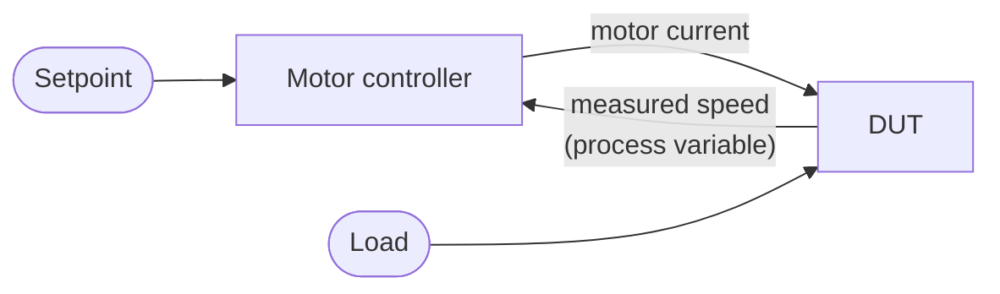
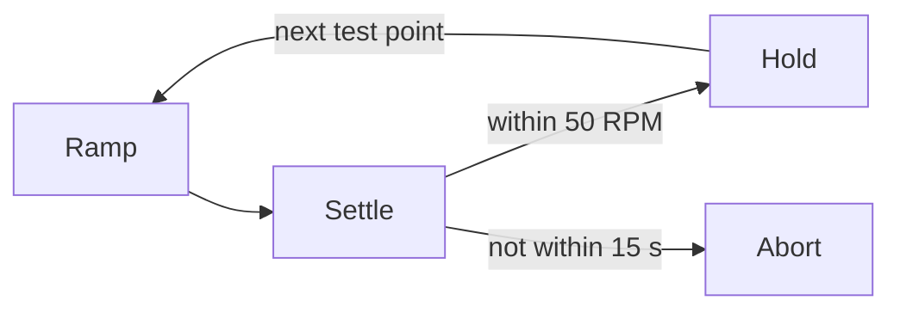

---
jupytext:
  text_representation:
    format_name: myst
kernelspec:
  display_name: Python 3 (ipykernel)
  language: python
  name: python3
---

# Control

{.lead}
Control makes a measurement follow a command. A controller compares the measured value with the setpoint, and adjusts its output until they match.

{download}`Download this page as a notebook <control.md>` to run its code in JupyterLab. [Running the notebooks](notebooks/running.md) explains how to set it up.

## Setpoint, process variable and error

Control theory names three quantities:[^ni-pid]

- The **process variable** is the quantity being controlled, as its sensor measures it. It's a {gloss}`measurement`.
- The **{gloss}`setpoint`** is the value you want the process variable to have.
- The **error** is the difference between the two.

On a {gloss}`dyno <dynamometer>`, two load motors brake the motor under test. When the dyno's sequence asks for 1,000 RPM, that's the setpoint. The DUT's measured speed is the process variable, and the gap between them is the error.

## Open loop and closed loop

An open-loop system sends a command and doesn't check the result. Take a fluids panel, which runs compressed air through valves and measures it with pressure transducers and a flow meter. If you command its proportional valve, `v_2`, and read the flow on `fm_1`, nothing adjusts `v_2` to hold a flow. If the supply pressure changes, the flow changes with it.

A {gloss}`closed loop <closed loop>` measures the process variable, compares it with the setpoint, and adjusts its output, over and over at a fixed rate.[^ni-pid] The dyno's DUT runs closed loop: its motor controller measures the speed and adjusts the motor current to hold the setpoint as the load changes:



Loops can also run inside instruments, where they can be fast. The fluids panel's electronic pressure regulator, `pr_2`, holds its own outlet pressure at whatever setpoint it's commanded. The dyno's motor controllers hold speed themselves. Each system's control software then works one level up, setting the setpoints those inner loops follow.

## PID control

"Proportional-integral-derivative (PID) control is by far the most common way of using feedback in engineering systems."[^fbs-pid] A PID controller sets its output from the error, as the sum of three terms:

```text
output = Kp × error + Ki × (sum of error over time) + Kd × (rate of change of error)
```

- **Proportional.** Depends only on the present error. Raising its gain speeds up the response, but too much gain makes the process variable oscillate.[^ni-pid]
- **Integral.** Sums the error over time, so it keeps pushing until no error is left. It removes steady-state error, but increases overshoot.[^ni-pid]
- **Derivative.** Pushes back when the process variable is changing fast, which reduces overshoot. It's very sensitive to noise in the measurement, so most real systems use only a little of it.[^ni-pid]

Tuning a PID controller means choosing the three gains. Classic methods such as Ziegler–Nichols tuning give starting values from a simple test of the process.[^ni-pid][^fbs-pid]

Integral windup happens when the controller's output hits a limit, such as a motor controller's current limit. The loop is then effectively open: the output stays at the limit whatever the process variable does. The error persists, so the integral term keeps growing. When the error finally changes sign, the oversized integral holds the output at its limit for a while longer, and the process variable overshoots. Anti-windup prevents this by keeping the controller's output close to the limit, so it changes as soon as the error does.[^fbs-pid] Controllers such as LabVIEW's PID VI include it.[^ni-pid]

In code, a controller that runs every `dt` seconds adds each cycle's error, times `dt`, to a running sum for the integral term, and keeps the previous error for the derivative term. This one also clamps its output to a limit, and stops adding to the sum while its output is clamped, so the integral term can't wind up:

```{code-cell} ipython3
import matplotlib.pyplot as plt
import numpy as np
import pandas as pd
from learning.style import set_matplotlib_style

set_matplotlib_style()
```

```{code-cell} ipython3
class PID:
    """A PID controller that runs every dt seconds, with its output clamped to ±limit."""

    def __init__(self, kp, ki=0.0, kd=0.0, dt=0.01, limit=np.inf):
        self.kp, self.ki, self.kd, self.dt, self.limit = kp, ki, kd, dt, limit
        self.integral = 0.0  # sum of error over time
        self.last_error = 0.0

    def update(self, setpoint, measurement):
        """Return this cycle's output."""
        error = setpoint - measurement
        derivative = (error - self.last_error) / self.dt  # rate of change of error
        self.last_error = error
        integral = self.integral + error * self.dt
        output = self.kp * error + self.ki * integral + self.kd * derivative
        if (
            abs(output) <= self.limit
        ):  # anti-windup: add to the sum only if not clamped
            self.integral = integral
        return np.clip(output, -self.limit, self.limit)
```

## Reading a step response

The step response is how the process variable responds when the setpoint jumps to a new value. It's described by four numbers:[^fbs-linear]

| Measure | Definition |
| --- | --- |
| Steady-state value | Where the process variable ends up, if it settles |
| Rise time | The time for the process variable to go from 10% to 90% of the way to its final value |
| Overshoot | How far the process variable goes past its final value, as a percentage of the final value |
| Settling time | The time until the process variable stays within 2% of its final value for good |

Texts differ on the details: some use a 5% or 1% band for settling time instead of 2%.[^fbs-linear] Say which you use.

This function measures a step response from 0 with the definitions in the table:

```{code-cell} ipython3
def step_metrics(t, y):
    """Measure a step response that starts at 0, from its times t and values y."""
    final = y[-1]  # the steady-state value, if the run is long enough to settle
    rise = t[np.argmax(y >= 0.9 * final)] - t[np.argmax(y >= 0.1 * final)]
    outside = np.flatnonzero(np.abs(y - final) > 0.02 * final)  # outside the 2% band
    return {
        "steady-state value (RPM)": final,
        "rise time (s)": rise,
        "overshoot (%)": max(y.max() - final, 0) / final * 100,
        "settling time (s)": t[outside[-1] + 1] if outside.size else 0.0,
    }
```

To try it, simulate a speed loop. The simulated motor isn't the dyno's: its speed moves toward 100 RPM for each amp of current, with a time constant of 0.5 s. Its controller limits the current to 35 A, the same maximum as the dyno's DUT (see [Protecting equipment](safety.md#protecting-equipment)). `simulate` runs a controller on the motor, and records the speed and the current every millisecond:

```{code-cell} ipython3
class Motor:
    """A simulated motor, with a speed in RPM."""

    def __init__(self):
        self.speed = 0.0

    def run(self, current, duration):
        """Apply a current, in A, for a duration, in s."""
        self.speed += (100 * current - self.speed) * (1 - np.exp(-duration / 0.5))


def simulate(controller, setpoint, duration):
    """Run a speed loop on a new motor. Return the time, speed and current each ms."""
    motor = Motor()
    t = np.arange(0, duration, 0.001)
    speed, current = np.zeros_like(t), np.zeros_like(t)
    every = round(controller.dt / 0.001)  # ms between the controller's updates
    for k in range(len(t)):
        if k % every == 0:
            amps = controller.update(setpoint(t[k]), motor.speed)
        speed[k], current[k] = motor.speed, amps
        motor.run(amps, 0.001)
    return t, speed, current
```

Step the setpoint from 0 to 500 RPM, first with P control alone and then with PI control. Both controllers run 100 times a second, and the step is small enough that neither reaches the current limit:

```{code-cell} ipython3
def step(t):
    return 500.0  # RPM, from t = 0


# kp in A per RPM of error, ki in A per RPM of error per second
p_only = simulate(PID(kp=0.06, dt=0.01, limit=35.0), step, 3)
pi = simulate(PID(kp=0.06, ki=0.2, dt=0.01, limit=35.0), step, 3)
pd.DataFrame({"P": step_metrics(*p_only[:2]), "PI": step_metrics(*pi[:2])}).round(2)
```

In the plot, P alone levels off below the setpoint, while PI rises past it and comes back:

```{code-cell} ipython3
fig, ax = plt.subplots()
ax.plot(p_only[0], p_only[1], label="P")
ax.plot(pi[0], pi[1], label="PI")
ax.axhline(500, color="grey", linestyle="--", label="Setpoint")
ax.set(xlim=(0, 1), xlabel="Time (s)", ylabel="Speed (RPM)")
ax.legend();
```

The steady-state error is the difference between the setpoint and the steady-state value. A loop without an integral term can end with some. Here, P alone ends at 429 RPM, 71 RPM short of the setpoint. Adding the integral term removes that error, and adds 4% overshoot.

To measure rise time in Nominal, plot the setpoint and the measurement together in a {gloss}`workbook`, and read the times where the measurement crosses 10% and 90% of the change.

## Ramps, limits and settling: the dyno's sequence

The dyno's sequence doesn't jump its setpoints. It ramps them, and checks that the DUT has settled before it holds each test point:

1. **Ramp.** The DUT's speed setpoint moves at **DUT Speed Ramp Rate**, 200 RPM/s by default, and the load torque at **Load Torque Ramp Rate**, 0.5 Nm/s. Moving from a test point at 500 RPM to one at 750 RPM takes 1.25 s, and the warm-up's climb from 0 to 2,000 RPM takes 10 s.
2. **Settle.** Once a ramp ends, the sequence waits until the DUT's measured speed is within 50 RPM of its setpoint. If it isn't within 15 s, the sequence aborts.
3. **Hold.** Only then does the test point's hold time start, 10 s by default for each sweep test point, so the recorded data is at {gloss}`steady state`.



As a state machine, the sequence moves the setpoint, checks the speed and changes state once a cycle. This one runs 10 times a second, as the dyno's sequence does (see [Loop rates](#loop-rates)). It drives the simulated motor from [Reading a step response](#reading-a-step-response) through a motor controller that runs 100 times a second:

```{code-cell} ipython3
RAMP_RATE = 200.0  # DUT Speed Ramp Rate, RPM/s
SETTLE_BAND = 50.0  # RPM
SETTLE_TIMEOUT = 15.0  # s
HOLD_TIME = 10.0  # s, for each sweep test point
RATE = 10  # cycles a second


def run_sequence(test_points, controller):
    """Ramp to, settle at and hold each test point. Return a log row for each cycle."""
    motor, points = Motor(), iter(test_points)
    state, target, setpoint = "RAMP", next(points), 0.0
    cycle, entered = 0, 0  # the cycle count, and the cycle the state started
    log = [(0.0, state, setpoint, motor.speed)]
    while state not in ("DONE", "ABORT"):
        for _ in range(10):  # the motor controller runs 10 times a cycle
            motor.run(controller.update(setpoint, motor.speed), 0.01)
        cycle += 1
        elapsed = (cycle - entered) / RATE  # s in this state
        if state == "RAMP":
            most = RAMP_RATE / RATE  # RPM per cycle
            setpoint += np.clip(target - setpoint, -most, most)
            if setpoint == target:
                state, entered = "SETTLE", cycle
        elif state == "SETTLE":
            if abs(motor.speed - setpoint) <= SETTLE_BAND:
                state, entered = "HOLD", cycle
            elif elapsed >= SETTLE_TIMEOUT:
                state = "ABORT"
        elif elapsed >= HOLD_TIME:  # HOLD is over
            target = next(points, None)
            state, entered = ("DONE", cycle) if target is None else ("RAMP", cycle)
        log.append((cycle / RATE, state, setpoint, motor.speed))
    columns = ["time (s)", "state", "setpoint (RPM)", "speed (RPM)"]
    return pd.DataFrame(log, columns=columns)
```

Run it through three test points, with the PI motor controller, and print the cycles where the state changes:

```{code-cell} ipython3
pi_run = run_sequence([500, 750, 1000], PID(kp=0.06, ki=0.2, dt=0.01, limit=35.0))
pi_run[pi_run.state != pi_run.state.shift()].round(1)
```

The ramp from 0 to 500 RPM takes 2.5 s. The ramp from 500 to 750 RPM ends 1.3 s after it starts: 1.25 s at 200 RPM/s, rounded up to the sequence's next cycle.

With P control alone, the motor controller leaves the same steady-state error as in [Reading a step response](#reading-a-step-response): 71 RPM at 500 RPM. That's outside the 50 RPM band, so the sequence aborts 15 s after the ramp ends:

```{code-cell} ipython3
p_run = run_sequence([500, 750, 1000], PID(kp=0.06, dt=0.01, limit=35.0))
p_run[p_run.state != p_run.state.shift()].round(1)
```

In the plot, the PI run's speed follows the setpoint through each ramp and hold, while the P run's speed levels off below 500 RPM until the sequence aborts:

```{code-cell} ipython3
fig, ax = plt.subplots()
time = pi_run["time (s)"]
ax.plot(time, pi_run["setpoint (RPM)"], "--", color="grey", label="Setpoint")
ax.plot(time, pi_run["speed (RPM)"], label="Speed, PI")
ax.plot(p_run["time (s)"], p_run["speed (RPM)"], label="Speed, P")
ax.set(xlabel="Time (s)", ylabel="Speed (RPM)")
ax.legend();
```

Throughout, every setpoint is clamped to its channel's range before it's sent.

A ramp asks less of the inner loop than a jump does. The motor controller doesn't have to accelerate as hard, so its current stays further from its limit, and the speed tracks the setpoint more closely.

On the simulated motor, compare the warm-up's climb from 0 to 2,000 RPM as a ramp at 200 RPM/s with the same change as a step:

```{code-cell} ipython3
setpoints = {"Step": lambda t: 2000.0, "Ramp": lambda t: min(RAMP_RATE * t, 2000.0)}
climbs, rows = {}, {}
for name, setpoint in setpoints.items():
    t, speed, current = simulate(
        PID(kp=0.06, ki=0.2, dt=0.01, limit=35.0), setpoint, 12
    )
    gap = np.abs([setpoint(x) for x in t] - speed)  # RPM between setpoint and speed
    climbs[name] = t, speed, current
    rows[name] = {
        "peak current (A)": current.max(),
        "time at the 35 A limit (s)": np.sum(current >= 35.0) * 0.001,
        "time more than 50 RPM off (s)": np.sum(gap > 50) * 0.001,
    }
pd.DataFrame(rows).round(2)
```

The step holds the current at its 35 A limit for 0.27 s, and the speed is more than 50 RPM from the setpoint for 0.73 s. The ramp needs at most 21 A, and the speed never strays that far. In the plot, the step's current jumps to the limit, while the ramp's rises gradually:

```{code-cell} ipython3
fig, (ax_speed, ax_current) = plt.subplots(2, 1, sharex=True, figsize=(8, 5))
for name, (t, speed, current) in climbs.items():
    ax_speed.plot(t, speed, label=name)
    ax_current.plot(t, current, label=name)
ax_current.axhline(35, color="grey", linestyle="--", label="Limit")
ax_speed.set(ylabel="Speed (RPM)")
ax_current.set(xlabel="Time (s)", ylabel="Current (A)")
ax_speed.legend()
ax_current.legend();
```

At the end of the warm-up, the sequence measures the ratio between the DUT's speed and the load motors' speed, and projects the load motors' speed at the fastest test point of the plan. If that projection is above the load motors' overspeed limit, the sequence aborts before the sweep starts, instead of finding out at full speed.

## Loop rates

A loop can't correct faster than it measures. If a loop runs too slowly for the process it controls, it reacts late, and a late correction overshoots or oscillates.

To see it, run the PI loop from [Reading a step response](#reading-a-step-response) 10 times a second instead of 100, with the same gains:

```{code-cell} ipython3
rates = {
    rate: simulate(PID(kp=0.06, ki=0.2, dt=1 / rate, limit=35.0), step, 3)
    for rate in (100, 10)
}
pd.DataFrame(
    {f"{r} Hz": step_metrics(t, y) for r, (t, y, _) in rates.items()}
).round(2)
```

At 10 Hz, the controller's first output is clamped at the 35 A limit, and held for a whole 100 ms. The speed rises faster, but by the time the controller next reads it, it's 27% past the setpoint. The correction comes late, so the speed swings down to 324 RPM, well below the setpoint, and takes longer to settle. In the plot, the 10 Hz current holds each value for 100 ms:

```{code-cell} ipython3
fig, (ax_speed, ax_current) = plt.subplots(2, 1, sharex=True, figsize=(8, 5))
for rate, (t, speed, current) in rates.items():
    ax_speed.plot(t, speed, label=f"{rate} Hz")
    ax_current.plot(t, current, label=f"{rate} Hz")
ax_speed.axhline(500, color="grey", linestyle="--", label="Setpoint")
ax_speed.set(ylabel="Speed (RPM)")
ax_current.set(xlim=(0, 1), xlabel="Time (s)", ylabel="Current (A)")
ax_speed.legend();
```

The dyno's software runs several loops at different rates:

| Loop | Times a second |
| --- | ---: |
| Sending commands to, and reading, each motor controller | ~16 |
| The sequence, which updates the setpoints | 10 |
| Reading the power supply | 2 |

The motor controllers' own speed and current loops run inside them, much faster than any of these. That's why the software can set the speed only 10 times a second and still get a steady speed.

## Sequences and states

Above the control loops, a {gloss}`sequence` decides which setpoints apply when. The software that runs it is a state machine: at any moment the system is in one state, and only certain commands are allowed in each.

The dyno's software has these states:

| State | What it means |
| --- | --- |
| OFF | Not connected. |
| ARMING | Connecting the instruments and powering the bus. |
| ARMED | Powered and ready. Setpoints can be staged, but no motor commands are sent. |
| RUNNING | Sending motor commands. |
| STOPPING | Bringing every motor to zero, then back to ARMED. |
| TRIP_STOPPING | Stopping every motor after a trip. |
| TRIPPED | Stopped after a measurement left its allowed range. Can return to ARMED only once every measurement is back in range. |
| DISARMING | Turning off the power supply and disconnecting, then back to OFF. |

The states are a form of protection in themselves: the software sends motor commands only in RUNNING, STOPPING and TRIP_STOPPING. See [Safety](safety.md).

## Further reading

- K. J. Åström and R. M. Murray, [Feedback Systems: An Introduction for Scientists and Engineers](https://fbswiki.org/wiki/index.php/Main_Page), a free textbook, with chapters on linear systems and PID control.
- NI, [The PID Controller & Theory Explained](https://www.ni.com/en/shop/labview/pid-theory-explained.html).

## References

[^ni-pid]: NI, ["The PID Controller & Theory Explained"](https://www.ni.com/en/shop/labview/pid-theory-explained.html), updated 2025-03-07. Retrieved 2026-11-12.
[^fbs-pid]: K. J. Åström and R. M. Murray, ["PID Control"](https://www.cds.caltech.edu/~murray/books/AM08/pdf/fbs-pid_24Jul2020.pdf), chapter 11 of *Feedback Systems: An Introduction for Scientists and Engineers*, 2nd edition, version 3.1.5, 2020-07-24, Princeton University Press. Retrieved 2026-11-13.
[^fbs-linear]: K. J. Åström and R. M. Murray, ["Linear Systems"](https://www.cds.caltech.edu/~murray/books/AM08/pdf/fbs-linsys_24Jul2020.pdf), chapter 6 of *Feedback Systems: An Introduction for Scientists and Engineers*, 2nd edition, version 3.1.5, 2020-07-24, Princeton University Press, section 6.3. Retrieved 2026-11-25.
