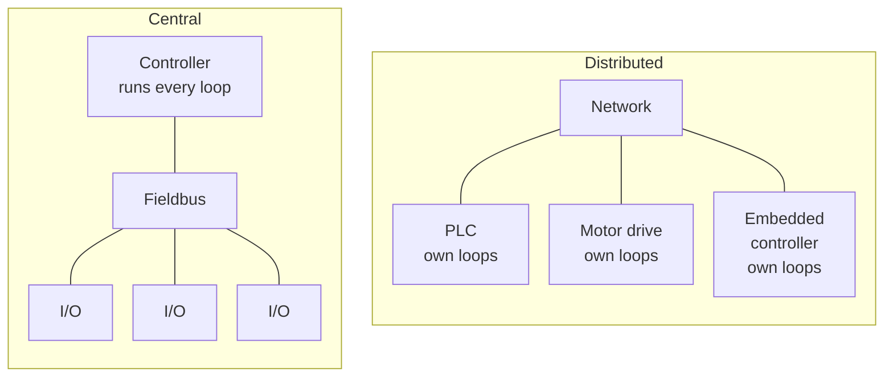
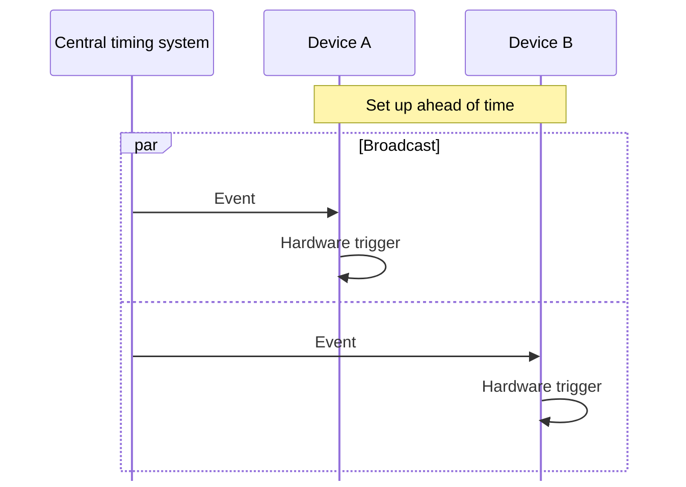

# Distributed control

{.lead}
Control can live in one central controller with a lot of I/O, or be spread across many smaller devices that each run part of it. Where it lives decides how much each controller is responsible for, and how much coordination has to happen between them.

## Where control lives

Control can live in two places:

- **Central.** One controller with a lot of {gloss}`I/O points <I/O point>` runs every loop. Its I/O can sit in one rack, or be spread around a machine on a fieldbus such as [EtherCAT](communications.md#industrial-ethernet-ethercat-and-opc-ua).
- **Distributed.** Many smaller devices, such as {gloss}`PLCs <PLC>`, motor drives and embedded controllers, each run their own loops, and exchange values over a network.

The two can be mixed. At large physics facilities, control that needs a deterministic response runs in PLCs, FPGAs or front-end computers next to its I/O, and the network coordinates the parts. That way the fastest loops don't depend on the network's timing.[^nif-2001][^ess-2023] In the European XFEL's RF control system, loops split by timescale:[^xfel-llrf]

| Timescale | What the loop does | Where it runs |
| --- | --- | --- |
| Microseconds | Corrects within one cycle of the process | FPGA |
| Milliseconds | Adapts from one cycle to the next | CPU |
| Seconds | Compensates for long-term drift | External modules and slow feedback loops |

A {gloss}`dyno <dynamometer>`, where two load motors brake the motor under test, mixes them too. One program runs the sequence for all three motors, while each motor controller closes its own speed and current loops. The software sets speed setpoints 10 times a second, and the motor controllers hold the speed in between. See [Loop rates](control.md#loop-rates).

## Responsibility and coordination

Each controller is responsible for some of the system's loops and actuators. Anything that crosses from one controller to another has to be coordinated over a link. So for each part of a system, decide how much one controller should own:

- A controller that owns more needs less coordination, but has more to do in each cycle, and more I/O to reach in time.
- A controller that owns less is simpler, but more of what it does has to be coordinated with others.

Draw each controller's boundary around the actuators that have to act together.

## Central control

A central controller runs one program that reads every input and writes every output in each {gloss}`control cycle`. That makes coordination simple. Two actuators commanded in the same cycle act on the same view of the system, and no other controller's command competes with them. Closing several motors' position loops in one controller makes it easier to synchronize them.[^ess-ecmc]

The cost is performance and timing. When one loop handles every device, a device that answers slowly delays all the others, and a computer that stalls stalls everything. [Network performance](network-performance.md#example-when-the-dynos-computer-fell-behind) shows how that played out on the dyno.

One limit on a central loop is the delay between the controller and its I/O, compared with the loop's period. On a network that reserved a queue for one loop's traffic, a delay below 300 µs was negligible for a loop at 25 Hz.[^lhc-orbit] For a loop at 1 kHz, it's almost a third of the period. ITER sized its real-time network for loops with a 500 µs cycle, assuming communication could use at most 10% of that time.[^iter-2011] Delays inside the front-end computers that read the sensors and drive the actuators were an order of magnitude larger than the network's,[^lhc-orbit] so count them too. A deterministic fieldbus such as EtherCAT keeps the delay to the I/O short and predictable.[^ess-2023] It can synchronize its devices' clocks to within 100 ns, with bus cycles under 50 µs.[^ess-ecmc]

## Distributed control

In a distributed system, many devices each run their own loops, and a supervisory layer coordinates them. Splitting a system into modules reduces the impact of a single fault on the whole.[^nist-ics] The National Ignition Facility chose a distributed architecture to reduce complexity and risk, and it also lowered cost.[^nif-2009]

The cost is coordination. When two devices have to act together, the link between them becomes part of the control system, and its {gloss}`latency` and {gloss}`jitter` limit how closely they can work. The software at each end can be the bottleneck as well as the network. At the SKA telescopes, running too many devices in one server process, with single-threaded event handling, delayed events severely.[^ska-2025]

When actuators have to act together, keep them on one controller, give their separate controllers a shared clock, or accept loose timing.

### Keep coupled actuators in one controller

Two motors on separate controllers are hard to move together. Started over the network, they don't start at exactly the same time.[^maxiv-scans] Even on one controller, sending each motor its own command starts one slightly before the other.[^sardana-motor] Computing a shared path in software and sending each motor its part doesn't keep them on the path while they move.[^maxiv-scans]

Instead, put the axes that have to move together on one controller, which computes or follows their path itself.[^diamond-motion][^maxiv-scans] Multi-axis motion controllers are built for this. Galil's controllers, for example, interpolate straight-line paths across up to 8 axes,[^galil] and one IcePAP system drives up to 128 axes.[^icepap]

Control software groups axes the same way. In the Sardana framework, one software controller handles several axes, and starts them all with one hardware command if the hardware supports it.[^sardana-motor] Synchronizing two separate controllers is harder. Sardana's planned trajectory support leaves it out of scope.[^sardana-traj]

Axes wired to separate controllers can still move together closely if a dedicated real-time motion bus lets one controller run all of them.[^soleil]

### Share a clock

When separate devices have to act at the same instant, set each one up ahead of time, and let a shared timing signal say when. A central timing system broadcasts events, and a receiver in each device turns them into hardware triggers.[^mrf] One such system is designed to trigger 1,600 channels to 30 ps accuracy.[^nif-2001] A device can also preload every waveform it might need, and play the right one when its clock event arrives.[^acnet]

Over Ethernet, the Precision Time Protocol (PTP, IEEE 1588) synchronizes clocks to under a microsecond, and to under a nanosecond in a properly designed network.[^ptp] With clocks that close, a message sent early enough can tell a device to act at a given absolute time, as in the White Rabbit timing system.[^white-rabbit]

### Accept loose timing

Where the process tolerates it, the ordinary network is enough. Two devices started over a network don't start at exactly the same time, but the difference can be well within what the process needs. A dedicated trigger cable is the fallback.[^maxiv-scans]

The dyno works this way. Its DUT and load motors have separate controllers on one CAN bus, and the software updates their setpoints 10 times a second. That's close enough, because the sequence ramps slowly and waits for each test point to settle. See [Ramps, limits and settling](control.md#ramps-limits-and-settling-the-dynos-sequence).

## Choosing where control lives

For each loop or action, compare its timing with the path it has to take:

| If you need | Put the control in | Coordinate with |
| --- | --- | --- |
| A loop whose period is less than about 10 times the network's worst-case delay | The device, or a controller next to its I/O | Setpoints sent from above |
| Several axes on one path | One multi-axis controller | The controller's coordinate system |
| Actions at the same instant on separate devices | Each device | A shared timing system |
| Parts that fail independently | Separate controllers | Supervision, with a {gloss}`watchdog` in each part |
| Steps in order, seconds apart | A {gloss}`sequence` or {gloss}`test executive` | The network, waiting for each step to finish |

Safety functions belong in a certified safety controller, not in ordinary control software. See [Safety controllers](safety.md#safety-controllers). A safety signal that crosses a network uses a certified safety protocol, such as Safety over EtherCAT, which carries safety data on the same EtherCAT network as the standard data.[^fsoe]

## Further reading

- L. J. Lagin et al., [The Overview of the National Ignition Facility Distributed Computer Control System](https://arxiv.org/abs/cs/0111045), with its supervisory, front-end and timing layers.
- NIST, [SP 800-82r3, Guide to Operational Technology Security](https://doi.org/10.6028/NIST.SP.800-82r3), section 2.3, on DCS, SCADA and PLC-based systems.
- R. J. Steinhagen et al., [LHC Orbit Stabilisation Tests at the SPS](https://proceedings.jacow.org/p05/PAPERS/MPPP004.PDF), a central feedback loop over a network.
- T. Gahl et al., [ECMC, the Open Source Motion Control Package for EtherCAT Hardware at the ESS](https://proceedings.jacow.org/icalepcs2017/papers/mocpl05.pdf), on where to close position loops.
- H. Enquist et al., [Continuous Scans with Position Based Hardware Triggers](https://proceedings.jacow.org/icalepcs2021/papers/frbr04.pdf), on moving coupled motors along one path, and triggering detectors from motor positions in hardware.
- The [EPICS](https://docs.epics-controls.org/) and [Tango Controls](https://tango-controls.readthedocs.io/) documentation, two frameworks for distributed control at physics facilities.

## References

[^nif-2001]: L. J. Lagin et al., LLNL, ["The Overview of the National Ignition Facility Distributed Computer Control System"](https://arxiv.org/abs/cs/0111045), ICALEPCS 2001, TUAP001. Retrieved 2026-11-18.
[^ess-2023]: T. Korhonen, ESS, ["Status of the European Spallation Source Controls"](https://proceedings.jacow.org/icalepcs2023/papers/fr1bco01.pdf), ICALEPCS 2023, FR1BCO01. Retrieved 2026-11-18.
[^xfel-llrf]: C. Schmidt et al., DESY, ["High Level Software Structure for the European XFEL LLRF System"](https://proceedings.jacow.org/ICALEPCS2015/papers/wepgf029.pdf), ICALEPCS 2015, WEPGF029. Retrieved 2026-11-18.
[^ess-ecmc]: T. Gahl et al., ESS, ["ECMC, the Open Source Motion Control Package for EtherCAT Hardware at the ESS"](https://proceedings.jacow.org/icalepcs2017/papers/mocpl05.pdf), ICALEPCS 2017, MOCPL05. Retrieved 2026-11-18.
[^lhc-orbit]: R. J. Steinhagen et al., CERN, ["LHC Orbit Stabilisation Tests at the SPS"](https://proceedings.jacow.org/p05/PAPERS/MPPP004.PDF), PAC 2005, MPPP004. Retrieved 2026-11-18.
[^nist-ics]: K. Stouffer et al., NIST, ["Guide to Operational Technology (OT) Security"](https://doi.org/10.6028/NIST.SP.800-82r3), SP 800-82r3, section 2.3, September 2023. Retrieved 2026-11-18.
[^nif-2009]: P. Van Arsdall et al., LLNL, ["National Ignition Facility Project Completion and Control System Status"](https://epaper.kek.jp/icalepcs2009/papers/tup078.pdf), ICALEPCS 2009, TUP078. Retrieved 2026-11-18.
[^ska-2025]: S. Vrcic et al., SKAO, ["SKA Control System in 2025"](https://proceedings.jacow.org/icalepcs2025/pdf/WEMG002.pdf), ICALEPCS 2025, WEMG002. Retrieved 2026-11-18.
[^sardana-motor]: Sardana, ["How to write a motor controller"](https://sardana-controls.org/how-to/controllers/motor.html), section "Multiple motion synchronization", Sardana 3.8.0 documentation. Retrieved 2026-11-19.
[^maxiv-scans]: H. Enquist et al., MAX IV, ["Continuous Scans with Position Based Hardware Triggers"](https://proceedings.jacow.org/icalepcs2021/papers/frbr04.pdf), ICALEPCS 2021, FRBR04. Retrieved 2026-11-18.
[^diamond-motion]: B. Nutter et al., Diamond Light Source, ["Recent Developments in Synchronised Motion Control at Diamond Light Source"](https://proceedings.jacow.org/icalepcs2011/papers/wepmn013.pdf), ICALEPCS 2011, WEPMN013. Retrieved 2026-11-18.
[^galil]: Galil Motion Control, ["Modes of Motion: Vector and Linear Interpolation"](https://www.galil.com/resources/application-notes/modes-of-motion-vector-and-linear-interpolation), Application Note #2519, 2026-05-21. Retrieved 2026-11-18.
[^icepap]: ESRF, ["IcePAP"](https://esrf.fr/Instrumentation/DetectorsAndElectronics/icepap). Retrieved 2026-11-18.
[^sardana-traj]: R. Homs Puron et al., ALBA Synchrotron, ["Sardana Trajectories: Preliminary Core Design for Synchronized Motion and Acquisition"](https://indico.tango-controls.org/event/737/contributions/1025/attachments/680/969/Sardana_trajectories.pdf), presented by J. Aguilar at the 40th Tango Community meeting, 2026-06-11, slide 5. Retrieved 2026-11-18.
[^soleil]: Y. M. Abiven et al., SOLEIL and Symetrie, ["SOLEIL and Symetrie Company Collaborate to Build Tango Ready In-Vacuum Diffractometer"](https://proceedings.jacow.org/ICALEPCS2017/papers/tupha007.pdf), ICALEPCS 2017, TUPHA007. Retrieved 2026-11-18.
[^iter-2011]: A. Wallander et al., ITER, ["News from ITER Controls – A Status Report"](https://proceedings.jacow.org/ICALEPCS2011/papers/mobaust01.pdf), ICALEPCS 2011, MOBAUST01. Retrieved 2026-11-18.
[^mrf]: Micro-Research Finland, ["The MRF Timing System"](https://mrftiming.readthedocs.io/en/stable/hardware/event-system-intro.html). Retrieved 2026-11-18.
[^acnet]: J. Patrick, Fermilab, ["The Fermilab Accelerator Control System"](https://epaper.kek.jp/icap06/PAPERS/WEA2IS03.PDF), ICAP 2006, WEA2IS03. Retrieved 2026-11-18.
[^ptp]: IEEE, ["IEEE 1588-2019: Standard for a Precision Clock Synchronization Protocol for Networked Measurement and Control Systems"](https://standards.ieee.org/ieee/1588/6825/), 2020. Retrieved 2026-11-18.
[^white-rabbit]: M. Kreider et al., GSI and CERN, ["WhiteRabbit – A Novel, High Precision Timing System"](https://proceedings.jacow.org/pcapac2010/papers/frcoma01.pdf), PCaPAC 2010, FRCOMA01. Retrieved 2026-11-18.
[^fsoe]: EtherCAT Technology Group, ["Safety over EtherCAT"](https://www.ethercat.org/en/safety.html). Retrieved 2026-11-19.
