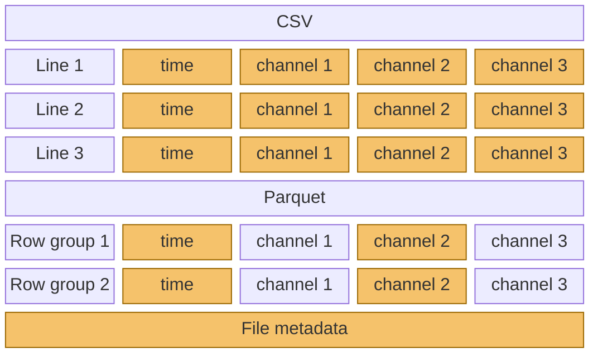
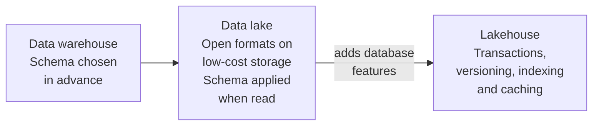

# Engineering data and warehousing

{.lead}
Data from industrial systems is time series from many channels, and it's useful later only with its context: units, calibration, the system's configuration, and the unit and run it came from. How you store the values and their context sets how much space they take, and whether you can find and trust them later.

## What test data is made of

A test produces two kinds of information: time series, and metadata that relates them to the physical world. Each {gloss}`channel` is a named set of (time, value) pairs, and separate channels can share timestamps or each have their own. The metadata describes the data in terms of physical things, such as the unit tested and the stand, and spans of time, such as runs and events.[^nominal-data-model]
Some context can't be read from the values at all. Take a {gloss}`dyno <dynamometer>`, where two load motors brake the motor under test, each through its own motor controller:

- A motor temperature of exactly 0.0 °C, or a large negative value, means no sensor is fitted, not a cold motor.
- Each motor controller calculates its input current from phase current and duty cycle, rather than measuring it, so the value is noisy, worst at low duty. The power supply's reading is the reference for power.
- The tachometer count is cumulative, and resets whenever a controller's configuration is written.
- The firmware clamps each command to its limit without reporting it: a controller capped at 20 A and commanded 60 A gives 20 A. Unless you record the command as well as the measured current, a saturated motor looks like one that's following its command.

Record context like this with the data, in channel descriptions and run properties, so it's there for someone who opens the data without the manual. Store a gap as a gap, too. The dyno's manual says that "missing data must never look like a measurement of zero", after a zero standing in for missing data caused a false abort during commissioning.

To estimate how much data a system produces, multiply its channels by each channel's {gloss}`sample rate` and the bytes per value, as in [Network performance](network-performance.md#bandwidth-and-throughput), then by the run's length. That guide's example, 8 channels at 1,000 samples per second and 16 bytes per value, makes 128,000 bytes a second, about 461 MB an hour.

## File formats

A file format decides whether values are stored as text or binary, whether they're laid out by row or by column, and how much metadata travels with them:

| Format | Values | Layout | Metadata in the file | Used for |
| --- | --- | --- | --- | --- |
| CSV | Text | One record per line | An optional header line of field names[^rfc4180] | Exchanging data between spreadsheet programs[^rfc4180] |
| NI TDMS | Binary | A file of groups, each holding channels | Properties on the file, each group and each channel[^ni-tdms] | Saving measurement data to disk[^ni-tdms] |
| ASAM MDF4 | Binary | Fixed-length records, in blocks | Conversion rules, channel sources, events[^asam-mdf] | Recording ECU signals and vehicle bus traffic[^asam-mdf] |
| HDF5 | Binary | Groups holding n-dimensional datasets | Attributes on any object[^hdf5-intro] | Storing heterogeneous, n-dimensional data[^hdf5] |
| Apache Parquet | Binary | Columns, within row groups | Column types, and key-value pairs[^parquet-thrift] | Storage and retrieval in analytics tools[^parquet-overview] |

### Text and binary

Every field in a CSV file is text, and the format has no types or units. The most a CSV file says about its values is an optional header line of field names.[^rfc4180] To read a value, a program parses its digits back into a number. A 64-bit floating-point number needs up to 17 significant digits to be read back exactly,[^goldberg] so a writer either rounds, and loses precision, or writes long strings.

ASAM ruled out text for MDF: "Due to the huge data rates already acquired today and expected to further increase in the future, a text-based format is not acceptable." Besides file size, it weighed how fast a file can be written during a measurement and read afterward.[^asam-mdf]

### Files that describe themselves

A self-describing file carries its metadata with its data, so everything travels as one file.[^hdf5]

- **NI TDMS** organizes a file into groups of channels, and stores any number of custom properties on the file, each group and each channel. NI notes that the more properties document the data, the more easily its DataFinder can locate it later.[^ni-tdms] A channel's timing can be two properties, `wf_start_time` and `wf_increment`, instead of a separate time channel.[^nominal-tdms]
- **HDF5** organizes a file into groups, like directories, and datasets, which hold arrays of values. Any object can carry attributes: small name-value pairs of user metadata. A dataset can be stored in chunks and compressed.[^hdf5-intro] HDF5 files have no fixed layout, so a reader has to know which arrays it needs.[^nominal-hdf5]
- **ASAM MDF4** stores a raw value for each signal, with a conversion rule that turns it into a physical value. Raw values can make records smaller, and let a logger store a whole bus message without unpacking it. MDF4 identifies a channel by its name together with its source and acquisition, because two devices can send signals with the same name. It also stores events, and its bus logging standard stores each CAN frame with its `ID`, `DLC` and `DataBytes`. Since version 4.1, blocks of data can be compressed with Deflate.[^asam-mdf]

### Rows and columns

A CSV file stores one record per line,[^rfc4180] so to read one channel, a program reads every line. Parquet splits a table into row groups, and stores each column's values for a row group together, as a column chunk. A reader reads the file's metadata first, to find the column chunks it needs.[^parquet-format]



A column store reads only the columns a query uses. Data stored by column also compresses better, because the values in one column resemble each other more than the values across a row.[^abadi] Parquet's encodings include dictionary encoding, run-length encoding for repeated values, and delta encoding for 32- and 64-bit integers.[^parquet-encodings] Parquet has no field for physical units, but the file and each column chunk can carry optional key-value metadata.[^parquet-thrift]

## Where the data lives

### Historians

A {gloss}`historian` records a plant's tags over time. Ignition's Tag Historian, for example, stores a value only when it changes, according to each tag's {gloss}`deadband`. With the Discrete style, it stores a new value only when it differs from the last stored value by at least the deadband. With the Analog style, the deadband is a compression threshold, in a modified sliding-window algorithm "similar to that employed in other Historian packages". In Ignition's example, an Analog deadband of about 5% of a signal's range stored 54% less data than a deadband of 0. With **Deadband Mode** set to **Off**, it stores every value whose timestamp changes.[^ign-history] Values a historian doesn't store are gone, so set the deadband below the smallest change you'll need to see.

### Time-series databases

Facebook built Gorilla, an in-memory {gloss}`time-series database`, for its monitoring measurements. Gorilla held each value as a 64-bit timestamp and a 64-bit floating-point number, 16 bytes, and compressed them to an average of 1.37 bytes. It encoded each timestamp as the change in the gap since the previous one, which took a single bit for about 96% of timestamps. It XORed each value with the one before, which took a single bit for the 51% of values that repeated. Gorilla's users cared more about aggregates than individual values, so it accepted "possibly dropping small amounts of data on the write path."[^gorilla] Check how a database behaves under load before you make it the only copy of your data.

### Warehouses, lakes and lakehouses

{gloss}`Data warehouses <data warehouse>` began as a way to collect data from a business's operational databases for decision support and business intelligence, written to a schema chosen in advance. {gloss}`Data lakes <data lake>` came next: low-cost storage with a file interface, holding raw data in open formats such as Parquet, with the schema applied when the data is read. Analysis tools, such as machine learning libraries, can read those files directly. A lakehouse keeps data in open formats on low-cost storage, and adds database features over it, such as transactions, versioning, indexing and caching.[^lakehouse]



### Downsampling for display

A chart shows only as much detail as it has pixels. In an example from high-tech manufacturing, one chart of the last 12 hours of a 100 Hz sensor needs over 4 million rows. The M4 method keeps four values for each pixel column of the chart: the minimum, the maximum, the first and the last. From at most four values per pixel column, it draws the same line chart as the raw data, where averaging each column "significantly changes the actual shape of the time series". M4 runs as part of the database query, so the raw data stays in the database, and only the reduced result goes to the chart.[^m4]

Downsample for display, and keep the raw data. The dyno's loaded-test script logs raw, unfiltered values, and filters only the live display, because "a filter can always be applied to logged data afterward, but information removed by filtering before logging cannot be recovered." The same holds for {gloss}`aliasing`. See [Measurement quality](measurement-quality.md#sample-rate-and-aliasing).

### Retention

Time-series databases can delete data automatically once it reaches a set age. InfluxDB's guide suggests keeping "the high precision raw data for only a limited time", storing downsampled summaries for longer, and setting how long each is kept with a retention policy.[^influx-downsample] Ignition's historian can partition and delete old data too.[^ign-historian]

Before a policy deletes raw data, check what your industry requires. US drug manufacturers, for example, must keep each batch's production and control records for at least 1 year after the batch's expiration date.[^cfr-211-180] The dyno's loaded-test script logs every run, including aborted ones, which its manual says "are usually the informative ones."

## Finding data later

The FAIR principles, written for scientific data, set out what makes data findable and reusable. Data and metadata have a globally unique, persistent identifier. Data is described with rich metadata, which includes the identifier of the data it describes, and both are indexed in a searchable resource. The metadata records detailed provenance, and meets the community standards of its domain.[^fair] For test data, that means:

- **Units.** Store each channel's {gloss}`engineering units` with it. The Mars Climate Orbiter was lost because ground software wrote thruster impulse to a file in pound-force seconds, where the file's interface specification required newton-seconds. The navigation team assumed metric units, underestimated the thrusters' effect by a factor of 4.45, and the spacecraft arrived about 170 km lower than planned.[^mco]
- **Names.** Name each channel by where it comes from and what it measures. The dyno's software names channels by controller and quantity, such as `dut.velocity` and `left_load.motor_temperature`.
- **Configuration and calibration.** Record which instrument filled each role, its {gloss}`calibration`, and the system's configuration, for each run. The dyno's manual says to keep each motor controller's exported configuration under version control.- **The unit and the run.** Link each run's data to the unit it tested, so you can trace from a unit to its data and back. See {gloss}`Genealogy`.

## In Nominal

A Nominal dataset stores time-series and log data, and grows as you upload or stream more into it.[^nominal-glossary] Each channel in it has a data type, and can have a unit and a description. A dataset carries properties, key-value pairs such as `"serial"="ABADCAFE"`, and labels, such as `aborted-test`.[^nominal-data-model] A {gloss}`run` names a span of time for one test, and references data rather than copying it.[^nominal-runs] You can search runs by label and property.[^nominal-search-runs]

Nominal's docs show how to upload CSV, Parquet, HDF5, NI TDMS, Avro, JSON Lines logs, MCAP, ArduPilot DataFlash, MAVLink and PX4 ULog files, and video. For another format, you can request support or write a file extractor.[^nominal-file-ingestion] A CSV or Parquet file needs one timestamp column, and every other column becomes a channel.[^nominal-csv-parquet] A TDMS channel becomes a channel named `<group>.<channel>`.[^nominal-tdms] To stream data instead, see [Network performance](network-performance.md#example-streaming-to-nominal).

Units are UCUM symbols, such as `Cel` for degrees Celsius, so workbooks can convert between them. Setting a unit changes the label, not the stored values. Register a channel before its first values arrive if they could give it the wrong type, such as a setpoint that reads 0 at start-up and becomes an integer channel. `add_channel` returns an existing channel unchanged, even if its unit or description differ.[^nominal-channels]

```python
from nominal.core import ChannelDataType, NominalClient

client = NominalClient.from_profile("default")
dataset = client.get_dataset("<dataset RID>")

# Register the channel with its unit, and the context its values can't carry
dataset.add_channel(
    "left_load.motor_temperature",
    ChannelDataType.DOUBLE,
    unit="Cel",
    description="Winding temperature. 0.0 or below means no sensor or a wiring fault.",
)
```

To chart a long recording, `channel_to_dataframe_decimated()` reads a fixed number of time buckets, each with the minimum, maximum, mean, count and variance of its values, so spikes stay visible. Zooming in requests new buckets for the visible range, until the chart shows raw values.[^nominal-decimate]

## Worked example: the size of one dyno run

Each of the dyno's three motor controllers broadcasts nine values on the {gloss}`CAN bus`, as scaled 16- and 32-bit integers in three frames. Speed, motor current and duty cycle come in an 8-byte frame at 50 Hz. The FET and motor temperatures, input current and PID position come in another 8-byte frame at 50 Hz. The tachometer count and input voltage come in a 6-byte frame at 5 Hz. Motor current, for example, is sent in tenths of an amp. For a run, take the manual's 12-minute soak test at 10 A:

```text
one controller:      3 × 50 + 4 × 50 + 2 × 5 = 360 values/s
three controllers:   3 × 360                 = 1,080 values/s
12-minute soak test: 1,080 × 720 s           = 777,600 values
```

The dyno's loaded-test script writes a CSV row 50 times a second. Suppose each row holds a timestamp and the latest of all 27 values, so the run is 36,000 rows. Suppose too that a value written to its resolution, such as `-12.3`, averages 5 characters, and that a value written with 17 significant digits, such as `-12.300000000000001`, takes 19. The run's size then depends on how each row stores its values:

| Each row stores | Bytes per row | 12-minute run |
| --- | ---: | ---: |
| A 64-bit timestamp, and each value as the integer it arrived as | 74 | 2.7 MB |
| CSV text: a timestamp such as `2026-01-01T12:00:00.000000Z`, and each value to its resolution | 190 | 6.8 MB |
| A 64-bit timestamp, and 27 64-bit numbers | 224 | 8.1 MB |
| CSV text: the same timestamp, and every value with 17 significant digits | 568 | 20.4 MB |

Written to their resolution, the dyno's values take fewer bytes as text than as 64-bit numbers. Text costs more for calculated values, such as the script's torque and efficiency, which can need all 17 digits to be read back exactly. The integers the controllers send are the smallest form. A format that stores raw values with conversion rules, as MDF4 does, keeps them, and the dyno's DBC file describes every status frame, so a CAN tool can decode them.

To plot the left load motor's temperature from the CSV file, a program reads all 36,000 rows. From a Parquet file, it reads only that column's chunks.[^parquet-format] A CSV file's only metadata is its header line,[^rfc4180] so it has nowhere to record that a temperature of 0.0 means no sensor is fitted.

## Further reading

- ASAM, [ASAM MDF](https://www.asam.net/standards/detail/mdf/wiki/), a technical overview of MDF4, its blocks, conversion rules and bus logging.
- NI, [NI TDMS File Format](https://www.ni.com/en/support/documentation/supplemental/06/the-ni-tdms-file-format.html), on TDMS and its properties.
- The HDF Group, [Introduction to HDF5](https://support.hdfgroup.org/documentation/hdf5/latest/_intro_h_d_f5.html), on groups, datasets and attributes.
- Apache Parquet, [documentation](https://parquet.apache.org/docs/), including the file format and its encodings.
- M. D. Wilkinson et al., [The FAIR Guiding Principles for scientific data management and stewardship](https://www.nature.com/articles/sdata201618), the principles in full.
- Nominal, [Direct file ingestion](https://dev.nominal.io/file-ingestion/), for uploading each format to a dataset.

## References

[^nominal-data-model]: Nominal, ["Data model core concepts"](https://dev.nominal.io/platform/data-model/). Retrieved 2026-11-24.
[^rfc4180]: Y. Shafranovich, ["Common Format and MIME Type for Comma-Separated Values (CSV) Files"](https://www.rfc-editor.org/rfc/rfc4180), RFC 4180, IETF, October 2005. Retrieved 2026-11-24.
[^ni-tdms]: NI, ["NI TDMS File Format"](https://www.ni.com/en/support/documentation/supplemental/06/the-ni-tdms-file-format.html), updated 2026-03-11. Retrieved 2026-11-24.
[^asam-mdf]: ASAM, ["ASAM MDF"](https://www.asam.net/standards/detail/mdf/wiki/), standard wiki, covering MDF up to version 4.1.0. Retrieved 2026-11-24.
[^hdf5-intro]: The HDF Group, ["Introduction to HDF5"](https://support.hdfgroup.org/documentation/hdf5/latest/_intro_h_d_f5.html), HDF5 documentation. Retrieved 2026-11-24.
[^hdf5]: The HDF Group, ["HDF5"](https://www.hdfgroup.org/solutions/hdf5/). Retrieved 2026-11-24.
[^parquet-overview]: Apache Parquet, ["Overview"](https://parquet.apache.org/docs/overview/), Parquet documentation. Retrieved 2026-11-24.
[^parquet-thrift]: Apache Parquet, `ColumnMetaData` and `FileMetaData` in [parquet.thrift](https://github.com/apache/parquet-format/blob/master/src/main/thrift/parquet.thrift), parquet-format. Retrieved 2026-11-24.
[^goldberg]: D. Goldberg, ["What Every Computer Scientist Should Know About Floating-Point Arithmetic"](https://docs.oracle.com/cd/E19957-01/806-3568/ncg_goldberg.html), *ACM Computing Surveys*, March 1991, reprinted in Oracle's *Numerical Computation Guide*, Theorem 15. Retrieved 2026-11-24.
[^nominal-tdms]: Nominal, ["TDMS"](https://dev.nominal.io/file-ingestion/tdms/). Retrieved 2026-11-24.
[^nominal-hdf5]: Nominal, ["HDF5"](https://dev.nominal.io/file-ingestion/hdf5/). Retrieved 2026-11-24.
[^parquet-format]: Apache Parquet, ["File Format"](https://parquet.apache.org/docs/file-format/), Parquet documentation. Retrieved 2026-11-24.
[^abadi]: D. J. Abadi, S. R. Madden and N. Hachem, ["Column-Stores vs. Row-Stores: How Different Are They Really?"](https://www.cs.umd.edu/~abadi/papers/abadi-sigmod08.pdf), SIGMOD 2008, sections 1 and 5.1. Retrieved 2026-11-24.
[^parquet-encodings]: Apache Parquet, ["Encodings"](https://parquet.apache.org/docs/file-format/data-pages/encodings/), Parquet documentation. Retrieved 2026-11-24.
[^ign-history]: Inductive Automation, ["Configuring Tag History"](https://docs.inductiveautomation.com/docs/8.1/ignition-modules/tag-historian/configuring-tag-history), Ignition 8.1 documentation, updated 2026-01-23. Retrieved 2026-11-24.
[^gorilla]: T. Pelkonen et al., ["Gorilla: A Fast, Scalable, In-Memory Time Series Database"](https://www.vldb.org/pvldb/vol8/p1816-teller.pdf), *Proceedings of the VLDB Endowment* 8(12), 2015, sections 1 and 4. Retrieved 2026-11-24.
[^lakehouse]: M. Armbrust, A. Ghodsi, R. Xin and M. Zaharia, ["Lakehouse: A New Generation of Open Platforms that Unify Data Warehousing and Advanced Analytics"](https://www.cidrdb.org/cidr2021/papers/cidr2021_paper17.pdf), CIDR 2021, sections 1 and 2. Retrieved 2026-11-24.
[^m4]: U. Jugel, Z. Jerzak, G. Hackenbroich and V. Markl, ["M4: A Visualization-Oriented Time Series Data Aggregation"](https://www.vldb.org/pvldb/vol7/p797-jugel.pdf), *Proceedings of the VLDB Endowment* 7(10), 2014, sections 1, 2 and 4. Retrieved 2026-11-24.
[^influx-downsample]: InfluxData, ["Downsample and retain data"](https://docs.influxdata.com/influxdb/v1/guides/downsample_and_retain/), InfluxDB 1 OSS documentation. Retrieved 2026-11-24.
[^ign-historian]: Inductive Automation, ["Tag Historian"](https://docs.inductiveautomation.com/docs/8.1/ignition-modules/tag-historian), Ignition 8.1 documentation. Retrieved 2026-11-24.
[^cfr-211-180]: US Code of Federal Regulations, [21 CFR 211.180, General requirements](https://www.ecfr.gov/current/title-21/chapter-I/subchapter-C/part-211/subpart-J/section-211.180), paragraph (a). Retrieved 2026-11-24.
[^fair]: M. D. Wilkinson et al., ["The FAIR Guiding Principles for scientific data management and stewardship"](https://www.nature.com/articles/sdata201618), *Scientific Data* 3, 160018, 2016. Retrieved 2026-11-24.
[^mco]: NASA, ["Mars Climate Orbiter Mishap Investigation Board Phase I Report"](https://llis.nasa.gov/llis_lib/pdf/1009464main1_0641-mr.pdf), 1999-11-10, executive summary and section 4. Retrieved 2026-11-24.
[^nominal-glossary]: Nominal, ["Glossary"](https://dev.nominal.io/platform/reference/glossary/), Dataset entry. Retrieved 2026-11-24.
[^nominal-runs]: Nominal, ["Runs"](https://dev.nominal.io/python/guides/runs/), Python client guide. Retrieved 2026-11-24.
[^nominal-search-runs]: Nominal, ["Finding runs by label or property"](https://dev.nominal.io/quickstart/quick/quick-search-runs/). Retrieved 2026-11-24.
[^nominal-file-ingestion]: Nominal, ["Direct File Ingestion"](https://dev.nominal.io/file-ingestion/). Retrieved 2026-11-24.
[^nominal-csv-parquet]: Nominal, ["CSV and Parquet"](https://dev.nominal.io/file-ingestion/csv-parquet/). Retrieved 2026-11-24.
[^nominal-channels]: Nominal, ["Channels and data types"](https://dev.nominal.io/python/guides/datasets/channels/), Python client guide. Retrieved 2026-11-24.
[^nominal-decimate]: Nominal, ["Decimate data"](https://dev.nominal.io/python/guides/datasets/decimating-data/), Python client guide. Retrieved 2026-11-24.
