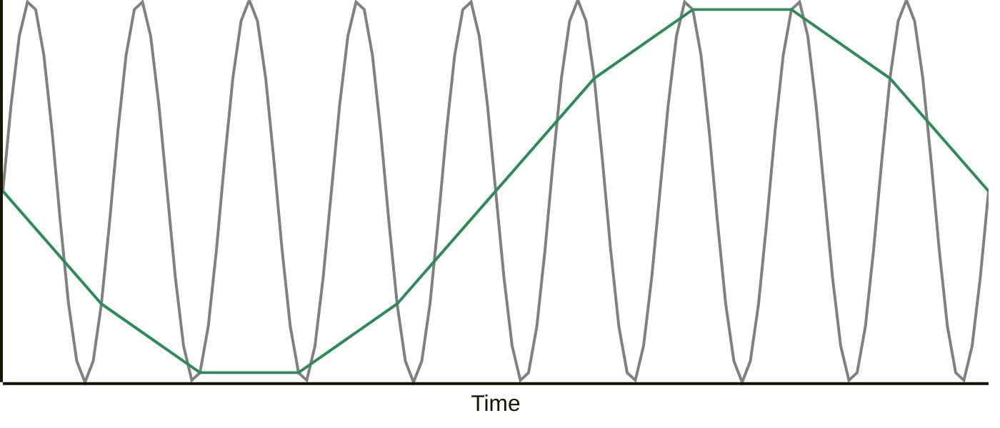
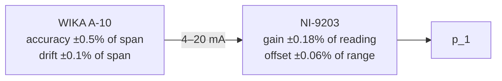

---
jupytext:
  text_representation:
    format_name: myst
kernelspec:
  display_name: Python 3 (ipykernel)
  language: python
  name: python3
---

# Measurement quality

{.lead}
Every measurement is off by some amount. To trust a result, you need to know by how much.

{download}`Download this page as a notebook <measurement-quality.md>` to run its code in JupyterLab. [Running the notebooks](notebooks/running.md) explains how to set it up.

## Accuracy, precision and resolution

These three words describe different things, and a measurement can be good at one and poor at another.

- {gloss}`Accuracy` is how close a reading is to the true value.
- {gloss}`Precision` is how close repeated readings of the same value are to each other.
- {gloss}`Resolution` is the smallest change a reading can show.

A pressure gauge that always reads 2 psig high is precise, but not accurate. A 16-bit module reading a pressure transducer can show steps of 0.002 psig, while the transducer itself is accurate only to ±0.5 psig. The worked example below shows where those numbers come from.

## Kinds of error

| Error | What it does | How to deal with it |
| --- | --- | --- |
| Offset, or zero error | Shifts every reading by the same amount | Calibrate and correct it, or check the reading at zero |
| Gain, or span error | Scales every reading by a small percentage, so it grows with the reading | Calibrate and correct it |
| Nonlinearity | Bends the response away from a straight line | Calibrate at several points, or accept it |
| Hysteresis | Makes the reading depend on whether the value is rising or falling | Approach each test point from the same direction |
| Non-repeatability | Gives slightly different readings for the same value | Average, or accept it |
| Noise | Adds random variation to each reading | Average, filter, or improve wiring and shielding |
| Drift | Moves the reading slowly over time | Recalibrate on a schedule |
| Temperature error | Shifts the reading when the temperature moves away from the sensor's reference temperature | Control the temperature, or allow for the datasheet's temperature error |

Offset, gain and nonlinearity are the same every time, so a calibration can measure them and a correction can remove them. Hysteresis is repeatable too, but it depends on direction. Noise and non-repeatability are random, so averaging reduces them. Drift is slow, so a correction from one calibration holds only until the reading drifts again.

Datasheets state errors in two ways. A percentage of span, the full output range, is a fixed amount across the range. A percentage of reading scales with the value. The NI-9203 current input module, for example, states its gain error as a percentage of reading and its offset error as a percentage of range.[^ni-9203]

## Bits and resolution

An {gloss}`analog-to-digital converter <analog-to-digital converter>` (ADC) divides its input range into steps. An N-bit ADC has 2{sup}`N` steps, so each step, one least significant bit (LSB), is the range divided by 2{sup}`N`.

The NI-9203 has a 16-bit ADC. In its unipolar mode it measures 0 to 20 mA, with 6.5% of overrange, for a range of 21.5 mA. That gives 330 nA per step.[^ni-9203] The same range at 12, 16 and 24 bits:

```{code-cell} ipython3
import matplotlib.pyplot as plt
import numpy as np
import pandas as pd

from learning.style import set_matplotlib_style

set_matplotlib_style()

range_ma = 21.5  # the NI-9203's unipolar range, with overrange
psig_per_ma = 100 / 16  # a 0–100 psig transducer, 4–20 mA

for bits in [12, 16, 24]:
    step_ma = range_ma / 2**bits  # one LSB
    print(
        f"{bits} bits: {step_ma * 1e6:,.2f} nA per step, "
        f"{16 / step_ma:,.0f} steps in 4–20 mA, "
        f"{step_ma * psig_per_ma:.7f} psig per step"
    )
```

A 4–20 mA sensor uses only 16 mA of that range, so at 16 bits a 0–100 psig transducer gets about 48,800 steps, or about 0.002 psig per step. The unused steps below 4 mA aren't wasted: a reading near 0 mA means a broken wire.

Quantizing one signal at each resolution shows the steps. The signal is the transducer's reading, swinging slowly by 0.1 psig around 85 psig:

```{code-cell} ipython3
t = np.linspace(0, 2, 2000)  # s
pressure = 85 + 0.05 * np.sin(2 * np.pi * 0.5 * t)  # psig
current = 4 + pressure / psig_per_ma  # mA

fig, ax = plt.subplots()
for bits in [12, 16, 24]:
    step_ma = range_ma / 2**bits
    quantized_ma = np.round(current / step_ma) * step_ma  # the nearest step
    reading = (quantized_ma - 4) * psig_per_ma  # psig
    error = np.abs(reading - pressure).max()
    print(f"{bits} bits: largest error {error:.7f} psig")
    ax.plot(t, reading, drawstyle="steps-post", label=f"{bits} bits")
ax.set_xlabel("Time (s)")
ax.set_ylabel("Pressure (psig)")
ax.legend();
```

At 12 bits, the reading jumps between a few levels 0.033 psig apart. At 16 bits, its steps are 0.002 psig, too small to see at this scale, and the 24-bit reading lies on top of it.

Converting to the nearest step adds an error of up to half a step. For an ideal N-bit converter, that sets a best possible signal-to-noise ratio of 6.02 × N + 1.76 dB, or 98 dB for 16 bits.[^ee-quantization] Real converters add their own noise. The NI-9203's input noise is 1 LSB RMS, and its nonlinearity is up to ±3 LSB.[^ni-9203]

More bits don't mean more accuracy. The NI-9203's calibrated offset error alone is 0.06% of its range, 12.9 µA, which is about 39 steps.[^ni-9203] Steps smaller than that offset are real changes in the signal, but they don't say what the true value is.

## Sample rate and aliasing

To capture a signal, sample faster than twice the highest frequency in it. Content above half the sample rate shows up in the data at false, lower frequencies. This is {gloss}`aliasing`, and it can't be undone afterwards, so an anti-aliasing filter goes before the ADC.[^ee-sampling]



The chart shows a 9 Hz sine, in gray, read 10 times a second. The samples, in green, trace a false 1 Hz sine. A frequency f above half the sample rate f{sub}`s` appears at |f − n × f{sub}`s`|, where n is the nearest whole number.[^ee-sampling] The spectra of the sine and of the samples show where the alias lands:

```{code-cell} ipython3
f_sine = 9  # Hz, a 1 V sine
fs = 10  # samples per second, so half the sample rate is 5 Hz
print(f"{f_sine} Hz appears at {abs(f_sine - round(f_sine / fs) * fs)} Hz")


def spectrum(rate, seconds=10):
    """Frequencies and amplitudes of the sine, read `rate` times a second."""
    t = np.arange(rate * seconds) / rate
    x = np.sin(2 * np.pi * f_sine * t)
    return np.fft.rfftfreq(t.size, 1 / rate), 2 * np.abs(np.fft.rfft(x)) / t.size


fig, ax = plt.subplots()
ax.plot(*spectrum(100), color="gray", label="Read 100 times a second")
ax.plot(*spectrum(fs), label=f"Read {fs} times a second")
ax.axvline(fs / 2, color="gray", linestyle="--", linewidth=1)  # half the sample rate
ax.set_xlim(0, 15)
ax.set_xlabel("Frequency (Hz)")
ax.set_ylabel("Amplitude (V)")
ax.legend();
```

Read 100 times a second, the sine's peak is at 9 Hz. Read 10 times a second, it lands at 1 Hz, mirrored about half the sample rate, the dashed line.

The NI-9203 samples at up to 200,000 samples per second,[^ni-9203] far faster than a pressure transducer can respond: the WIKA A-10's response time is under 4 ms.[^wika-a10] On a fluids panel, which runs compressed air through valves and pressure transducers, the pressures change over seconds, so a low sample rate is enough for them.

On a {gloss}`dyno <dynamometer>`, where two load motors brake the motor under test, the software reads each motor controller about 16 times a second. That's enough to follow changes slower than 8 Hz, such as speed steps and temperature, but not to measure vibration. [Frequency domain](frequency-domain.md#worked-example-what-an-e-axle-dynos-data-can-show) works out which of the dyno's frequencies that rules out, and what an accelerometer would need.

## Worked example: an error budget for a pressure reading

The fluids panel's supply pressure, `p_1`, is a 0–100 psig transducer with a 4–20 mA output, read by an NI current input module. This example works out how accurate a reading of 85 psig is, using a real transducer and module:

- The transducer is a WIKA A-10, 0–100 psig, 4–20 mA, with the 0.25% nonlinearity option. Its accuracy is ±0.5% of span, which includes nonlinearity, hysteresis, offset and gain error. Its long-term drift is ±0.1% of span.[^wika-a10]
- The module is an NI-9203 in unipolar mode, calibrated, anywhere from −40 °C to 70 °C. Its maximum gain error is ±0.18% of reading, and its maximum offset error is ±0.06% of its 21.5 mA range.[^ni-9203]
- The panel is indoors at 15–25 °C, the transducer's reference temperature, so the transducer's temperature error doesn't apply.[^wika-a10]



### 1. Find the signal

The transducer maps 0–100 psig to 4–20 mA, so 1 mA is 6.25 psig, and 85 psig is 17.6 mA:

```{code-cell} ipython3
reading_psig = 85
signal_ma = 4 + reading_psig / 100 * 16
print(f"{psig_per_ma} psig per mA, {signal_ma:.1f} mA at {reading_psig} psig")
```

### 2. Add up the module's error

NI's formula for a C Series module's absolute accuracy is the reading times the gain error, plus the range times the offset error, plus noise.[^ni-accuracy] Work it out for three of the NI-9203's specified conditions: calibrated maximum, calibrated typical and uncalibrated maximum.[^ni-9203]

```{code-cell} ipython3
specs = {  # condition: (gain error in % of reading, offset error in % of range)
    "Calibrated maximum, −40 °C to 70 °C": (0.18, 0.06),
    "Calibrated typical, 25 °C ± 5 °C": (0.04, 0.02),
    "Uncalibrated maximum, −40 °C to 70 °C": (0.66, 0.54),
}
# µA: 3 sigma of the 1 LSB RMS input noise, averaging 100 readings
noise = 3 * 0.33 / np.sqrt(100)
rows = {}
for condition, (gain_pct, offset_pct) in specs.items():
    gain = signal_ma * gain_pct / 100 * 1000  # µA
    offset = range_ma * offset_pct / 100 * 1000  # µA
    total = gain + offset + noise
    rows[condition] = [gain, offset, noise, total, total / 1000 * psig_per_ma]
columns = ["Gain (µA)", "Offset (µA)", "Noise (µA)", "Total (µA)", "Total (± psig)"]
module = pd.DataFrame.from_dict(rows, orient="index", columns=columns)
module.round({**dict.fromkeys(columns[:4], 1), "Total (± psig)": 2})
```

At the calibrated maximum, the total is 44.7 µA, which at 6.25 psig per mA is ±0.28 psig. At the module's typical accuracy, near 25 °C, the same sum is 11.4 µA, or ±0.07 psig.

### 3. Add up the transducer's error

```{code-cell} ipython3
accuracy_psig = 0.5 / 100 * 100  # ±0.5% of the 100 psig span
drift_psig = 0.1 / 100 * 100  # ±0.1% of span
print(f"accuracy ±{accuracy_psig:.2f} psig, drift ±{drift_psig:.2f} psig")
```

### 4. Combine them

When errors are independent, NI combines them as the square root of the sum of their squares (RSS).[^ni-accuracy] The worst case adds them directly:

```{code-cell} ipython3
errors = pd.Series(
    {
        "Transducer accuracy": accuracy_psig,
        "Transducer long-term drift": drift_psig,
        "NI-9203 accuracy, calibrated maximum": module.loc[
            "Calibrated maximum, −40 °C to 70 °C", "Total (± psig)"
        ],
    }
)
combined = pd.Series(
    {
        "Combined, RSS": np.sqrt((errors**2).sum()),
        "Combined, worst case": errors.sum(),
    }
)
budget = pd.concat([errors, combined]).rename_axis("Source")
budget.to_frame("Error (± psig)").round(2)
```

The reading is 85.0 psig, give or take about 0.6 psig.

- The transducer dominates. A better module wouldn't help much. A better transducer, or a calibration of the whole chain against a reference gauge, would.
- The resolution, 0.002 psig, is about 300 times finer than the accuracy. Don't report more digits than the accuracy supports.
- Without calibration, the module alone could be off by up to 232 µA, or ±1.45 psig, using the NI-9203's uncalibrated maximum errors of ±0.66% of reading and ±0.54% of range.[^ni-9203]

Outside its reference temperature, the transducer's temperature error can reach 1.0% of span typically and 2.5% at most, ±2.5 psig, over its 0–80 °C operating range.[^wika-a10] That would dominate every other error in the budget.

The transducer's signal noise, up to 0.3% of span,[^wika-a10] is random, so averaging reduces it. Averaging 100 readings divides random noise by √100, a factor of 10.[^ni-accuracy] Simulate a steady 85 psig, read 1,000 times a second for 10 minutes, and average each 100 readings. The simulation uses the transducer's signal noise, 0.3 psig, as the noise's standard deviation:

```{code-cell} ipython3
rng = np.random.default_rng(2026)
readings = reading_psig + rng.normal(0, 0.3, 600_000)  # psig
averages = readings.reshape(-1, 100).mean(axis=1)  # 10 averages a second
print(f"Standard deviation of single readings: {readings.std():.3f} psig")
print(f"Standard deviation of averages: {averages.std():.3f} psig")
print(f"Noise divided by {readings.std() / averages.std():.1f}")
```

The noise drops by about a factor of 10. In the first 5 seconds, the single readings spread across about ±1 psig, and the averages stay within about ±0.1 psig of 85 psig:

```{code-cell} ipython3
t = np.arange(5000) / 1000  # s, the first 5 seconds
fig, ax = plt.subplots(layout="constrained")
ax.plot(
    t,
    readings[:5000],
    color="gray",
    linewidth=0.5,
    rasterized=True,
    label="Single readings",
)
ax.plot(t[50::100], averages[:50], marker="o", label="Averages of 100 readings")
ax.set_xlabel("Time (s)")
ax.set_ylabel("Pressure (psig)")
ax.legend(loc="upper left", bbox_to_anchor=(1, 1));
```

## Uncertainty

The error budget above gives limits. Metrology states the same result as an {gloss}`uncertainty`, using the method in the *Guide to the expression of uncertainty in measurement* (GUM).[^gum]

The GUM combines standard uncertainties, which are like standard deviations. To turn a datasheet limit of ±a into a standard uncertainty, treat the true error as equally likely anywhere in that range, which gives a/√3. Combine the standard uncertainties by RSS, then multiply by a coverage factor, k. With k = 2, the result covers about 95% of cases.[^nist-tn1297] To estimate a standard uncertainty from repeated readings, see [Describing a set of results](statistical-analysis.md#describing-a-set-of-results).

For the example above:

```{code-cell} ipython3
standard = errors / np.sqrt(3)  # each limit of ±a as a standard uncertainty, a/√3
combined_u = np.sqrt((standard**2).sum())  # RSS
expanded_u = 2 * combined_u  # coverage factor k = 2
print(f"Combined standard uncertainty: {combined_u:.2f} psig")
print(f"Expanded uncertainty (k = 2): {expanded_u:.2f} psig")
```

So the reading is 85.0 psig ± 0.7 psig, at k = 2.

## Calibration

{gloss}`Calibration` compares an instrument with a known reference and records the difference, so its readings can be corrected. The NI-9203 ships with a NIST-traceable calibration, and NI recommends recalibrating it every year.[^ni-9203] Traceable means the result links to a reference, such as a national standard, through an unbroken chain of calibrations, each adding to the uncertainty.

A module calibration covers the module, not the transducer. To calibrate the whole chain, apply known pressures from a reference, record the readings, and fit a correction. That removes the repeatable errors of every part at once.

## Checks you can do in place

Each check finds one kind of error from [Kinds of error](#kinds-of-error):

- **Zero check.** Vent the fluids panel and read `p_1`. It should read 0 psig. Anything else is offset error.
- **Two-sensor check.** Where two sensors measure the same thing, compare them. A difference that grows with the value is gain error.
- **Repeatability check.** Run the same step twice and compare the readings.
- **Noise check.** Hold a steady condition, and look at the spread of the readings. On the dyno, hold a speed and compare the standard deviation of the speed channel with the speed itself.
- **Hysteresis check.** Step a value up, then back down through the same points, and compare.

## Further reading

- NI, [Calculating Absolute Accuracy or System Accuracy](https://www.ni.com/en/support/documentation/supplemental/18/calculating-absolute-accuracy-or-system-accuracy.html).
- JCGM, [Guide to the expression of uncertainty in measurement (GUM) and the International Vocabulary of Metrology (VIM)](https://www.bipm.org/en/committees/jc/jcgm/publications), free from the BIPM.
- NIST, [Technical Note 1297](https://www.nist.gov/pml/nist-technical-note-1297), a short guide to evaluating and expressing uncertainty.
- EE Notebook, [Sampling Theory](https://applied-ee.github.io/ee-notebook/docs/audio-signal/sampling-and-conversion/sampling-theory/) and [Quantization Effects](https://applied-ee.github.io/ee-notebook/docs/audio-signal/practical-signal-reality/quantization-effects/).

## References

[^ni-9203]: NI, ["NI-9203 Specifications"](https://www.ni.com/docs/en-US/bundle/ni-9203-specs/page/specs.html), 2022-06-21. Retrieved 2026-11-12.
[^wika-a10]: WIKA, ["Datasheet A-10: Pressure transmitter for general industrial applications"](https://www.transcat.com/media/pdf/Wika_A-10.pdf), 02/2008, US edition, hosted by Transcat. WIKA's current edition is data sheet PE 81.60. Retrieved 2026-11-12.
[^ee-quantization]: EE Notebook, ["Quantization Effects"](https://applied-ee.github.io/ee-notebook/docs/audio-signal/practical-signal-reality/quantization-effects/). Retrieved 2026-11-12.
[^ee-sampling]: EE Notebook, ["Sampling Theory"](https://applied-ee.github.io/ee-notebook/docs/audio-signal/sampling-and-conversion/sampling-theory/). Retrieved 2026-11-12.
[^ni-accuracy]: NI, ["Calculating Absolute Accuracy or System Accuracy"](https://www.ni.com/en/support/documentation/supplemental/18/calculating-absolute-accuracy-or-system-accuracy.html), updated 2026-01-27. Retrieved 2026-11-12.
[^gum]: JCGM, [JCGM 100:2008, Evaluation of measurement data: Guide to the expression of uncertainty in measurement](https://www.bipm.org/en/committees/jc/jcgm/publications), BIPM. Retrieved 2026-11-12.
[^nist-tn1297]: B. N. Taylor and C. E. Kuyatt, [NIST Technical Note 1297: Guidelines for Evaluating and Expressing the Uncertainty of NIST Measurement Results](https://www.nist.gov/pml/nist-technical-note-1297), 1994. Retrieved 2026-11-12.
