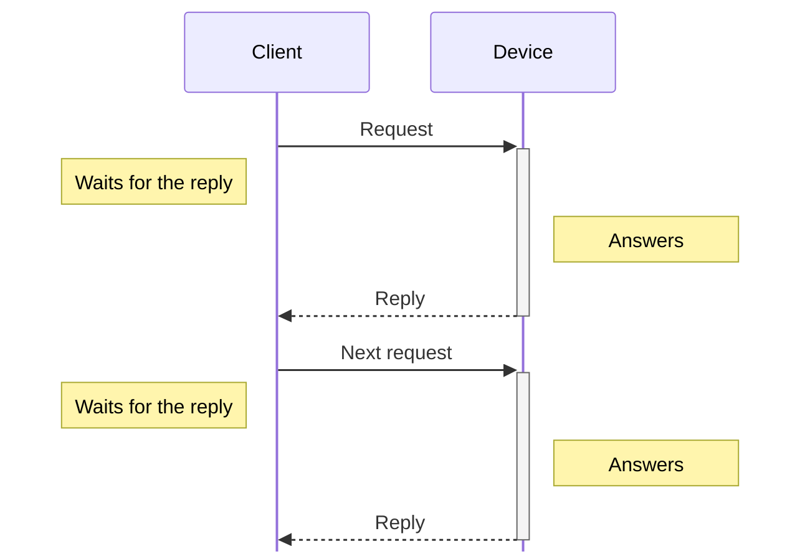
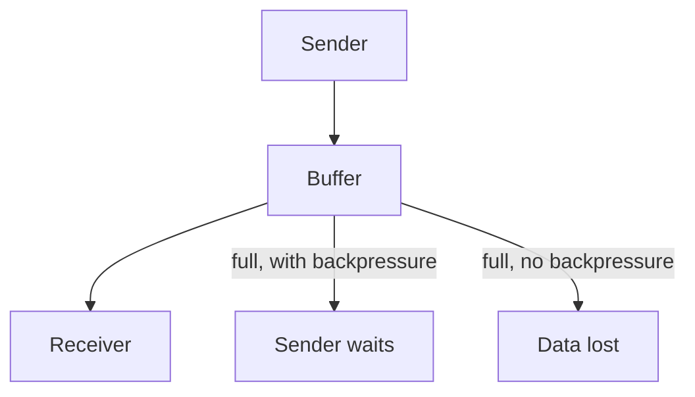

---
jupytext:
  text_representation:
    format_name: myst
kernelspec:
  display_name: Python 3 (ipykernel)
  language: python
  name: python3
---

# Network performance

{.lead}
A link carries a limited number of bits each second, and every message takes time to cross it. When data arrives faster than the receiver can handle it, either the sender waits or data is lost.

{download}`Download this page as a notebook <network-performance.md>` to run its code in JupyterLab. [Running the notebooks](notebooks/running.md) explains how to set it up.

## Bandwidth and throughput

A link's {gloss}`bandwidth` is the number of bits it can carry each second. Throughput is what a system achieves in practice, and it's often lower: a pair of nodes on a link with a bandwidth of 10 Mbit/s might get a throughput of only 2 Mbit/s.[^sa-performance]

Every stage between a sensor and the data store has its own limit: the link, the adapter, the computer's drivers, and the program that reads each message. The slowest stage sets the throughput, so a fast link doesn't help if the program reading it falls behind.

To check whether a link can carry a system's data, multiply the number of channels by each channel's sample rate and the size of each value. Stored as a 64-bit timestamp and a 64-bit number, a value takes 16 bytes. Eight channels at 1,000 samples per second each come to:

```{code-cell} ipython3
import matplotlib.pyplot as plt
import numpy as np

from learning.style import set_matplotlib_style

set_matplotlib_style()
```

```{code-cell} ipython3
value_bytes = 8 + 8  # a 64-bit timestamp and a 64-bit number
data_rate = 8 * 1_000 * value_bytes  # channels × samples/s × bytes, in bytes/s
print(f"{data_rate:,} bytes/s ≈ {data_rate * 8 / 1e6:.0f} Mbit/s")
```

That's before any protocol overhead. A module sampling at the NI-9203's maximum of 200,000 samples per second[^ni-9203] makes 25.6 Mbit/s, a quarter of a 100 Mbit/s Ethernet link. For the storage a run needs, and the file formats to keep it in, see [Engineering data and warehousing](engineering-data.md).

### Example: a dyno's CAN bus

On a {gloss}`dyno <dynamometer>`, two load motors brake the motor under test. Their three motor controllers share a {gloss}`CAN bus` that runs at 500 kbit/s. Each controller broadcasts its status without being asked: two frames at 50 Hz and one at 5 Hz, for about 105 frames a second from each controller, 315 in all.

Each status frame has a 29-bit identifier and up to 8 bytes of data. Counting stuff bits, the extra bits CAN inserts after five bits of the same value, and the gap between frames, such a frame takes at most 160 bits on the bus.[^wiki-can] At worst, the status frames use:

```{code-cell} ipython3
bit_rate = 500_000  # bit/s
frame_bits = 160  # worst case, with a 29-bit identifier and 8 bytes of data
# Three controllers, each sending two frames at 50 Hz and one at 5 Hz
frames_per_s = 3 * (2 * 50 + 5)

load = frames_per_s * frame_bits  # bit/s
print(f"{frames_per_s} frames/s × {frame_bits} bits = {load:,} bit/s")
print(f"{load / bit_rate:.0%} of {bit_rate / 1000:.0f} kbit/s")
```

During commissioning, each controller sent two more status frames, for 205 a second each:

```{code-cell} ipython3
load = 3 * 205 * frame_bits  # bit/s
print(f"{load:,} bit/s, {load / bit_rate:.0%} of {bit_rate / 1000:.0f} kbit/s")
```

That's still only about 20% of the bus, yet the computer received only about a third of the frames it expected. The bus had room, and the program reading it was the bottleneck. The [dyno's backpressure example](#example-when-the-dynos-computer-fell-behind) below has the cause and the fix.

## Latency

{gloss}`Latency` is the time a message takes to get from one end of a link to the other. It has three parts:[^sa-performance]

- **Propagation** is the time the signal takes to travel the distance. It grows with distance, and on short cables it's tiny next to the other two parts.
- **Transmit** time is the size of the message divided by the bandwidth.
- **Queuing** is the time a message waits for its turn, in a buffer or for a shared link to be free. On a CAN bus, a frame waits until the bus is free and it wins [arbitration](communications.md#can).

A 160-bit CAN frame at 500 kbit/s, the worst case on the dyno's bus, takes 320 µs to transmit:

```{code-cell} ipython3
transmit_time = frame_bits / bit_rate  # s
print(f"{transmit_time * 1e6:.0f} µs")
```

Queuing depends on how busy the link and the receiver are, so it changes from message to message.

### Round trips

The round-trip time is how long a message takes to go from one end of a link to the other and back.[^sa-performance] A request-and-reply protocol, such as Modbus or a SCPI query, pays it on every request, plus the time the device takes to answer. A client that waits for each reply before sending the next request can make at most one request per round trip, however much bandwidth the link has.



Registers next to each other can be read in one request: a Modbus Read Holding Registers request reads from 1 to 125 consecutive registers.[^modbus-spec] This simulation polls 20 registers over Modbus TCP, first one request at a time, then in one request. Each round trip, including the device's time to answer, is a simulated 5 ms or so:

```{code-cell} ipython3
rng = np.random.default_rng(1)


def round_trip() -> float:
    """Simulated time for one request and its reply, in s."""
    return rng.normal(5e-3, 0.5e-3)


registers = 20
one_at_a_time = sum(round_trip() for _ in range(registers))  # a request per register
# One request for all 20. The reply is 38 bytes longer: about 3 µs at 100 Mbit/s.
batched = round_trip()
for name, poll in [("One at a time", one_at_a_time), ("One request", batched)]:
    print(f"{name}: {poll * 1e3:.0f} ms per poll, {1 / poll:.0f} polls/s")
```

One request at a time pays the round trip 20 times, so it polls the registers about 20 times less often.

### Batching

The Nominal Python client doesn't send each value as you write it. It collects values into batches, and sends a batch when it reaches `batch_size` points or when it's `max_wait` old. The defaults are 250,000 points and 0.25 s.[^nominal-client] Unless a program writes 250,000 points in less than 0.25 s, each batch waits the full 0.25 s, so a value can wait up to that long before it's sent.

A smaller `max_wait` sends data sooner, in more and smaller requests:

```python
from datetime import datetime, timedelta, timezone

from nominal.core import NominalClient

client = NominalClient.from_profile("default")
dataset = client.get_dataset("<dataset RID>")

# Send each batch within 0.1 s, instead of the default 0.25 s
with dataset.get_write_stream(max_wait=timedelta(seconds=0.1)) as stream:
    stream.enqueue("dut.speed", datetime.now(timezone.utc), 1000.0)
```

### Jitter

The variation in latency from one message to the next is called {gloss}`jitter`.[^sa-performance] Where values are timestamped when they arrive, as on the dyno, jitter shows up as uneven gaps between samples. See [What the link means for your data](communications.md#what-the-link-means-for-your-data). Links built for guaranteed timing, such as EtherCAT, keep jitter small.

This simulation sends a message every 20 ms, like one of the dyno's 50 Hz status frames, and timestamps each message when it arrives. Each message's latency is a fixed 1 ms, plus a simulated queuing delay that changes from message to message:

```{code-cell} ipython3
rng = np.random.default_rng(2)
period = 20e-3  # s, 50 Hz
sent = np.arange(1_000) * period
latency = 1e-3 + rng.exponential(1e-3, sent.size)  # s: fixed, plus queuing
intervals = np.diff(sent + latency)  # s, between arrival timestamps

fig, ax = plt.subplots()
ax.hist(intervals * 1e3, bins=60)
ax.axvline(period * 1e3, color="0.5", linestyle="--", label="Time between sends")
ax.set_xlabel("Time between arrivals (ms)")
ax.set_ylabel("Messages")
ax.legend()
plt.show()
print(f"Standard deviation: {intervals.std() * 1e3:.1f} ms")
```

The messages leave exactly 20 ms apart, yet the gaps between their arrival timestamps spread out: about nine in ten are within 2 ms of 20 ms, and a few are more than 5 ms off. The fixed 1 ms delays every message equally, so the spread comes only from the queuing delay that varies.

## Backpressure

A receiver holds incoming messages in a buffer until it can handle them. The buffer absorbs short bursts, but if data keeps arriving faster than the receiver handles it, the buffer fills. Then either the receiver makes the sender wait, which is {gloss}`backpressure`, or data is lost.



This simulation sends 1,000 messages a second to a receiver that handles 800 a second, through a buffer that holds 100 messages. It runs once without backpressure, then once with it:

```{code-cell} ipython3
def simulate(backpressure: bool, seconds=2.0, step=0.005, capacity=100):
    """Count messages in the buffer, lost, and waiting at the sender, each step."""
    send, handle = round(1_000 * step), round(800 * step)  # messages per step
    buffered = lost = waiting = 0
    history = []
    for _ in range(round(seconds / step)):
        buffered -= min(buffered, handle)  # the receiver handles what it can
        ready = send + waiting  # new messages, and any the sender held back
        accepted = min(ready, capacity - buffered)
        if backpressure:
            waiting = ready - accepted  # the sender waits with the rest
        else:
            lost += ready - accepted  # the rest is lost
        buffered += accepted
        history.append((buffered, lost, waiting))
    return np.array(history)


no_backpressure = simulate(backpressure=False)
t = np.arange(1, len(no_backpressure) + 1) * 0.005  # s

fig, ax = plt.subplots()
ax.axhline(100, color="0.5", linestyle="--", label="Buffer size")
ax.plot(t, no_backpressure[:, 0], label="In the buffer")
ax.plot(t, no_backpressure[:, 1], label="Lost")
ax.set_xlabel("Time (s)")
ax.set_ylabel("Messages")
ax.legend()
plt.show()

backpressure = simulate(backpressure=True)
for name, run in [("Without", no_backpressure), ("With", backpressure)]:
    _, lost, waiting = run[-1]  # after 2 s
    print(f"{name} backpressure: {lost} lost, {waiting} waiting at the sender")
```

Without backpressure, the buffer fills in about half a second, and from then on 200 messages a second are lost, the difference between the two rates. With backpressure, none are lost, but by the end the same number are waiting at the sender, which falls further behind for as long as it has more to send than the receiver handles.

TCP has backpressure built in. Each receiver advertises how much free space its buffer has, and the sender sends no more than that. When the buffer is full, the advertised space is 0, and TCP blocks the sending program until space frees up.[^sa-tcp]

### Example: when the dyno's computer fell behind

The dyno's motor controllers send each status frame on schedule, whether or not the computer has read the last one.

During commissioning, the code that read the frames ran in the same loop that drew the screen and made control decisions. Whenever something stalled that loop, such as a console redraw or the Windows screenshot shortcut, the frames weren't read in time. The computer received only about a third of the frames the controllers sent.

The software kept the last value it had received from each controller, and treated it as current. After a stall, it judged its trips against stale values, and aborted a run for a fault that wasn't there.

Three changes fixed it:

- Reading the frames moved to its own thread, which does nothing but decode them, so a stall elsewhere in the program can't hold it up.
- The two unused status frames were turned off, which halved the data to read.
- Each {gloss}`trip` that checked a measurement first checked that the measurement was fresh, and telemetry more than 0.5 s old became a trip of its own.

Where a link has no backpressure, read it on its own thread, send only the data you use, and check how old a value is before you act on it.

### Example: streaming to Nominal

The Nominal Python client streams through nominal-streaming, a library designed to hold data in memory only for a limited time, to write to disk if the network fails, and to apply backpressure when the network's throughput is saturated.[^nominal-streaming]

When you write a value, it's queued, not uploaded. If uploads fall behind and 4 requests are waiting, the next write can block until there's room.[^nominal-streaming-api] A slow network then slows down the program that writes the data. Keep those writes out of any loop that has to keep time, such as one that sends a controller the commands that feed its {gloss}`watchdog`.

To keep data through a network outage, pass `file_fallback`, the path to an `.avro` file. The client writes batches that fail to upload to that file.[^nominal-client]

## Checks you can do

Each check finds one of the problems above:

- **Rate check.** Count the messages each device sends in a second, and compare with what it's set up to send. Each of the dyno's controllers should send about 105 frames a second. Fewer means the computer is missing frames.
- **Age check.** Compare each value's timestamp with the current time. A value that stops changing may be stale rather than steady.
- **Gap check.** Plot the time between one sample and the next. Spikes are delays, and a wide spread is jitter.
- **Load check.** Before you add a device or raise a rate, work out the bus load, as in the [dyno's CAN bus example](#example-a-dynos-can-bus).

## Further reading

- L. L. Peterson and B. S. Davie, [Computer Networks: A Systems Approach](https://book.systemsapproach.org/), a free textbook, with sections on performance and TCP flow control.
- Nominal, [nominal-streaming](https://pypi.org/project/nominal-streaming/), the library the Nominal Python client streams through.

## References

[^sa-performance]: L. L. Peterson and B. S. Davie, ["Performance"](https://book.systemsapproach.org/foundation/performance.html), section 1.5 of *Computer Networks: A Systems Approach*, version 6.2-dev. Retrieved 2026-11-16.
[^sa-tcp]: L. L. Peterson and B. S. Davie, ["Reliable Byte Stream (TCP)"](https://book.systemsapproach.org/e2e/tcp.html), section 5.2 of *Computer Networks: A Systems Approach*, version 6.2-dev. Retrieved 2026-11-16.
[^wiki-can]: Wikipedia, ["CAN bus"](https://en.wikipedia.org/wiki/CAN_bus), sections "Extended frame format" and "Bit stuffing". Retrieved 2026-11-16.
[^ni-9203]: NI, ["NI-9203 Specifications"](https://www.ni.com/docs/en-US/bundle/ni-9203-specs/page/specs.html), 2022-06-21. Retrieved 2026-11-12.
[^modbus-spec]: Modbus Organization, ["MODBUS Application Protocol Specification V1.1b3"](https://www.modbus.org/file/secure/modbusprotocolspecification.pdf), 2012. Retrieved 2026-11-12.
[^nominal-client]: Nominal, `Dataset.get_write_stream` in the [nominal](https://pypi.org/project/nominal/) Python client, version 1.181.0. Retrieved 2026-11-16.
[^nominal-streaming]: Nominal, [nominal-streaming](https://pypi.org/project/nominal-streaming/) README, version 0.11.1. Retrieved 2026-11-16.
[^nominal-streaming-api]: Nominal, `PyNominalStreamOpts` and `PyNominalDatasetStream.enqueue_batch` docstrings in [nominal-streaming](https://pypi.org/project/nominal-streaming/), version 0.11.0. Retrieved 2026-11-16.
