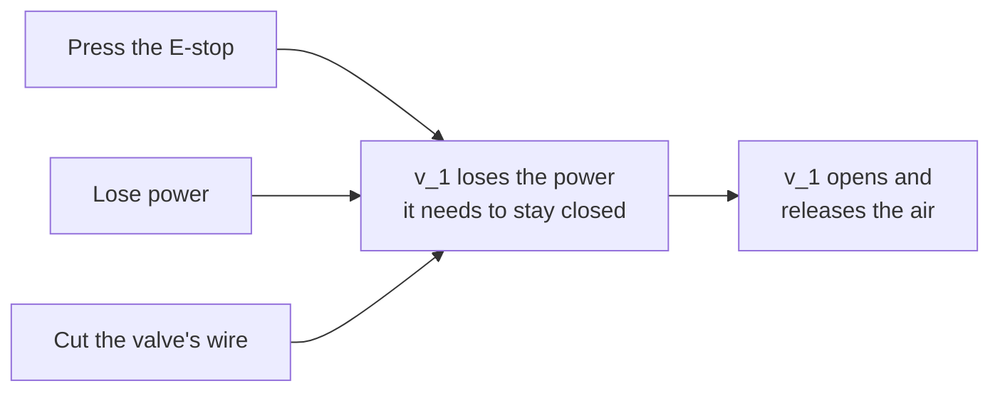
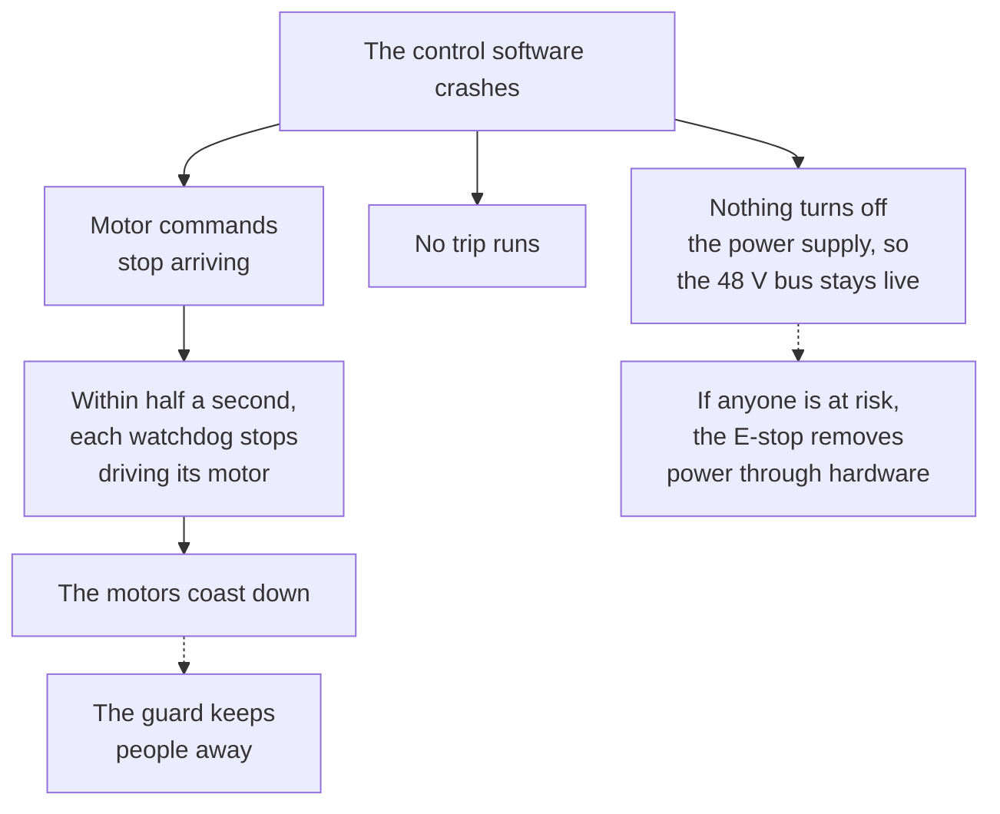

# Safety

{.lead}
Industrial equipment has the ability to hurt people and destroy property. Systems must be engineered to prevent or limit that risk.

## Safety and equipment protection

In safety standards, {gloss}`safety` is about people. ISO 12100, the basic standard for the safety of machinery, defines harm as "physical injury or damage to health".[^idec-12100] Some standards reach further. IEC 61511, for process plants, also counts harm that reaches people indirectly, through damage to property or the environment,[^is-61511] and IEC 60204-1, on the electrical equipment of machines, aims to promote "safety of persons and property".[^iec-60204-preview]

Protecting the equipment itself is a separate goal, {gloss}`equipment protection`. IEC 61511 lists asset protection as a "non-safety" application of its methods,[^iec-61511-preview] and IEC 61508 notes that it could be used for a system that protects equipment or product.[^iec-61508-preview] At particle accelerators, CERN defines machine protection as "the collection of measures that protect an accelerator from beam induced damage", while noting that "this definition is not universal".[^cern-mps]

Each sector has its own names for the systems that serve the two goals:

| Sector | Protecting people | Protecting equipment |
| --- | --- | --- |
| Process plants, under IEC 61511 | Safety instrumented system (SIS)[^iec-61511-preview] | Asset protection[^is-61511] |
| Accelerators | Personnel protection system (PPS) at SLAC,[^slac-rss] personnel safety systems at ESS[^ess-pss] | Machine protection system (MPS) at SLAC[^slac-rss] |
| Fusion, at ITER | Safety control systems[^iter-safety] | Interlock control systems[^iter-safety] |
| Laser fusion, at NIF | Safety Interlock System (SIS)[^nif-safety] | Machine Safety System (MSS)[^nif-safety] |

The same words can mean opposite things. "Safety of machinery", in the machinery standards, means protecting people from a machine,[^idec-12100] but NIF's Machine Safety System "handles only machine safety and does not implement any personnel safety functions".[^nif-safety] SIS stands for safety instrumented system in IEC 61511, but for Safety Interlock System at NIF. When you meet one of these terms, check what it protects.

## Safety functions and the control system

A {gloss}`safety function` is "a function of a machine whose failure can result in an immediate increase of the risk".[^sistema] The standards rate how reliably a safety function works, as described in [Safety controllers](#safety-controllers) below.

In a process plant, the system that runs the process is the basic process control system (BPCS). IEC 61511 defines it as a system that runs the process "but which does not perform any safety instrumented functions with a claimed SIL ≥1".[^icheme-lopa] The UK's Health and Safety Executive (HSE) explains why the two are kept apart: control systems are "primarily implemented for economic reasons",[^hse-control] and they're "designed for flexible and complex operation and to maximise production rather than to prevent accidents".[^hse-functional]

So the standards give an ordinary control system little or no credit as protection:

- IEC 61511 caps the risk reduction claimed for a BPCS that isn't built to IEC 61511 or IEC 61508 at less than a factor of 10.[^is-61511]
- HSE counts a control system's failure as part of how a hazard starts, "rather than a risk reduction measure". A control system that claims a failure rate below 10⁻⁵ per hour "provides safety functions, and is safety related".[^hse-control]
- In layer of protection analysis (LOPA), the failure of a control loop "is likely to be one of the main Initiating Causes".[^icheme-lopa]
- Under ISO 13849-1, a single-channel electronic control system without testing or redundancy reaches at most PL b, and a PLC can't count as a well-tried component.[^dguv-plc]

The safety functions also have to stay independent of the control system. IEC 61511 requires a BPCS that isn't qualified to the standard to be "separate and independent to the extent that the functional integrity of the safety instrumented system is not compromised".[^is-61511] API RP 14C, for offshore production platforms, says its two levels of protection "should be independent of and in addition to the control devices used in normal process operation".[^api-14c]

None of this rules out software. ISO 12100 allows PLCs in the safety-related parts of a control system, as long as their random hardware failures and systematic failures are unlikely enough.[^idec-12100] SLAC's personnel protection system can use relay logic or PLCs "that include fail-safe circuits", and a computer-based one that's part of credited control is redundant and independent, "each with its own independently written logic and control software".[^slac-rss] ESS's personnel safety systems use failsafe safety PLCs,[^ess-pss] and NIF's Safety Interlock System is PLC-based.[^nif-safety] The line runs between rated, independent safety functions and ordinary control, not between hardware and software.

An ordinary control system still has to be designed so that its faults don't create hazards. The EU's machinery regulation requires that "a fault in the hardware or the logic of the control system shall not lead to hazardous situations".[^eu-machinery] IEC 62061 notes that the control system that runs a machine "often contributes to safety by mitigating risks associated with hazards arising directly from control system failures".[^iec-62061-preview]

## Hazards

A {gloss}`hazard` is a source of possible harm. Risk combines how severe the harm would be with how likely it is, and reducing risk means reducing either one or both.[^idec-12100]

The hazards depend on the system. For example, compare a fluids panel, which runs compressed air through valves and a proof and leak vessel, with a {gloss}`dyno <dynamometer>`, where two load motors brake the motor under test:

| Hazard | Fluids panel | Dyno |
| --- | --- | --- |
| Stored pressure | Compressed air in the supply line, up to about 85 psig, and in the proof and leak vessel | None |
| Moving parts | The air-driven slide | The spinning motor under test and the load motors |
| Stored motion | None | The motors keep turning after their power is removed |
| Electrical energy | Control power and wiring | The 48 V DC bus, which the load motors also feed when they brake |

## The hierarchy of controls

A {gloss}`hazard control` is anything that reduces a hazard's risk. NIOSH ranks five kinds of hazard control from most to least effective, and OSHA recommends choosing them in that order:[^niosh-hoc][^osha-hpc]

1. **Elimination** removes the hazard, such as venting a pressure system before working on it, or testing control software against a simulation instead of the real equipment.
2. **Substitution** replaces the hazard with a smaller one. Run at the lowest pressure, speed or power that does the job. On a fluids panel, for example, the proof and leak branch fills its vessel to about 72 psig, below the 85 psig supply.
3. **Engineering controls** keep people away from the hazard: E-stops, fail-safe valves, guards and interlocks, such as the interlocks on a laser's housing panels that stop or reduce the beam when a panel is opened.[^osha-laser]
4. **Administrative controls** change how people work: procedures, training, a safety briefing, and lockout/tagout.
5. **Personal protective equipment (PPE)** is worn to reduce exposure, such as safety glasses. Use it with the other controls, not instead of them.

Where no single control protects people enough, combine them. A control mustn't add a hazard of its own, such as hearing protection that stops someone hearing an alarm.[^osha-hpc]

An engineering control can include programmable parts. A laser safety program based on ANSI Z136.1 lists interlocks, shutters and watchdog timers as engineering control measures.[^csulb-laser] An ordinary control system's trips are different: they get little or no credit as protection for people, as [Safety functions and the control system](#safety-functions-and-the-control-system) describes.

## Engineering controls

### Fail-safe design

A {gloss}`fail-safe` design puts a system in its safe state when something fails, such as a power loss or a broken wire. Make the running state the one that needs power. Then losing power, for any reason, puts the system back in its safe state.

The laser safety program defines a fail-safe interlock as one where "the failure of a single mechanical or electrical component of the interlock will cause the system to go into, or remain in, a safe mode."[^csulb-laser] IEC 61508, the base standard for functional safety, doesn't use fail-safe as a concept of its own, but notes that the principle may apply.[^iec-61508-4-preview]

A fluids panel's main vent valve, `v_1`, works this way. It's {gloss}`normally open <normally open>`: it needs power to stay closed and hold pressure. Press the E-stop, lose power, or cut the valve's wire, and it opens and releases the air.

### Emergency stop

An {gloss}`E-stop` stops a machine in an emergency. Pressing it removes power from the actuators, and the machine stays stopped until someone resets the E-stop by releasing the button.[^idec-13850]

An E-stop is a complementary protective measure: it backs up guards and other controls, and doesn't replace them.[^idec-13850] It's for emergencies, when someone has already seen a problem.

IEC 60204-1 defines three ways a machine can stop, and an E-stop has to use category 0 or 1:[^idec-60204]

| Stop category | What happens |
| --- | --- |
| 0 | Power is removed from the actuators at once. |
| 1 | The machine makes a controlled stop with power available, then power is removed. |
| 2 | The machine makes a controlled stop, and power stays available afterwards. |

For safety-related control functions, IEC 60204-1 points to the requirements of ISO 13849-1 and IEC 62061,[^idec-60204] which [Safety controllers](#safety-controllers) describes.

An abort button in an HMI or a control program isn't an E-stop. It's a software stop, so it works only while that software runs.

### Guards and interlocks

A guard is a physical barrier between people and a hazard. OSHA requires guarding against hazards such as rotating parts, and requires that the guard isn't a hazard itself.[^osha-1910-212]

An {gloss}`interlock` checks a condition before it allows an action, or stops the machine when the condition changes. An interlocked guard has a switch that stops the machine when the guard opens. An interlock that protects people is a safety function, and is built and rated as one, as [Safety controllers](#safety-controllers) describes. On a laser, interlocks must be provided on housing panels meant to be opened, and the OSHA Technical Manual says that for embedded Class IIIB and Class IV lasers, they're to be fail-safe.[^osha-laser]

Interlocks also protect equipment. SLAC's machine protection system uses many of the same techniques and instruments as the systems that protect its personnel, "but there is less redundancy and less rigid administrative control".[^slac-rss]

### Safety controllers

A safety controller is hardware built and certified to carry out safety functions, such as removing power when an E-stop is pressed or a guard opens. A safety relay does one fixed function. A safety PLC is programmable.

ISO 13849-1 rates how reliably the safety-related parts of a control system perform a safety function, as a performance level (PL) from PL a, the lowest, to PL e, the highest. Each level is a band of probability of a dangerous failure per hour. A risk assessment sets the required level, PLr, that a machine's safety function has to reach. IEC 62061 rates the same thing as a safety integrity level (SIL).[^sick-pl] In process plants, IEC 61511 also rates each safety instrumented function by SIL.[^icheme-lopa]

Ordinary control software, such as a Python program or a standard PLC program, has no such rating.

## Administrative controls

Administrative controls depend on people following them, so they back up engineering controls. They can include:

- A safety briefing, where everyone is shown each E-stop.
- A rule that anyone may press an E-stop without asking.
- An E-stop test before each session.

### Lockout/tagout

Lockout/tagout (LOTO) protects people working on a machine from it starting unexpectedly, or releasing stored energy, while they work.[^osha-1910-147] OSHA's regulation sets the order of the steps:[^osha-1910-147]

1. Prepare for shutdown.
2. Shut the machine down.
3. Isolate it from every energy source.
4. Put a lock or tag on each energy isolating device.
5. Relieve, disconnect or restrain any stored energy.
6. Verify the isolation before starting work.

For a pressure system, step 5 means venting it until its pressure reads 0. For a rotating machine, it means waiting until it has stopped turning.

Pressing an E-stop isn't lockout. Anyone can release it.

## Protecting equipment

Control systems also protect the equipment they run. A dyno, for example, protects its hardware in four ways, three in the control software and one in the motor controllers:

- **Command limits.** Each command is clamped to its channel's range before it's sent. Ask the DUT for 50 A and it gets its 35 A maximum.
- **Trips.** Every measured channel has an allowed range, such as up to 100 °C for each motor's temperature. If a measurement leaves its range while the dyno runs, the software commands every motor to zero and turns off the power supply. It won't run again until every measurement is back in range.
- **A software interlock.** The software sends motor commands only while the dyno is running or stopping.
- **A watchdog in the hardware.** The software resends every motor command about 16 times a second. A motor controller that hears nothing for half a second stops driving its motor, so crashed software can't leave a motor running.

Where you can, put equipment limits in hardware too. CERN's advice for machine protection is to apply limits "at the lowest level (hardware)", "as high level software limitations may be accidentally bypassed".[^cern-mps]

## Which control covers which failure

| Failure | What protects against it | Protects |
| --- | --- | --- |
| A command asks for more than a channel allows | A command limit in the control software | Equipment |
| A measurement leaves its allowed range | A trip in the control software | Equipment |
| The control software crashes or loses its connection | A watchdog in the hardware, such as in a motor controller | Equipment |
| Power is lost | Fail-safe design, such as a normally open vent valve | People |
| A person is in danger, or a machine does something unexpected | An E-stop | People |
| A person could reach a moving or pressurized part | Guards and interlocks | People |
| Someone works on the machine | Lockout/tagout | People |

## Worked example: the control software crashes mid-sweep

A dyno is partway through a speed sweep, with the DUT at 1,000 RPM and both load motors braking, when the control software crashes.

Motor commands stop arriving, and within half a second each motor controller's watchdog stops driving its motor. The motors coast down. No trip runs, because the software that runs trips has stopped. Nothing turns off the power supply, which holds its setpoint on its own, so the 48 V bus stays live. The guard keeps people away from the coasting motors, and if anyone is at risk, the E-stop removes power through hardware, whether or not the software runs.

Before running again, find out why the software crashed, and check the dyno.

## Further reading

- OSHA, [Machine Guarding eTool](https://www.osha.gov/etools/machine-guarding), on recognizing and controlling amputation hazards.
- OSHA, [29 CFR 1910.147, The control of hazardous energy (lockout/tagout)](https://www.osha.gov/laws-regs/regulations/standardnumber/1910/1910.147), the full regulation.
- NIOSH, [Hierarchy of Controls](https://www.cdc.gov/niosh/hierarchy-of-controls/about/index.html).
- NASA, [NASA-STD-8719.17, Ground-Based Pressure Vessels and Pressurized Systems](https://standards.nasa.gov/standard/NASA/NASA-STD-871917), for pressure systems.
- IDEC, [summaries of the machinery safety standards](https://www.idec.com/en-eu/solutions/safety/law/iso-iec/iso12100), including ISO 12100, ISO 13850 and IEC 60204-1.
- HSE, [Functional safety](https://www.hse.gov.uk/eci/functional.htm), on safety instrumented systems and the process control system in process plants.
- J. Wenninger, [State-of-the-art and future challenges for machine protection systems](https://proceedings.jacow.org/IPAC2014/papers/frxca01.pdf), on protecting accelerators from damage.

## References

[^idec-12100]: IDEC, ["Basic Safety Standard: ISO 12100"](https://www.idec.com/en-eu/solutions/safety/law/iso-iec/iso12100). Retrieved 2026-11-12.
[^niosh-hoc]: NIOSH, ["About Hierarchy of Controls"](https://www.cdc.gov/niosh/hierarchy-of-controls/about/index.html). Retrieved 2026-11-12.
[^osha-hpc]: OSHA, ["Hazard Prevention and Control"](https://www.osha.gov/safety-management/hazard-prevention), Recommended Practices for Safety and Health Programs. Retrieved 2026-11-12.
[^idec-13850]: IDEC, ["ISO 13850"](https://www.idec.com/en-eu/solutions/safety/law/iso-iec/iso13850), on the safety requirements for emergency stop devices. Retrieved 2026-11-12.
[^idec-60204]: IDEC, ["IEC 60204-1"](https://www.idec.com/en-ca/solutions/safety/law/iso-iec/iec60204), on stop categories and the emergency stop function. Retrieved 2026-11-12.
[^osha-1910-212]: OSHA, [29 CFR 1910.212, General requirements for all machines](https://www.osha.gov/laws-regs/regulations/standardnumber/1910/1910.212). Retrieved 2026-11-12.
[^sick-pl]: SICK, ["What are performance levels?"](https://www.sick.com/us/en/blog/what-are-performance-levels/w/blog-safety-standard-performance-levels), 2022. Retrieved 2026-11-12.
[^osha-1910-147]: OSHA, [29 CFR 1910.147, The control of hazardous energy (lockout/tagout)](https://www.osha.gov/laws-regs/regulations/standardnumber/1910/1910.147). Retrieved 2026-11-12.
[^is-61511]: Bureau of Indian Standards, ["IS/IEC 61511-1:2003, Functional safety: Safety instrumented systems for the process industry sector, Part 1"](https://law.resource.org/pub/in/bis/S05/is.iec.61511.1.2003.pdf), an adoption of IEC 61511-1:2003. Retrieved 2026-11-24.
[^iec-61511-preview]: IEC, ["IEC 61511-1:2016, Functional safety: Safety instrumented systems for the process industry sector, Part 1: Framework, definitions, system, hardware and application programming requirements"](https://assets.vde-verlag.de/iec-normen/preview-pdf/info_iec61511-1%7Bed2.0%7Db.pdf), preview. Retrieved 2026-11-24.
[^iec-61508-preview]: IEC, ["IEC 61508-1:2010, Functional safety of electrical/electronic/programmable electronic safety-related systems, Part 1: General requirements"](https://assets.vde-verlag.de/iec-normen/preview-pdf/info_iec61508-1%7Bed2.0%7Db.pdf), preview. Retrieved 2026-11-24.
[^iec-61508-4-preview]: IEC, ["IEC 61508-4:2010, Functional safety of electrical/electronic/programmable electronic safety-related systems, Part 4: Definitions and abbreviations"](https://assets.vde-verlag.de/iec-normen/preview-pdf/info_iec61508-4%7Bed2.0%7Db.pdf), preview. Retrieved 2026-11-24.
[^iec-60204-preview]: IEC, ["IEC 60204-1:2016, Safety of machinery: Electrical equipment of machines, Part 1: General requirements"](https://assets.vde-verlag.de/iec-normen/preview-pdf/info_iec60204-1%7Bed6.0%7Db.pdf), preview. Retrieved 2026-11-24.
[^iec-62061-preview]: IEC, ["IEC 62061:2021, Safety of machinery: Functional safety of safety-related control systems"](https://assets.vde-verlag.de/iec-normen/preview-pdf/info_iec62061%7Bed2.0%7Db.pdf), preview. Retrieved 2026-11-24.
[^cern-mps]: J. Wenninger, CERN, ["State-of-the-art and future challenges for machine protection systems"](https://proceedings.jacow.org/IPAC2014/papers/frxca01.pdf), IPAC2014. Retrieved 2026-11-24.
[^slac-rss]: SLAC, ["Radiation Safety Systems Technical Basis Document"](https://www-esh.slac.stanford.edu/eshmanual/references/rss.pdf), SLAC-I-720-0A05Z-002, 2023. Retrieved 2026-11-24.
[^ess-pss]: S. L. Birch, A. Nordt and D. Paulic, ["Personnel safety systems for the European Spallation Source"](https://proceedings.jacow.org/IPAC2015/papers/mopty046.pdf), IPAC2015. Retrieved 2026-11-24.
[^iter-safety]: L. Scibile et al., ITER Organization, ["An overview of the ITER interlock and safety systems"](https://epaper.kek.jp/icalepcs2009/papers/wec005.pdf), ICALEPCS2009. Retrieved 2026-11-24.
[^nif-safety]: R. Reed et al., LLNL, ["Personnel and machine protection systems in the National Ignition Facility (NIF)"](https://proceedings.jacow.org/ICALEPCS2013/papers/tucoca08.pdf), ICALEPCS2013. Retrieved 2026-11-24.
[^sistema]: R. Apfeld, M. Hauke and S. Otto, IFA, ["The SISTEMA Cookbook 6: Definition of safety functions: what is important?"](https://presse.dguv.de/medien/ifa/en/pra/softwa/sistema/kochbuch/sistema_cookbook6_en.pdf). Retrieved 2026-11-24.
[^icheme-lopa]: A. G. Foord, W. G. Gulland, C. R. Howard, T. Kellacher and W. H. Smith, ["Applying the latest standard for functional safety: IEC 61511"](https://www.icheme.org/media/9906/xviii-paper-23.pdf), IChemE Symposium Series No. 150, 2004. Retrieved 2026-11-24.
[^hse-control]: HSE, ["Control systems"](https://www.hse.gov.uk/Comah/sragtech/techmeascontsyst.htm). Retrieved 2026-11-24.
[^hse-functional]: HSE, ["Functional safety"](https://www.hse.gov.uk/eci/functional.htm). Retrieved 2026-11-24.
[^dguv-plc]: DGUV, ["Can PL c be achieved with a standard PLC?"](https://publikationen.dguv.de/widgets/pdf/download/article/4600), DGUV Test Information 061, 2022. Retrieved 2026-11-24.
[^api-14c]: API, ["RP 14C, Recommended Practice for Analysis, Design, Installation, and Testing of Basic Surface Safety Systems for Offshore Production Platforms"](https://law.resource.org/pub/us/cfr/ibr/002/api.14c.2001.pdf), 7th edition, 2001. Retrieved 2026-11-24.
[^eu-machinery]: European Union, ["Regulation (EU) 2023/1230 on machinery"](https://eur-lex.europa.eu/eli/reg/2023/1230/oj/eng), Annex III, section 1.2.1. Retrieved 2026-11-24.
[^osha-laser]: OSHA, ["Laser Hazards"](https://www.osha.gov/otm/section-3-health-hazards/chapter-6), OSHA Technical Manual, Section III, Chapter 6. Retrieved 2026-11-24.
[^csulb-laser]: California State University, Long Beach, ["Laser Safety Program"](https://www.csulb.edu/college-of-engineering/laser-safety-program). Retrieved 2026-11-24.
