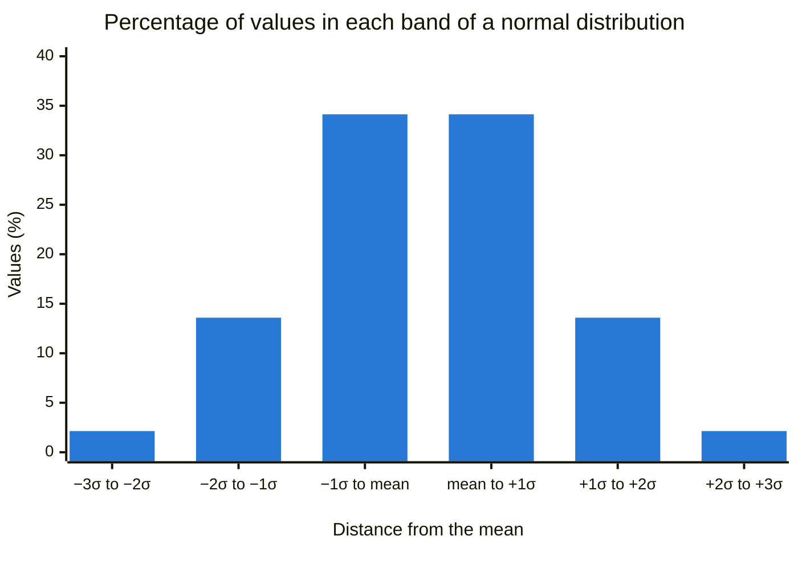

---
jupytext:
  text_representation:
    format_name: myst
kernelspec:
  display_name: Python 3 (ipykernel)
  language: python
  name: python3
---

# Statistical analysis and DOE

{.lead}
Run the same test twice and the results differ a little. Statistics tells you whether a difference between results is bigger than that run-to-run variation, and {gloss}`design of experiments` (DOE) plans the test points so that the answer comes out clearly.

{download}`Download this page as a notebook <statistical-analysis.md>` to run its code in JupyterLab. [Running the notebooks](notebooks/running.md) explains how to set it up.

```{code-cell} ipython3
import itertools

import matplotlib.pyplot as plt
import numpy as np
import pandas as pd
from scipy import stats

from learning.style import set_matplotlib_style

set_matplotlib_style()  # plots that suit the page in its light and dark themes
```

## Describing a set of results

Describe N repeated results by where they're centered and how far they spread. The mean is the sum of the values divided by N.[^nist-location] The {gloss}`standard deviation` measures the spread:[^nist-scale]

```text
mean:                ȳ = (y₁ + y₂ + … + y_N) / N
standard deviation:  s = √( Σ (yᵢ − ȳ)² / (N − 1) )
```

These describe the sample, the results you have. They estimate the mean, μ, and standard deviation, σ, of the process that produced them, which are in general unknown. Dividing by N − 1 rather than N makes s² an unbiased estimate of σ².[^nist-variables-charts]

The {gloss}`confidence intervals <confidence interval>` and t-tests below assume that the results come from one normal distribution, the symmetric bell curve, and are uncorrelated over time. They tolerate small departures from normality. Check with a histogram or a normal probability plot.[^nist-assumptions] The outlier tests and capability indices assume normal data too.[^nist-outliers][^nist-capability] In a normal distribution, 68.27% of values lie within 1σ of the mean, 95.45% within 2σ, and 99.73% within 3σ.[^nist-normal] In data with extreme values in the tails, the median, the middle value, estimates the center better than the mean does.[^nist-location]



The mean of N runs varies less than one run does. Its standard deviation, called the standard error of the mean, is s/√N.[^psu-503-l1] In the terms of the GUM, that's a Type A evaluation of {gloss}`uncertainty`,[^nist-tn1297-3] which you combine with the instrument's own errors as in [Measurement quality](measurement-quality.md#uncertainty).

### Outliers

An outlier is an observation that appears to deviate markedly from the others. If you can show it's wrong, for example because the test wasn't run correctly, delete or correct it. If you can't, don't delete it: it may be random variation, or a sign of something real. Use a method that outliers affect less instead.[^nist-outliers] The median is one: extreme values don't distort it, because it's based on ranks.[^nist-location]

On a {gloss}`dyno <dynamometer>`, where two load motors brake the motor under test, a test point recorded while a load motor was above 85 °C has a known cause. Its controller was reducing its current, so the data isn't at the commanded load. Exclude it, and record why.

To find candidates, plot the data first. For one outlier in roughly normal data, NIST recommends Grubbs' test. A z-score, the distance from the mean in standard deviations, can mislead in small samples, because it can't exceed (N − 1)/√N.[^nist-outliers] With 10 values, that's 2.85, so a rule that flags values beyond 3 standard deviations never fires.

To see the limit at work, simulate ten runs of one test point: nine near 61.6 W, and a tenth at 70.0 W.

```{code-cell} ipython3
rng = np.random.default_rng(2)
# Each run's mean input power, W: nine simulated runs, and a tenth far above them.
runs = np.append(rng.normal(61.6, 0.67, size=9), 70.0).round(1)
n, mean, s = len(runs), runs.mean(), runs.std(ddof=1)  # ddof=1 divides by N − 1
z = (runs - mean) / s
print(f"runs (W): {runs}")
print(f"largest z-score {z.max():.2f}, bound (N − 1)/√N {(n - 1) / np.sqrt(n):.2f}")
```

In a plot, the 70.0 W run stands out from the others. It also raises s so much that it stays inside 3 standard deviations of the mean:

```{code-cell} ipython3
fig, ax = plt.subplots()
ax.plot(np.arange(1, n + 1), runs, "o", label="run")
ax.axhline(mean, color="C1", label="mean")
ax.axhline(mean + 3 * s, color="C1", linestyle="--", label="mean ± 3s")
ax.axhline(mean - 3 * s, color="C1", linestyle="--")
ax.set(xlabel="Run", ylabel="Mean input power (W)")
ax.legend(loc="lower left", bbox_to_anchor=(0, 1), ncols=3);  # above the plot
```

The 70.0 W run pulls the mean up by 0.84 W, while the median moves by 0.05 W:

```{code-cell} ipython3
nine = runs[:-1]  # without the tenth run
print(f"ten runs:  mean {mean:.2f} W, median {np.median(runs):.2f} W")
print(f"nine runs: mean {nine.mean():.2f} W, median {np.median(nine):.2f} W")
```

## Is a difference real?

### Confidence intervals

A confidence interval gives a range for the population mean instead of a single number:[^nist-ci]

```text
ȳ ± t × s / √N
```

Here t is the 100(1 − α/2) percentile of the t distribution with N − 1 degrees of freedom, and α = 0.05 gives a 95% interval. The interval narrows as N grows and widens as s grows. A 95% interval doesn't mean a 95% chance that the true mean is inside it. It means that over many samples, about 95% of the intervals computed this way contain the true mean.[^nist-ci]

Suppose you hold one dyno test point in five separate runs, and the DUT's mean input power in each run is 61.2, 62.0, 60.8, 61.5 and 62.5 W:

```{code-cell} ipython3
a = np.array([61.2, 62.0, 60.8, 61.5, 62.5])  # each run's mean input power, W
n = len(a)
mean, s = a.mean(), a.std(ddof=1)
t = stats.t.ppf(1 - 0.05 / 2, df=n - 1)  # α = 0.05, for a 95% interval
print(f"mean {mean:.1f} W, s {s:.2f} W, t {t:.3f}")
print(f"95% interval: {mean:.1f} ± {t * s / np.sqrt(n):.1f} W")
```

The mean is 61.6 W and s is 0.67 W. With t = 2.776 for 4 degrees of freedom, the 95% interval is 61.6 ± 0.8 W.

Each of those values is one run's mean. The roughly 160 readings in a 10 s hold, at about 16 a second, are repeated measurements of one test point, not independent replicates, so average them into one value per run.[^psu-503-l5] Measurements made close together in time are often correlated.[^nist-assumptions]

### Comparing two configurations

To decide whether two configurations differ, test the hypothesis that their population means are equal with a two-sample t-test:[^nist-t-test]

```text
T = (ȳ₁ − ȳ₂) / √( s₁²/N₁ + s₂²/N₂ )
```

Reject the hypothesis if |T| is larger than t at 1 − α/2 with ν degrees of freedom. The Welch–Satterthwaite formula for ν holds up when the two samples have unequal sizes or unequal variances. If each value in one sample pairs with one in the other, such as the same unit tested in both configurations, test the differences between the pairs instead.[^nist-t-test]

Suppose a second configuration gives 60.1, 59.6, 60.9, 60.3 and 59.8 W at the same test point. SciPy's `ttest_ind` runs Welch's t-test when you pass `equal_var=False`, and its result's `confidence_interval` gives the interval for the difference:[^scipy-ttest]

```{code-cell} ipython3
b = np.array([60.1, 59.6, 60.9, 60.3, 59.8])  # the second configuration, W
result = stats.ttest_ind(a, b, equal_var=False)  # Welch's t-test
nu = result.df  # from the Welch–Satterthwaite formula
critical = stats.t.ppf(1 - 0.05 / 2, df=nu)
ci = result.confidence_interval(confidence_level=0.95)
diff = a.mean() - b.mean()
print(f"second configuration: mean {b.mean():.2f} W, s {b.std(ddof=1):.2f} W")
print(f"difference {diff:.2f} W, T {result.statistic:.2f}, ν {nu:.1f}")
print(f"critical value {critical:.2f}, 95% interval {ci.low:.2f} to {ci.high:.2f} W")
```

The second configuration's mean is 60.14 W, with s of 0.50 W. The difference is 1.46 W, T = 3.91 and ν = 7.4. The critical value at α = 0.05 is 2.34, so the difference is significant at the 0.05 level. The 95% confidence interval for the difference, 0.59 to 2.33 W, also says how big it might be.

### Statistical and practical significance

A p-value, or statistical significance, doesn't measure the size of an effect or the importance of a result. With enough samples or precise enough measurements, any effect, however tiny, gives a small p-value.[^asa-pvalues] Decide before the test how big a difference has to be to matter, from the requirement or the design margin, and judge the confidence interval against it.

On the dyno, compare configurations on the same stand. The dyno's manual puts absolute torque at ±5%, but repeat measurements at the same brake current agreed within 1.5%, and comparisons depend on that relative accuracy.

### How many runs you need

The number of runs depends on α, the risk of declaring a difference that isn't there, and β, the risk of missing a difference of size δ. It also depends on σ, for which you use the best estimate available, such as one from an earlier test. With σ known, the minimum is:[^nist-sample-size]

```text
N = (z₁₋α/₂ + z₁₋β)² × (σ / δ)²
```

NIST's table for a two-sided test of one mean, at α = 0.05:[^nist-sample-size]

| β | Runs for δ = 0.5σ | Runs for δ = 1.0σ | Runs for δ = 1.5σ |
| --- | ---: | ---: | ---: |
| 0.05 | 53 | 13 | 6 |
| 0.10 | 43 | 11 | 5 |
| 0.20 | 33 | 8 | 4 |

The formula, rounded up to whole runs, gives the same numbers in most cells:

```{code-cell} ipython3
def runs_needed(delta_over_sigma, alpha=0.05, beta=0.10):
    """Minimum runs for a two-sided test of one mean, with σ known."""
    z = stats.norm.ppf(1 - alpha / 2) + stats.norm.ppf(1 - beta)
    return int(np.ceil(z**2 / delta_over_sigma**2))


betas, deltas = [0.05, 0.10, 0.20], [0.5, 1.0, 1.5]  # δ as a multiple of σ
table = {f"δ = {d}σ": [runs_needed(d, beta=beta) for beta in betas] for d in deltas}
pd.DataFrame(table, index=pd.Index(betas, name="β"))
```

At δ = 0.5σ, it gives 52 runs for β = 0.05 and 32 for β = 0.20, one fewer than NIST's table. N grows with (σ/δ)², so halving the difference you need to detect roughly quadruples the runs.

## Variation over time and across units

### Control charts

Statistical process control compares what a process does now with what it did before.[^nist-spc] A {gloss}`control chart` plots one measured characteristic against sample number or time. A center line marks the in-control mean, with an upper and a lower control limit either side.[^nist-control-charts] Shewhart's limits sit k standard deviations from the center line, and k = 3 is the accepted standard in industry.[^nist-variables-charts] For a normal process, a point falls outside ±3σ by chance 0.27% of the time, so a point outside the limits warrants a search for its cause.[^nist-control-charts]

A {gloss}`production test <production testing>` gives one value per unit, so use an individuals chart. It estimates σ from the average moving range, MR̄, the mean absolute difference between consecutive values:[^nist-individuals]

```text
UCL = x̄ + 3 × MR̄ / 1.128
LCL = x̄ − 3 × MR̄ / 1.128
```

Points inside the limits must also form a random pattern.[^nist-control-charts] The Western Electric (WECO) rules flag patterns about as rare as a point beyond 3σ: two of the last three points beyond 2σ on one side, four of the last five beyond 1σ on one side, or eight in a row on one side of the center line. A trend rule adds six points in a row rising or falling. The extra rules cost false alarms. An in-control process gives one false alarm every 371 points on average with the 3σ rule alone, and about one every 92 with the WECO rules added.[^nist-variables-charts]

Compute the first limits from past data, investigate the points outside them, and recompute. NIST calls that Phase I, and monitoring against the resulting limits Phase II.[^nist-spc] After that, change the limits only for a compelling reason, such as 30 more points with no process change, or a major change to the process.[^nist-variables-charts]

Suppose a production test measures the output voltage of each 5 V power supply it tests. Simulate 80 units, with the process mean 0.015 V higher from unit 61 on. The first 50 units set the limits, in Phase I, and units 51 to 80 are monitored against them, in Phase II:

```{code-cell} ipython3
rng = np.random.default_rng(11)
volts = rng.normal(5.008, 0.012, size=80)  # each unit's simulated output voltage, V
volts[60:] += 0.015  # the process mean rises from unit 61 on
phase1 = volts[:50]  # Phase I: the first 50 units set the limits

center = phase1.mean()
mr_bar = np.abs(np.diff(phase1)).mean()  # the average moving range, MR̄
ucl, lcl = center + 3 * mr_bar / 1.128, center - 3 * mr_bar / 1.128
print(f"center line {center:.3f} V, UCL {ucl:.3f} V, LCL {lcl:.3f} V")
```

Check every unit against two of the rules: a point beyond the limits, and eight in a row on one side of the center line.

```{code-cell} ipython3
unit = np.arange(1, len(volts) + 1)
beyond = unit[(volts > ucl) | (volts < lcl)]
side = np.sign(volts - center)  # +1 above the center line, −1 below
# A window of eight units that are all on one side sums to ±8. Flag the eighth unit.
run_of_8 = unit[7:][np.abs(np.convolve(side, np.ones(8), "valid")) == 8]
print(f"beyond the limits: units {beyond}")
print(f"eighth in a row on one side: units {run_of_8}")
```

```{code-cell} ipython3
fig, ax = plt.subplots()
ax.plot(unit, volts, ".-", label="unit")
ax.plot(beyond, volts[beyond - 1], "o", fillstyle="none", label="beyond the limits")
ax.axhline(center, color="C1", label="center line")
ax.axhline(ucl, color="C1", linestyle="--", label="control limits")
ax.axhline(lcl, color="C1", linestyle="--")
ax.axvline(50.5, color="grey", linestyle=":")  # the end of Phase I
ax.set(xlabel="Unit", ylabel="Output voltage (V)")
ax.legend(loc="lower left", bbox_to_anchor=(0, 1), ncols=4);  # above the plot
```

In Phase I, left of the dotted line, no point is beyond the limits, and no eight in a row are on one side of the center line. After the mean rises at unit 61, the eight-in-a-row rule flags unit 67, eight units before unit 75 falls beyond the UCL.

Control limits aren't test limits. Control limits show whether the process is consistent, and specification limits show whether the product will work.[^nist-variables-charts] In control only means predictable: the process can still be off target or too variable.[^nist-in-control]

### Process capability

{gloss}`Process capability` compares the spread of an in-control process with its specification limits, which for a production test are its test {gloss}`limits <limit>`:[^nist-capability]

```text
Cp  = (USL − LSL) / 6σ
Cpk = min[ (USL − μ) / 3σ, (μ − LSL) / 3σ ]
```

Cp compares widths only. Cpk also accounts for a mean that's off center, and is never larger than Cp. With only an upper limit, use Cpu = (USL − μ) / 3σ. The indices assume normal data, and need about 50 independent values. For a centered process, a Cp of 1.00 means 0.27% rejects, and a Cp of 1.33 means 64 parts per million.[^nist-capability]

Suppose the power supplies in the control chart above have test limits of 4.95 and 5.05 V. Estimate μ and σ from the 50 units of Phase I, which the chart showed in control, with their mean and their standard deviation, s:[^nist-capability]

```{code-cell} ipython3
lsl, usl = 4.95, 5.05  # test limits, V
mu, sigma = phase1.mean(), phase1.std(ddof=1)
cp = (usl - lsl) / (6 * sigma)
cpk = min(usl - mu, mu - lsl) / (3 * sigma)
print(f"mean {mu:.4f} V, s {sigma:.4f} V, Cp {cp:.2f}, Cpk {cpk:.2f}")
```

Cpk is smaller than Cp, because the mean is above 5.00 V, the center of the test limits, and so closer to the USL.

### Measurement system analysis

Every unit's result includes the measurement's own variation. Check the gauges before you rely on them.[^nist-doe-steps] A {gloss}`gauge R&R` study measures the same items repeatedly: over a short time for repeatability, the gauge's short-term {gloss}`precision`, and over days for reproducibility.[^nist-grr] On a production line, testing a {gloss}`golden unit` several times a day, over several days, gives you that data. For accuracy and uncertainty, see [Measurement quality](measurement-quality.md).

## Design of experiments

[Test design](test-design.md#design-of-experiments) introduces DOE, and describes the dyno's sequence as a full factorial of 15 test points.

### Factors, levels and responses

In an experiment, you change one or more inputs, called factors, to see the effect on one or more outputs, called responses.[^nist-doe-what] Each factor takes a few settings, called levels. Each combination of levels is a test point, which DOE texts call a treatment combination or a run.[^nist-doe-glossary]

Choose levels boldly, but not foolishly, and check that every combination is feasible. Record every relevant response, and measure the quantities a ratio combines, not only the ratio:[^nist-doe-variables] on the dyno, log absorbed power and input power, not only efficiency. Factors you can't control, such as ambient temperature, can still affect the response, so measure them and use them in the analysis.[^nist-doe-what][^nist-doe-glossary]

### Why one factor at a time misses interactions

An {gloss}`interaction` occurs when the effect of one factor depends on the level of another.[^nist-doe-glossary] Varying one factor at a time, with the others held fixed, is a very inefficient way to learn.[^psu-503-l1] Two one-factor experiments give neither the precision of a factorial design nor the ability to test for interactions.[^psu-503-l5]

To see an interaction, plot the response against one factor, with a line for each level of the other. Parallel lines mean no interaction, and a plot of main effects alone can hide one.[^psu-503-l6]

### Full factorial designs

A full factorial runs every combination of every factor's levels. With k factors at two levels each, that's 2^k test points: 8 for 3 factors, 32 for 5 and 128 for 7. For 5 or more factors, NIST recommends a fractional factorial instead.[^nist-full-factorial]

Two-level designs code each factor's low and high levels as −1 and +1.[^nist-doe-variables] A factor's main effect is the average response at its high level minus the average at its low level.[^nist-half-fraction] Once the data is in, test each effect to see whether it's significantly different from 0.[^nist-doe-what]

### Fractional factorials and aliasing

A fractional factorial runs a chosen fraction, such as a half or a quarter, of a full factorial's test points.[^nist-fractional] The price is aliasing. In DOE, two effects are aliased, or confounded, when one estimate includes both.[^nist-doe-glossary] This is a different sense from aliasing in sampling, which [Measurement quality](measurement-quality.md#sample-rate-and-aliasing) covers.

To make a half fraction of a three-factor design, run all four combinations of X1 and X2, and set X3 to X1 × X2 in each. That's 4 test points instead of 8, but X3's column is now the X1 × X2 interaction's column, so the estimate of X3's main effect is X3's effect plus the interaction. The design works only if that interaction is small, which NIST calls the sparsity of effects assumption.[^nist-confounding]

A design's resolution says how badly it aliases effects:[^nist-doe-glossary][^nist-resolution]

| Resolution | Main effects are aliased with | Use |
| --- | --- | --- |
| III | Two-factor interactions | Economical screening |
| IV | Three-factor interactions, while some two-factor interactions are aliased with each other | May be adequate |
| V | Four-factor interactions | Excellent for most purposes |

A full factorial has no aliasing.[^nist-doe-glossary]

### Randomization, replication and blocking

Randomization, replication and blocking are the basic principles of DOE.[^psu-503-l1]

- **Randomization** runs the test points in an order where one test point's conditions neither depend on the previous one's nor predict the next one's. It's necessary for the conclusions to be correct and defensible.[^nist-doe-glossary]
- **Replication** runs the same test point more than once. It estimates the random error separately from lack of fit, the error from terms the model leaves out.[^nist-doe-glossary]
- **Blocking** groups test points so that a nuisance factor, such as the operator or the time of day, is held constant within each group, and its effect stays out of the comparison between levels.[^nist-rbd] It restricts randomization.[^nist-doe-glossary]

NIST's rule is "Block what you can, randomize what you cannot."[^nist-rbd] Watch for drifts during the test, and keep all the raw data, not only the averages.[^nist-doe-steps]

### Response surface designs

A two-level design assumes each effect is a straight line. Adding center points can detect curvature but can't fit it, and fitting it needs at least three levels of each factor. Response surface designs fit a quadratic model, which adds a squared term for each factor to the main effects and interactions.[^nist-rsm] A central composite design starts from a factorial or fractional factorial with center points, and adds two star points per factor to estimate curvature.[^nist-ccd] These designs work best with fewer than 5 factors.[^nist-doe-glossary]

## Statistics in Nominal

Record each replicate as its own {gloss}`run`, so that you can compare replicates run by run. A comparison workbook computes a statistic, such as each run's maximum, or a channel's mean and standard deviation, across many runs or assets. Its **Filter by ranges** setting picks the part of each run to compare, for example where a channel is above a threshold.[^nominal-post-test]

For a t-test in code, pull each run's data into a pandas DataFrame with `datasource_to_dataframe`,[^nominal-post-test] and take one mean per run. Pass the two configurations' means to SciPy's `ttest_ind` with `equal_var=False` for Welch's t-test. Its result's `confidence_interval` gives the interval for the difference.[^scipy-ttest]

## Worked example: planning the dyno's speed and load test

The dyno's sequence holds 15 test points: DUT speeds from 500 to 1,500 RPM in 250 RPM steps, at each of three loads, 0.25, 0.75 and 1.25 Nm on each load motor. It dwells 10 s at each. Before the {gloss}`sweep`, a warm-up runs until the DUT reaches 35 °C. After it, a cool-down runs until every motor is at or below 35 °C. Each gives up after 180 s.

### Run order

The sequence always runs the points in the same order: all five speeds at 0.25 Nm, then at 0.75 Nm, then at 1.25 Nm. The load motors' windings heat through the sweep, so the highest load always runs when they're hottest. Any effect of winding temperature on a response then shows up as an effect of load.

On this stand, temperature does affect the responses. The dyno calculates torque from current, using a flux linkage measured cold. As the magnets warm, the flux linkage falls, so hot readings of torque, absorbed power and efficiency come out slightly high. Above 85 °C, the controllers reduce their current without reporting it, and the result looks like a real efficiency change.

To break the link, randomize the order within each replicate, so that no test point's conditions depend on the one before.[^nist-doe-glossary] The sequence can't shuffle its points, so a randomized design needs a script that commands them in your order:

```{code-cell} ipython3
speeds = [500, 750, 1000, 1250, 1500]  # DUT speed, RPM
loads = [0.25, 0.75, 1.25]  # torque on each load motor, Nm
# The full factorial: every combination of speed and load, 15 test points
points = list(itertools.product(speeds, loads))

rng = np.random.default_rng(503)  # a fixed seed, so you can reproduce the order
plan = []
for block in range(1, 4):
    order = rng.permutation(len(points))  # a new order for each block
    for position, i in enumerate(order, start=1):
        plan.append((block, position, *points[i]))
# Save this with the run's data.
plan = pd.DataFrame(plan, columns=["block", "position", "speed", "load"])

# Each column is one block's order.
labels = plan["speed"].astype(str) + " RPM, " + plan["load"].astype(str) + " Nm"
plan.assign(point=labels).pivot(index="position", columns="block", values="point")
```

### Blocks and replicates

Make each replicate a block that starts from the same thermal state. The warm-up already brings the DUT up to 35 °C. For the load motors, start each block only once every motor is at or below 35 °C, and record each block's starting temperatures, because the cool-down moves on after 180 s whether or not it got there. Record each load motor's winding temperature at every test point too, so you can use it in the analysis.[^nist-doe-glossary]

Three blocks give 45 test points, with 450 s of dwell plus the ramps between them. The replicates estimate the run-to-run variation at each test point,[^nist-doe-glossary] which tells you whether a difference between test points is bigger than chance.

### Thermal limits

At 1.25 Nm, each load motor carries about 1.25 / 0.19 ≈ 6.6 A, using its torque constant of 0.19 Nm/A. The manual scales heating with the square of the current from a measured 2.8 °C a minute at 10 A, which gives about 1.2 °C a minute. At 10 A, the manual recommends at most 15 minutes of continuous running, and a block's 15 points take a few minutes at under half that heating rate, so a block fits.

Add a load near the load motors' 20 A limit, 3.8 Nm, and the manual's estimate rises to 11 °C a minute, with at most 4 minutes continuous and a 20 minute cool-down. A random order could then put several high-load points in a row. Check the worst case against 85 °C before you run it, and if it's too hot, use smaller blocks that each start cool.

### Main effects and interactions

Suppose the four corner test points of one block give these mean DUT input powers, in watts:

| Load | 500 RPM | 1,500 RPM |
| --- | ---: | ---: |
| 0.25 Nm | 40.0 | 110.0 |
| 1.25 Nm | 55.0 | 155.0 |

```{code-cell} ipython3
# Mean DUT input power at the corner test points, W.
# A row for each load, Nm, and a column for each speed, RPM.
power = pd.DataFrame({500: [40.0, 55.0], 1500: [110.0, 155.0]}, index=[0.25, 1.25])

at_speed = power.mean(axis="index")  # average over load, at each speed
at_load = power.mean(axis="columns")  # average over speed, at each load
speed_effect = at_speed[1500] - at_speed[500]
load_effect = at_load[1.25] - at_load[0.25]
load_at_speed = power.loc[1.25] - power.loc[0.25]  # the effect of load at each speed
print(f"speed: {at_speed[1500]:.1f} − {at_speed[500]:.1f} = {speed_effect:.1f} W")
print(f"load: {at_load[1.25]:.1f} − {at_load[0.25]:.1f} = {load_effect:.1f} W")
for speed, effect in load_at_speed.items():
    print(f"load at {speed:,} RPM: {effect:.1f} W")
```

Speed's main effect is the average at 1,500 RPM minus the average at 500 RPM: 132.5 − 47.5 = 85.0 W. Load's is 105.0 − 75.0 = 30.0 W. But load adds 15.0 W at 500 RPM and 45.0 W at 1,500 RPM. The effect of load depends on speed, which is an interaction, and a plot against load shows two lines that aren't parallel. Some of it is expected: the dyno's manual calculates absorbed power as torque times angular speed, so the same load absorbs three times the power at three times the speed.

```{code-cell} ipython3
fig, (ax_speed, ax_load, ax_both) = plt.subplots(1, 3, sharey=True, figsize=(9, 3.2))
ax_speed.plot(at_speed.index, at_speed, "o-")
ax_speed.set(title="Speed", xlabel="Speed (RPM)", ylabel="Mean input power (W)")
ax_speed.set_ylim(0, 170)  # from 0, so the slopes compare fairly
ax_load.plot(at_load.index, at_load, "o-")
ax_load.set(title="Load", xlabel="Load on each load motor (Nm)")
for speed in power.columns:
    ax_both.plot(power.index, power[speed], "o-", label=f"{speed:,} RPM")
ax_both.set(title="Load at each speed", xlabel="Load on each load motor (Nm)")
ax_both.legend();
```

The two main effects, left and middle, show only that input power rises with speed and with load. The right plot shows the interaction: the line for 1,500 RPM rises three times as much as the line for 500 RPM.

Five speeds and three loads also let you fit curvature in both factors, which two levels can't.[^nist-rsm] Use the replicates to test whether each effect and interaction is significantly different from 0.[^nist-doe-what]

## Further reading

- NIST/SEMATECH, [e-Handbook of Statistical Methods](https://www.itl.nist.gov/div898/handbook/): chapter 5 for DOE, chapter 6 for control charts and capability, and chapter 7 for comparing processes.
- Penn State, [STAT 503: Design of Experiments](https://online.stat.psu.edu/stat503/), open course notes from factorial designs to response surfaces.
- R. L. Wasserstein and N. A. Lazar, [The ASA Statement on p-Values: Context, Process, and Purpose](https://doi.org/10.1080/00031305.2016.1154108), on what a p-value does and doesn't tell you.

## References

[^nist-location]: NIST/SEMATECH, ["Measures of Location"](https://www.itl.nist.gov/div898/handbook/eda/section3/eda351.htm), e-Handbook of Statistical Methods, section 1.3.5.1. Retrieved 2026-11-24.
[^nist-scale]: NIST/SEMATECH, ["Measures of Scale"](https://www.itl.nist.gov/div898/handbook/eda/section3/eda356.htm), e-Handbook of Statistical Methods, section 1.3.5.6. Retrieved 2026-11-24.
[^nist-assumptions]: NIST/SEMATECH, ["What assumptions are typically made?"](https://www.itl.nist.gov/div898/handbook/prc/section1/prc12.htm), e-Handbook of Statistical Methods, section 7.1.2. Retrieved 2026-11-24.
[^nist-normal]: NIST/SEMATECH, ["What do we mean by 'Normal' data?"](https://www.itl.nist.gov/div898/handbook/pmc/section5/pmc51.htm), e-Handbook of Statistical Methods, section 6.5.1. Retrieved 2026-11-24.
[^psu-503-l1]: Penn State Department of Statistics, ["Introduction to Design of Experiments"](https://online.stat.psu.edu/stat503/Lesson01.html), STAT 503 lesson 1, section 1.2. Retrieved 2026-11-24.
[^nist-tn1297-3]: B. N. Taylor and C. E. Kuyatt, ["Type A evaluation of standard uncertainty"](https://www.nist.gov/pml/nist-technical-note-1297/nist-tn-1297-3-type-evaluation-standard-uncertainty), section 3 of NIST Technical Note 1297, 1994. Retrieved 2026-11-24.
[^nist-outliers]: NIST/SEMATECH, ["Detection of Outliers"](https://www.itl.nist.gov/div898/handbook/eda/section3/eda35h.htm), e-Handbook of Statistical Methods, section 1.3.5.17. Retrieved 2026-11-24.
[^nist-ci]: NIST/SEMATECH, ["Confidence Limits for the Mean"](https://www.itl.nist.gov/div898/handbook/eda/section3/eda352.htm), e-Handbook of Statistical Methods, section 1.3.5.2. Retrieved 2026-11-24.
[^psu-503-l5]: Penn State Department of Statistics, ["Introduction to Factorial Designs"](https://online.stat.psu.edu/stat503/Lesson05.html), STAT 503 lesson 5. Retrieved 2026-11-24.
[^nist-t-test]: NIST/SEMATECH, ["Two-Sample t-Test for Equal Means"](https://www.itl.nist.gov/div898/handbook/eda/section3/eda353.htm), e-Handbook of Statistical Methods, section 1.3.5.3. Retrieved 2026-11-24.
[^scipy-ttest]: SciPy, ["scipy.stats.ttest_ind"](https://docs.scipy.org/doc/scipy/reference/generated/scipy.stats.ttest_ind.html), SciPy 1.18.0 documentation. Retrieved 2026-11-24.
[^asa-pvalues]: R. L. Wasserstein and N. A. Lazar, ["The ASA Statement on p-Values: Context, Process, and Purpose"](https://doi.org/10.1080/00031305.2016.1154108), *The American Statistician* 70(2), 129–133, 2016, principle 5. Retrieved 2026-11-24.
[^nist-sample-size]: NIST/SEMATECH, ["Sample sizes required"](https://www.itl.nist.gov/div898/handbook/prc/section2/prc222.htm), e-Handbook of Statistical Methods, section 7.2.2.2. Retrieved 2026-11-24.
[^nist-spc]: NIST/SEMATECH, ["What are Process Control Techniques?"](https://www.itl.nist.gov/div898/handbook/pmc/section1/pmc12.htm), e-Handbook of Statistical Methods, section 6.1.2. Retrieved 2026-11-24.
[^nist-control-charts]: NIST/SEMATECH, ["What are Control Charts?"](https://www.itl.nist.gov/div898/handbook/pmc/section3/pmc31.htm), e-Handbook of Statistical Methods, section 6.3.1. Retrieved 2026-11-24.
[^nist-variables-charts]: NIST/SEMATECH, ["What are Variables Control Charts?"](https://www.itl.nist.gov/div898/handbook/pmc/section3/pmc32.htm), e-Handbook of Statistical Methods, section 6.3.2. Retrieved 2026-11-24.
[^nist-individuals]: NIST/SEMATECH, ["Individuals Control Charts"](https://www.itl.nist.gov/div898/handbook/pmc/section3/pmc322.htm), e-Handbook of Statistical Methods, section 6.3.2.2. Retrieved 2026-11-24.
[^nist-in-control]: NIST/SEMATECH, ["What to do if 'In Control' but Unacceptable?"](https://www.itl.nist.gov/div898/handbook/pmc/section1/pmc15.htm), e-Handbook of Statistical Methods, section 6.1.5. Retrieved 2026-11-24.
[^nist-capability]: NIST/SEMATECH, ["What is Process Capability?"](https://www.itl.nist.gov/div898/handbook/pmc/section1/pmc16.htm), e-Handbook of Statistical Methods, section 6.1.6. Retrieved 2026-11-24.
[^nist-doe-steps]: NIST/SEMATECH, ["What are the steps of DOE?"](https://www.itl.nist.gov/div898/handbook/pri/section1/pri13.htm), e-Handbook of Statistical Methods, section 5.1.3. Retrieved 2026-11-24.
[^nist-grr]: NIST/SEMATECH, ["Analysis of variability"](https://www.itl.nist.gov/div898/handbook/mpc/section4/mpc44.htm), e-Handbook of Statistical Methods, section 2.4.4. Retrieved 2026-11-24.
[^nist-doe-what]: NIST/SEMATECH, ["What is experimental design?"](https://www.itl.nist.gov/div898/handbook/pri/section1/pri11.htm), e-Handbook of Statistical Methods, section 5.1.1. Retrieved 2026-11-24.
[^nist-doe-glossary]: NIST/SEMATECH, ["A Glossary of DOE Terminology"](https://www.itl.nist.gov/div898/handbook/pri/section7/pri7.htm), e-Handbook of Statistical Methods, section 5.7. Retrieved 2026-11-24.
[^nist-doe-variables]: NIST/SEMATECH, ["How do you select and scale the process variables?"](https://www.itl.nist.gov/div898/handbook/pri/section3/pri32.htm), e-Handbook of Statistical Methods, section 5.3.2. Retrieved 2026-11-24.
[^psu-503-l6]: Penn State Department of Statistics, ["The 2^k Factorial Design"](https://online.stat.psu.edu/stat503/Lesson06.html), STAT 503 lesson 6. Retrieved 2026-11-24.
[^nist-full-factorial]: NIST/SEMATECH, ["Full factorial designs"](https://www.itl.nist.gov/div898/handbook/pri/section3/pri333.htm), e-Handbook of Statistical Methods, section 5.3.3.3. Retrieved 2026-11-24.
[^nist-half-fraction]: NIST/SEMATECH, ["A 2^(3-1) design (half of a 2^3)"](https://www.itl.nist.gov/div898/handbook/pri/section3/pri3341.htm), e-Handbook of Statistical Methods, section 5.3.3.4.1. Retrieved 2026-11-24.
[^nist-fractional]: NIST/SEMATECH, ["Fractional factorial designs"](https://www.itl.nist.gov/div898/handbook/pri/section3/pri334.htm), e-Handbook of Statistical Methods, section 5.3.3.4. Retrieved 2026-11-24.
[^nist-confounding]: NIST/SEMATECH, ["Confounding (also called aliasing)"](https://www.itl.nist.gov/div898/handbook/pri/section3/pri3343.htm), e-Handbook of Statistical Methods, section 5.3.3.4.3. Retrieved 2026-11-24.
[^nist-resolution]: NIST/SEMATECH, ["Fractional factorial design specifications and design resolution"](https://www.itl.nist.gov/div898/handbook/pri/section3/pri3344.htm), e-Handbook of Statistical Methods, section 5.3.3.4.4. Retrieved 2026-11-24.
[^nist-rbd]: NIST/SEMATECH, ["Randomized block designs"](https://www.itl.nist.gov/div898/handbook/pri/section3/pri332.htm), e-Handbook of Statistical Methods, section 5.3.3.2. Retrieved 2026-11-24.
[^nist-rsm]: NIST/SEMATECH, ["Response surface designs"](https://www.itl.nist.gov/div898/handbook/pri/section3/pri336.htm), e-Handbook of Statistical Methods, section 5.3.3.6. Retrieved 2026-11-24.
[^nist-ccd]: NIST/SEMATECH, ["Central Composite Designs (CCD)"](https://www.itl.nist.gov/div898/handbook/pri/section3/pri3361.htm), e-Handbook of Statistical Methods, section 5.3.3.6.1. Retrieved 2026-11-24.
[^nominal-post-test]: Nominal, ["Post-test analysis"](https://dev.nominal.io/platform/data-model/paradigms/stories/post-test/). Retrieved 2026-11-24.
